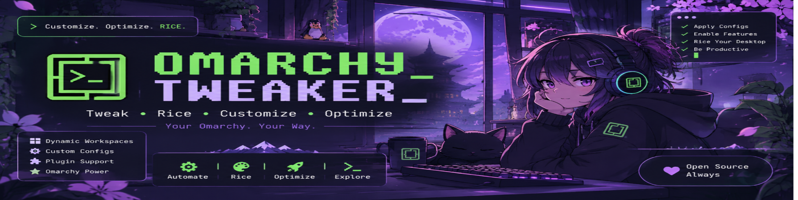

<strong>My personal Omarchy customization, automation, and bootstrap toolkit.</strong>

---

 

---

    <a href="#about">◈ ABOUT</a>
    &nbsp; · &nbsp;
    <a href="#-features">🔧 FEATURES</a>
    &nbsp; · &nbsp;
    <a href="#disclaimer">⚠ DISCLAIMER</a>
    &nbsp; · &nbsp;
    <a href="#license">⚖ LICENSE</a>

EXPLORE THE PROJECT · KNOW THE RULES · CHECK THE LICENSE

---

## About

Omarchy Tweaker is a personal project focused on customizing, automating, and streamlining my [Omarchy](https://omarchy.org) installation.

The goal is simple: make my Omarchy experience more personalized, consistent, and efficient.

This repository serves as my personal workspace for maintaining and evolving my setup. It brings together the tools, configurations, scripts, and dotfiles I use to customize my environment and automate repetitive tasks.

Whether it's tweaking system configurations, streamlining workflows, managing dotfiles, or automating setup tasks, this toolkit keeps everything organized in one place.

## Features

A growing collection of tools and resources, including:

* **Configuration Files**: My personal dotfiles and configuration files for various applications and tools.
* **Automation Scripts**: Scripts to automate common tasks, streamline workflows, and enhance productivity.
* **Setup Scripts**: Scripts to bootstrap and configure a fresh Omarchy installation according to my preferences.
* **Documentation**: Notes, guides, and documentation to help understand and maintain my setup
* **Customization**: Tweaks and modifications to enhance the look, feel, and behavior of my Omarchy environment.

## Platform Compatibility

> [!CAUTION]
> **Omarchy Tweaker is exclusively designed for Omarchy Linux. It is NOT a cross-platform application or a universal Linux customization tool.**

### Supported Environment

- **Omarchy Linux:** The ONLY supported operating system and execution environment.

### Unsupported Environments

This project is NOT designed, supported, or tested for:

- Standard Arch Linux installations (even though Omarchy is Arch-based).
- Other Arch Linux-based distributions.
- Ubuntu.
- Debian.
- Fedora.
- Linux Mint.
- Other Linux distributions.
- macOS.
- Windows.
- Any other operating system or Linux distribution.

### Important Technical Details

Omarchy Tweaker relies on Omarchy-specific system configurations, directory structures, packages, defaults, utilities, and workflows.

Although some components may use Python, Bash, or other cross-platform technologies, this does NOT make the project cross-platform.

Having Python installed, satisfying Python dependencies, or successfully running individual scripts does not guarantee compatibility with any environment other than Omarchy Linux.

**Do not attempt to install, execute, or use Omarchy Tweaker on non-Omarchy systems.**

## Disclaimer

This repository reflects my personal Omarchy setup and preferences. It is primarily developed and tested for my own environment.

* Configurations and scripts may not work as expected on other systems.
* Some modifications may overwrite existing configurations or affect system behavior.
* Always review scripts and configuration files before executing or applying them.
* Back up important files and configurations before making changes.

> ***Use at your own risk***. I am not responsible for data loss, system damage, or unexpected behavior resulting from the use of this toolkit.

## License

This project is licensed under the MIT License. See the [LICENSE](LICENSE) file for details.
