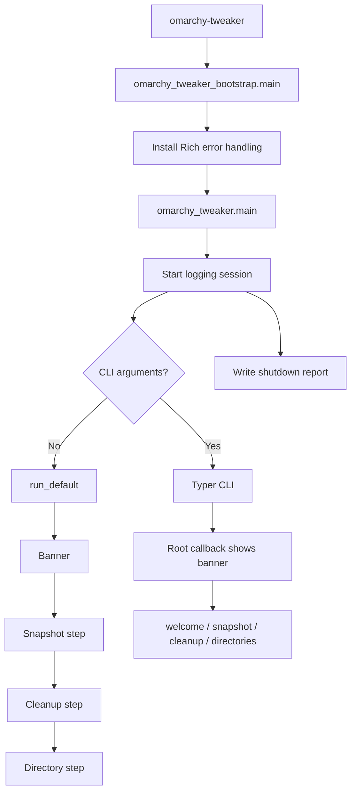
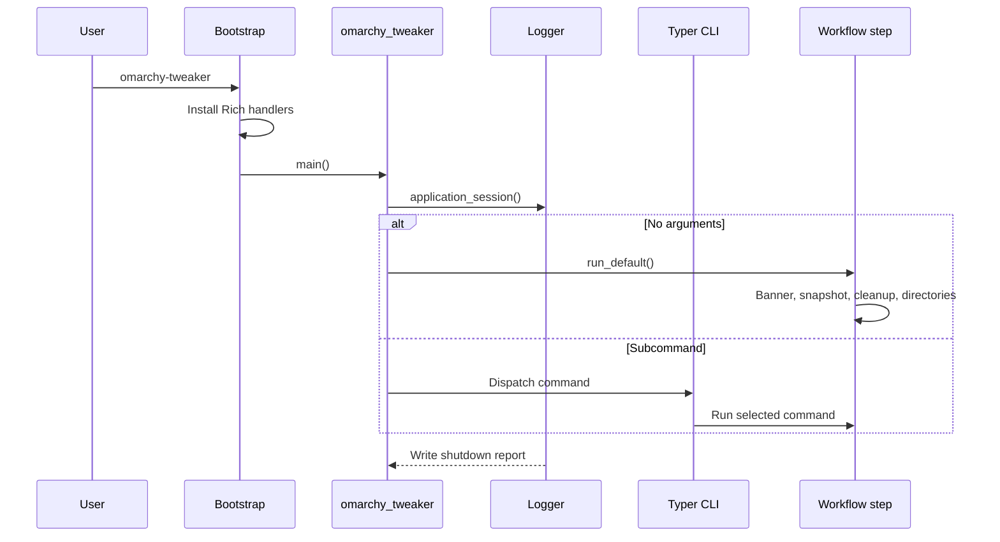
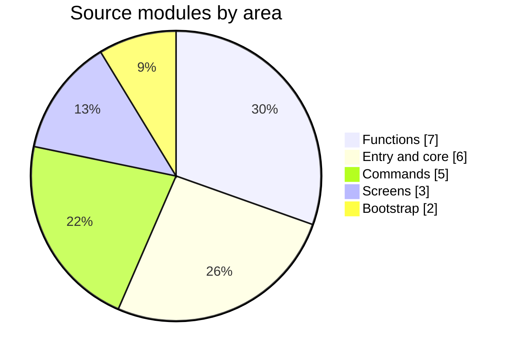

# Architecture

This page describes how Omarchy Tweaker is organized, how a command flows through the application, and where to extend it.

The architecture is intentionally small: a bootstrap layer, a Typer CLI, a Typer-free default workflow, and focused modules for screens, commands, system operations, logging, and terminal UI.

---

## Runtime flow





### Why there is a bootstrap package

`omarchy_tweaker_bootstrap` installs Rich error handling before importing `omarchy_tweaker`.

This matters because a syntax or import error in the application package, including `__init__.py`, would otherwise prevent custom error rendering from being installed. Keeping the bootstrap separate means the first import can still produce a useful Rich traceback.

### Why the default workflow is Typer-free

Running `omarchy-tweaker` with no arguments does not need Typer's argument parser. The default path imports `startup.run_default()` directly, which keeps the interactive workflow independent from CLI command registration.

---

## Package layout

```text
src/
├── omarchy_tweaker/
│   ├── __init__.py              # Application entry and default/CLI dispatch
│   ├── __main__.py              # python -m omarchy_tweaker
│   ├── app_metadata.py          # Name and version from package metadata
│   ├── cli.py                   # Typer application and root callback
│   ├── startup.py               # Typer-free default sequence
│   ├── error_handling.py        # Compatibility re-exports
│   ├── commands/
│   │   ├── __init__.py          # Command registration
│   │   ├── cleanup.py           # cleanup command wrapper
│   │   ├── directory.py         # directories command wrapper
│   │   ├── snapshot.py          # snapshot command wrapper
│   │   └── welcome.py           # welcome command wrapper
│   ├── screens/
│   │   ├── __init__.py
│   │   ├── banner.py            # Banner screen
│   │   └── welcome.py           # Welcome and system overview
│   └── functions/
│       ├── __init__.py          # Logger exports
│       ├── cleanup.py           # Cleanup discovery and removal
│       ├── directory.py         # Workspace directory setup
│       ├── logger.py            # Session logging
│       ├── snapshot.py          # Snapshot workflow
│       ├── system_info.py       # OS and hardware information
│       └── ui.py                # Rich and InquirerPy UI toolkit
└── omarchy_tweaker_bootstrap/
    ├── __init__.py              # Early error handling and entry point
    └── error_handling.py        # Process-wide Rich exception rendering
```

The layout is flat by design. There is no implemented `cli/`, `core/`, or `models/` subpackage; new code should follow the existing module patterns rather than assuming a planned structure.

---

### Source modules



## Module responsibilities

| Module | Responsibility |
|:--|:--|
| `omarchy_tweaker_bootstrap` | Install error handling before the application imports. |
| `omarchy_tweaker.__init__` | Start the logging session and dispatch to default or Typer path. |
| `omarchy_tweaker.cli` | Define the Typer app and show the banner before subcommands. |
| `omarchy_tweaker.startup` | Run the ordered default sequence. |
| `commands/*` | Thin CLI wrappers around function modules. |
| `screens/*` | Reusable screen-level presentation. |
| `functions/cleanup.py` | Discover installed cleanup targets and remove selected items. |
| `functions/directory.py` | Create the fixed workspace directories after per-path confirmation. |
| `functions/snapshot.py` | Confirm and run `omarchy snapshot create`. |
| `functions/system_info.py` | Collect OS, CPU, GPU, memory, disk, and uptime data. |
| `functions/logger.py` | Write structured session logs. |
| `functions/ui.py` | Centralize Rich, InquirerPy, and Prompt Toolkit presentation. |
| `app_metadata.py` | Resolve application name and version from package metadata. |

Commands stay thin. They translate CLI options into function calls and convert failure results into exit codes. System behavior lives in `functions/`.

---

## Default sequence

The default sequence is defined in `startup.py`:

```python
DEFAULT_SEQUENCE = (
    show_banner,
    run_snapshot_step,
    run_cleanup_step,
    run_directory_step,
)
```

`run_default()` logs each step and calls them in order. A step can skip itself without raising an exception.

The banner is part of the default sequence. For subcommands, the Typer root callback shows the banner instead, so it is not duplicated.

---

## CLI layer

The Typer app is configured with:

- Name: `omarchy-tweaker`
- Help: “Customize, automate, and maintain your Omarchy installation.”
- No automatic help on no arguments.
- No shell completion.
- Rich help panels.

The root callback checks `ctx.invoked_subcommand`:

- If no subcommand was invoked, it calls `run_default()`.
- If a subcommand was invoked, it shows the banner and lets Typer dispatch the command.

Commands are registered centrally in `commands/__init__.py`.

---

## Terminal UI layer

`functions/ui.py` is the single place for terminal presentation.

It provides:

- Banner rendering with a compact fallback for narrow terminals.
- Messages, sections, rules, panels, tables, and lists.
- Markdown, syntax, JSON, columns, and tree views.
- Spinners and progress bars.
- Interactive prompts and validated menus.
- A fixed-height `VirtualTerminal` that streams command output.

The UI uses:

| Library | Role |
|:--|:--|
| Rich | Rendering, tables, panels, progress, tracebacks. |
| InquirerPy | Interactive selection and confirmation prompts. |
| Prompt Toolkit | Advanced input, completion, and path prompts. |
| Pydantic | Validated theme, menu, tree, and terminal configuration models. |

Display helpers accept an optional `console` argument, which makes them testable with a recording console.

### Virtual terminal

`VirtualTerminal` keeps a bounded scrollback buffer and redraws the most recent lines in place. It runs commands without a shell, merges stdout and stderr, supports timeouts, and can stream output while a command is still running.

Snapshot and package removal use the virtual terminal so long-running command output stays visible without flooding the terminal.

---

## Logging

Every invocation starts a process-wide logging session through `application_session()`.

The logger writes:

- A startup header with application, execution, system, and logging metadata.
- Timestamped log records.
- A shutdown report with runtime and per-level message counts.

Log locations and overrides are documented in **[Getting Started](getting-started.md#logs)**.

Session statuses include `SUCCESS`, `FAILED`, `INTERRUPTED`, `CANCELLED`, and `PAUSED`.
`application_session()` marks `KeyboardInterrupt` as interrupted and non-zero `SystemExit`
as failed. Nested entry points reuse an existing session instead of creating a second log
file.

---

## Error handling

`omarchy_tweaker_bootstrap.error_handling` installs handlers for:

- `sys.excepthook` — uncaught main-thread exceptions.
- `threading.excepthook` — uncaught worker-thread exceptions.
- `sys.unraisablehook` — unraisable exceptions.

Syntax and indentation errors get a dedicated code-frame panel because their source location is not part of a runtime traceback.

Rich tracebacks include locals by default, with bounded value lengths and string lengths.

---

## Boundaries

| Boundary | Rule |
|:--|:--|
| CLI commands | Thin wrappers: parse options, call a function, translate failures into exit codes. |
| System behavior | Lives in `functions/`; subprocess calls stay mockable and testable. |
| Terminal presentation | Lives in `functions/ui.py`; command modules do not build Rich or InquirerPy setup directly. |
| Destructive actions | Explicit selection, confirmation, path validation, and partial-failure reporting. |
| Omarchy integration | Snapshot and cleanup delegate to Omarchy instead of reimplementing package or snapshot logic. |

---

## Extension points

### Add a command

1. Create a module in `src/omarchy_tweaker/commands/`.
2. Keep it thin: parse options, call a function, translate failures into `typer.Exit`.
3. Register it in `commands/__init__.py`.
4. Add tests for success, failure, and skip paths.

### Add system behavior

Put behavior in `src/omarchy_tweaker/functions/` and return a small result enum or report object. Keep subprocess calls mockable and testable.

### Add a UI helper

Add it to `functions/ui.py` only when the helper is reusable. Accept an optional `console` for testability. Avoid duplicating Rich or InquirerPy setup in command modules.

### Add a screen

Use `screens/` for screen-level composition that is reused by multiple commands. Keep individual widgets in `ui.py`.

---

## Related pages

- [Commands](commands.md)
- [Cleanup](cleanup.md)
- [Development](development.md)
- [Security Policy](security.md)
