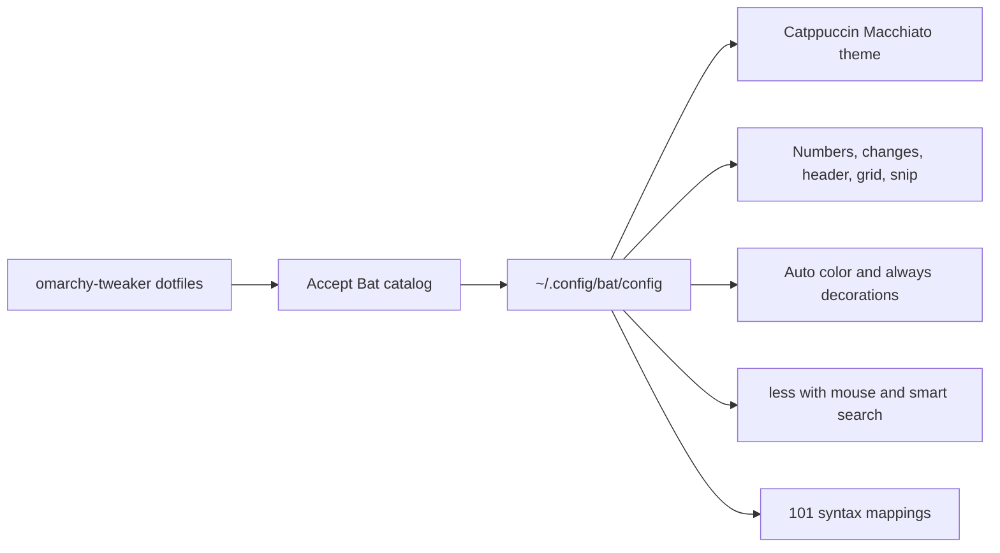

# Bat Dotfiles

This page is the practical usage guide for the custom Bat configuration bundled with
Omarchy Tweaker. It explains what the linked config changes, how to use Bat day to day, and
how to verify or customize it safely.

For an explanation of the dotfile catalog system itself, see **[Dotfiles](dotfiles.md)**.

!!! note "Catalog scope"
    The `Bat` catalog only links the bundled configuration to `~/.config/bat/config`. It does
    not install `bat`, the Catppuccin theme, `less`, or any terminal font. The catalog
    directory is named `Bat`, so that is the name shown in the dotfiles confirmation prompt.

---

## What this custom setup gives you

The bundled config gives Bat a consistent Catppuccin Macchiato look and predictable output
for interactive and piped use:

- Catppuccin Macchiato syntax colors.
- Line numbers, Git change markers, a file header, a subtle grid, and `snip` range markers.
- Italic text where a syntax definition uses italics and the terminal font has an italic face.
- Four-space tab rendering and automatic wrapping on terminals, but not when piping.
- Automatic color for terminals; piped output stays free of ANSI color codes.
- Always-on decorations, with `-p` available when plain output is needed.
- A `less` pager with one-screen exit, mouse and wheel scrolling, smart-case search, and
  centered search hits.
- Broad syntax mappings for common source, config, lock, dotenv, and markup files.



---

## Requirements

| Tool | Used for |
|---|---|
| `bat` | The linked configuration itself. |
| Catppuccin Macchiato theme | Verify with `bat --list-themes`; some releases need a one-time theme install and cache build. |
| `less` | The configured pager; needs `--mouse` and `--wheel-lines` support. |
| A 256-color or truecolor terminal | Accurate Catppuccin colors. |
| A font with a real italic face | Italic comments and keywords. |

The configuration was validated with Bat `0.26.1` and `less` 704. Older releases may not support
every option, theme name, or pager flag.

---

## Install and verify

Run the dotfiles command and accept the `Bat` catalog:

```bash
omarchy-tweaker dotfiles
```

Check the link and Bat setup:

```bash
ls -l ~/.config/bat/config
bat --config-file
bat --version
bat --list-themes
bat --paging=never --color=never pyproject.toml > /dev/null
```

If `bat --list-themes` does not show `Catppuccin Macchiato`, install the theme once and rebuild
Bat's theme cache:

```bash
mkdir -p "$(bat --config-dir)/themes"
cd "$(bat --config-dir)/themes"
curl -O https://raw.githubusercontent.com/catppuccin/bat/main/themes/Catppuccin%20Macchiato.tmTheme
bat cache --build
```

The bundled config itself does not require a cache rebuild. Only theme and syntax asset changes
do.

You can also validate the bundled file before linking it:

```bash
BAT_CONFIG_PATH=src/omarchy_tweaker/dotfiles/Bat/config \
  bat --paging=never --color=never pyproject.toml > /dev/null
```

If the command exits without an error, the config is syntactically valid.

---

## Linked files

| Bundled source | Destination | Purpose |
|---|---|---|
| `src/omarchy_tweaker/dotfiles/Bat/config` | `~/.config/bat/config` | Main Bat configuration. |
| `src/omarchy_tweaker/dotfiles/Bat/config.toml` | Not linked | Catalog manifest read by Omarchy Tweaker. |

Bat uses `~/.config/bat/config` by default unless `BAT_CONFIG_PATH` points somewhere else.
If that environment variable is set, the linked config will be ignored until it is removed
or changed.

---

## What each option does

| Option | Value | Effect |
|---|---|---|
| `--theme` | `Catppuccin Macchiato` | Sets the default syntax theme. |
| `--style` | `numbers,changes,header,grid,snip` | Shows line numbers, Git markers, a header, a grid, and `snip` range markers. |
| `--italic-text` | `always` | Enables italic text where the syntax and font support it. |
| `--tabs` | `4` | Renders tabs as four spaces. |
| `--wrap` | `auto` | Wraps long lines on terminals but not in pipes. |
| `--paging` | `auto` | Pages only when output is longer than the screen. |
| `--pager` | `less -RFKX -i -j.5 --mouse --wheel-lines=3` | Keeps colors, exits on one screen, keeps output visible, and configures mouse and search behavior. |
| `--color` | Not set; Bat's `auto` default | Colors terminals only, avoiding ANSI codes in pipes and redirects. |
| `--decorations` | `always` | Keeps headers and line numbers even in piped output. |
| `--map-syntax` | 101 extension mappings | Applies known Bat syntaxes to common file extensions and dotfiles. |

### Syntax mappings

The bundled config includes 101 `--map-syntax` entries covering 35 installed Bat syntaxes.
They cover source files such as `.py`, `.rs`, `.ts`, `.lua`, and `.go`; config formats such as
`.toml`, `.yaml`, `.json`, `.ini`, and `.conf`; shell variants such as `.sh`, `.zsh`, `.ps1`,
and `.fish`; infrastructure files such as `.nix`, `.tf`, `.tfvars`, and `Dockerfile`; diff and
patch files; dotenv and ignore files; lockfiles; Make and CMake files; and common markup
formats.

```text
--map-syntax "*.md:Markdown"
--map-syntax "*.zsh:Bourne Again Shell (bash)"
--map-syntax "*.tf:Terraform"
--map-syntax "*.diff:Diff"
--map-syntax "*.conf:INI"
--map-syntax "Dockerfile:Dockerfile"
```

Mappings must use language names from `bat --list-languages`. Names with spaces are valid,
but the whole `pattern:syntax` value must stay inside the quoted argument.

---

## Daily usage

```bash
bat README.md
bat -n README.md
bat -l INI settings.conf
bat --theme="Catppuccin Mocha" README.md
bat -H 12 README.md
bat --paging=never README.md
bat -p README.md
git diff | bat -l diff
```

Common overrides:

- `-n` shows only line numbers.
- `-p` uses plain style without decorations.
- `-l` forces a language or syntax.
- `-H` highlights a real line number.
- `--paging=auto` is the configured default; use `--paging=never` to force no pager or
  `--paging=always` to page short output.
- `--theme=...` overrides the configured theme for one invocation.

---

## Pager behavior

The linked pager command uses `less`:

```text
less -RFKX -i -j.5 --mouse --wheel-lines=3
```

`-R` preserves Bat's ANSI colors, `-F` exits for output that fits on one screen, `-K` quits on
`Ctrl+c`, and `-X` keeps the output visible after exiting. `-i` enables smart-case search and
`-j.5` centers search hits. `--mouse` enables mouse input where supported by the terminal, and
`--wheel-lines=3` controls wheel scroll speed.

Paging itself is set to `auto`, so short files print directly like `cat` and long files open in
`less`. If mouse input or colors behave badly, override the pager for a single command:

```bash
bat --pager="less -R" README.md
bat --paging=never README.md
```

---

## Customization

Edit the linked file directly for a local change:

```bash
nvim ~/.config/bat/config
```

Permanent changes belong in the catalog source:

```text
src/omarchy_tweaker/dotfiles/Bat/config
```

After editing, validate the file with `BAT_CONFIG_PATH` before rerunning
`omarchy-tweaker dotfiles`. Rerunning the dotfiles command backs up and replaces the
existing destination. Config-option changes take effect on the next Bat invocation; only theme
or syntax asset changes require `bat cache --build`.

Useful checks after customization:

```bash
bat --config-file
bat --list-themes
bat --paging=never --color=never pyproject.toml > /dev/null
bat --paging=never --color=never --map-syntax "*.md:Markdown" example.md > /dev/null
```

---

## Safety notes

- The catalog links configuration only; it installs no packages and edits no shell startup files.
- Existing destinations are backed up before replacement.
- `--color` is intentionally unset, so pipes and redirects stay free of ANSI color codes; use `--color=always` only when colored piped output is wanted.
- `--decorations=always` is intentional; use `-p` when plain output is needed.
- `--paging=auto` avoids opening a pager for short output; use `--paging=never` in scripts or non-interactive contexts.
- Bat reads syntax definitions and themes from installed data files; malformed custom assets are outside this catalog's control.
- Theme and syntax asset changes require `bat cache --build`; config-option changes do not.

---

## Troubleshooting

| Symptom | Fix |
|---|---|
| Config changes are ignored | Check `BAT_CONFIG_PATH`; it overrides `~/.config/bat/config`. |
| Theme not found | Run `bat --list-themes`; if missing, install the Catppuccin theme and run `bat cache --build`. |
| Output has no colors in a pipe | Expected with the default `auto` color mode; use `--color=always` when colored piped output is intentional. |
| Output has no colors in a terminal | Use a color-capable terminal and avoid `--color=never`; verify the theme is installed. |
| Short files open in a pager | The old config used `always`; this config uses `auto`. Override with `--paging=never` or `--paging=always`. |
| Too much decoration when piping | Use `bat -p` or remove `--decorations=always`. |
| Pager shows escape codes | Confirm `less` supports `-R`, or use `--pager="less -R"`. |
| Mouse scrolling does not work | Confirm terminal and `less` support `--mouse` and `--wheel-lines`, or remove those pager flags. |
| A file extension uses the wrong syntax | Add a `--map-syntax` entry with an exact name from `bat --list-languages`, or force one with `-l`. |
| Config file is not a symlink | Rerun `omarchy-tweaker dotfiles`; check the backup created before replacement. |

---

## Related pages

- [Dotfiles](dotfiles.md)
- [Foot Dotfiles](foot.md)
- [Superfile Dotfiles](superfile.md)
- [Git Dotfiles](git.md)
- [Lazygit Dotfiles](lazygit.md)
- [Tig Dotfiles](tig.md)
- [Tmux Dotfiles](tmux.md)
- [Starship Dotfiles](starship.md)
- [Zellij Dotfiles](zellij.md)
- [Zsh Dotfiles](zsh.md)
- [Commands](commands.md)
- [Security](security.md)
- [Troubleshooting](troubleshooting.md)
