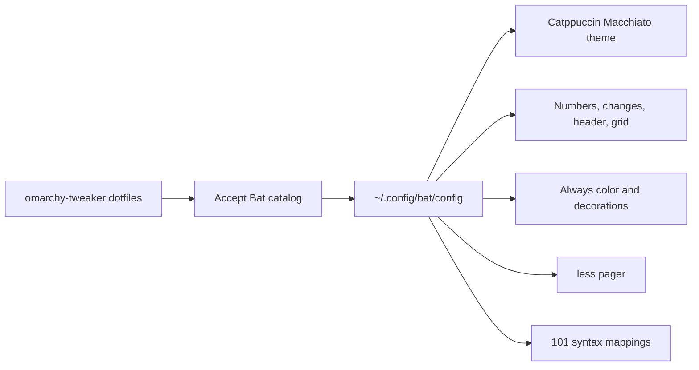

# Bat Dotfiles

This page is the practical usage guide for the custom Bat configuration bundled with
Omarchy Tweaker. It explains what the linked config changes, how to use Bat day to day, and
how to verify or customize it safely.

For an explanation of the dotfile catalog system itself, see **[Dotfiles](dotfiles.md)**.

!!! note "Catalog scope"
    The `Bat` catalog only links the bundled configuration to `~/.config/bat/config`. It does
    not install `bat`, the Catppuccin theme, `less`, or any terminal font. The catalog
    directory is named `Bat`, so that is the name shown in the dotfiles confirmation prompt.

---

## What this custom setup gives you

The bundled config gives Bat a consistent Catppuccin Macchiato look and predictable output
for interactive and piped use:

- Catppuccin Macchiato syntax colors.
- Line numbers, Git change markers, a file header, and a subtle grid.
- Italic text where a syntax definition uses italics.
- Four-space tab rendering and automatic wrapping at the terminal width.
- Colored, decorated output even when Bat writes to a pipe.
- A `less` pager configured for ANSI color codes, single-screen shortcuts, and mouse input.
- Broad syntax mappings for common source, config, lock, dotenv, and markup files.



---

## Requirements

| Tool | Used for |
|---|---|
| `bat` | The linked configuration itself. |
| Catppuccin Macchiato theme | Included with current Bat releases; verify with `bat --list-themes`. |
| `less` | The configured pager. |
| A 256-color or truecolor terminal | Accurate Catppuccin colors. |

The configuration was validated with Bat `0.26.1`. Older releases may not support every
option or theme name.

---

## Install and verify

Run the dotfiles command and accept the `Bat` catalog:

```bash
omarchy-tweaker dotfiles
```

Check the link and Bat setup:

```bash
ls -l ~/.config/bat/config
bat --version
bat --list-themes
bat --paging=never --color=never pyproject.toml > /dev/null
```

You can also validate the bundled file before linking it:

```bash
BAT_CONFIG_PATH=src/omarchy_tweaker/dotfiles/Bat/config \
  bat --paging=never --color=never pyproject.toml > /dev/null
```

If the command exits without an error, the config is syntactically valid.

---

## Linked files

| Bundled source | Destination | Purpose |
|---|---|---|
| `src/omarchy_tweaker/dotfiles/Bat/config` | `~/.config/bat/config` | Main Bat configuration. |
| `src/omarchy_tweaker/dotfiles/Bat/config.toml` | Not linked | Catalog manifest read by Omarchy Tweaker. |

Bat uses `~/.config/bat/config` by default unless `BAT_CONFIG_PATH` points somewhere else.
If that environment variable is set, the linked config will be ignored until it is removed
or changed.

---

## What each option does

| Option | Value | Effect |
|---|---|---|
| `--theme` | `Catppuccin Macchiato` | Sets the default syntax theme. |
| `--style` | `numbers,changes,header,grid` | Shows line numbers, Git change markers, a header, and a grid. |
| `--italic-text` | `always` | Enables italic text where the syntax supports it. |
| `--tabs` | `4` | Renders tabs as four spaces. |
| `--color` | `always` | Keeps ANSI colors even when output is piped. |
| `--wrap` | `auto` | Wraps long lines to terminal width. |
| `--decorations` | `always` | Keeps headers and line numbers in piped output. |
| `--paging` | `always` | Uses the pager for output. |
| `--pager` | `less --RAW-CONTROL-CHARS --quit-if-one-screen --mouse` | Preserves colors, exits quickly for short output, and enables mouse scrolling. |
| `--highlight-line` | `0` | Sets a neutral line-highlight value; use `-H` for a real line. |
| `--map-syntax` | 101 extension mappings | Applies known Bat syntaxes to common file extensions and dotfiles. |

### Syntax mappings

The bundled config includes 101 `--map-syntax` entries covering 35 installed Bat syntaxes.
They cover source files such as `.py`, `.rs`, `.ts`, `.lua`, and `.go`; config formats such as
`.toml`, `.yaml`, `.json`, `.ini`, and `.conf`; shell variants such as `.sh`, `.zsh`, `.ps1`,
and `.fish`; infrastructure files such as `.nix`, `.tf`, `.tfvars`, and `Dockerfile`; diff and
patch files; dotenv and ignore files; lockfiles; Make and CMake files; and common markup
formats.

```text
--map-syntax "*.md:Markdown"
--map-syntax "*.zsh:Bourne Again Shell (bash)"
--map-syntax "*.tf:Terraform"
--map-syntax "*.diff:Diff"
--map-syntax "*.conf:INI"
--map-syntax "Dockerfile:Dockerfile"
```

Mappings must use language names from `bat --list-languages`. Names with spaces are valid,
but the whole `pattern:syntax` value must stay inside the quoted argument.

---

## Daily usage

```bash
bat README.md
bat -n README.md
bat -l INI settings.conf
bat --theme="Catppuccin Mocha" README.md
bat -H 12 README.md
bat --paging=never README.md
bat -p README.md
git diff | bat -l diff
```

Common overrides:

- `-n` shows only line numbers.
- `-p` uses plain style without decorations.
- `-l` forces a language or syntax.
- `-H` highlights a real line number.
- `--paging=never` or `cat` piped input avoids the pager.
- `--theme=...` overrides the configured theme for one invocation.

---

## Pager behavior

The linked pager command uses `less`:

```text
less --RAW-CONTROL-CHARS --quit-if-one-screen --mouse
```

`--RAW-CONTROL-CHARS` tells `less` to preserve Bat's ANSI colors, `--quit-if-one-screen`
short-circuits short files, and `--mouse` enables mouse scrolling where supported by the
terminal and `less`.

If mouse input or colors behave badly, override the pager for a single command:

```bash
bat --pager="less -R" README.md
bat --paging=never README.md
```

---

## Customization

Edit the linked file directly for a local change:

```bash
nvim ~/.config/bat/config
```

Permanent changes belong in the catalog source:

```text
src/omarchy_tweaker/dotfiles/Bat/config
```

After editing, validate the file with `BAT_CONFIG_PATH` before rerunning
`omarchy-tweaker dotfiles`. Rerunning the dotfiles command backs up and replaces the
existing destination.

Useful checks after customization:

```bash
bat --list-themes
bat --paging=never --color=never pyproject.toml > /dev/null
bat --paging=never --color=never --map-syntax "*.md:Markdown" example.md > /dev/null
```

---

## Safety notes

- The catalog links configuration only; it installs no packages and edits no shell startup files.
- Existing destinations are backed up before replacement.
- `--color=always` and `--decorations=always` are intentional; use `-p` or `--color=never` when piping plain text matters.
- `--paging=always` is intentional; use `--paging=never` in scripts or non-interactive contexts.
- Bat reads syntax definitions and themes from installed data files; malformed custom assets are outside this catalog's control.

---

## Troubleshooting

| Symptom | Fix |
|---|---|
| Config changes are ignored | Check `BAT_CONFIG_PATH`; it overrides `~/.config/bat/config`. |
| Theme not found | Run `bat --list-themes`, update Bat, or choose another installed theme. |
| Output has no colors | Use a color-capable terminal and avoid `--color=never`; some pipes and tools strip ANSI codes. |
| Too much decoration when piping | Use `bat -p` or remove `--decorations=always`. |
| Pager shows escape codes | Confirm `less` supports `--RAW-CONTROL-CHARS`, or use `--pager="less -R"`. |
| Mouse scrolling does not work | Confirm terminal and `less` support `--mouse`, or remove that pager flag. |
| A file extension uses the wrong syntax | Add a `--map-syntax` entry with an exact name from `bat --list-languages`, or force one with `-l`. |
| Config file is not a symlink | Rerun `omarchy-tweaker dotfiles`; check the backup created before replacement. |

---

## Related pages

- [Dotfiles](dotfiles.md)
- [Foot Dotfiles](foot.md)
- [Superfile Dotfiles](superfile.md)
- [Git Dotfiles](git.md)
- [Lazygit Dotfiles](lazygit.md)
- [Tig Dotfiles](tig.md)
- [Tmux Dotfiles](tmux.md)
- [Starship Dotfiles](starship.md)
- [Zellij Dotfiles](zellij.md)
- [Commands](commands.md)
- [Security](security.md)
- [Troubleshooting](troubleshooting.md)
