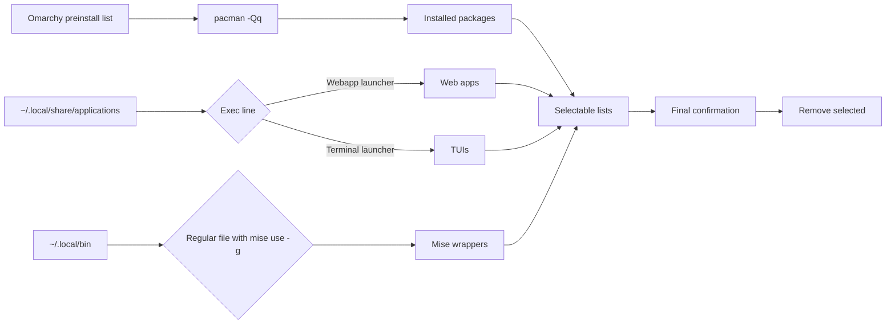
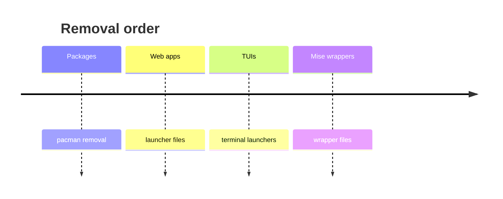
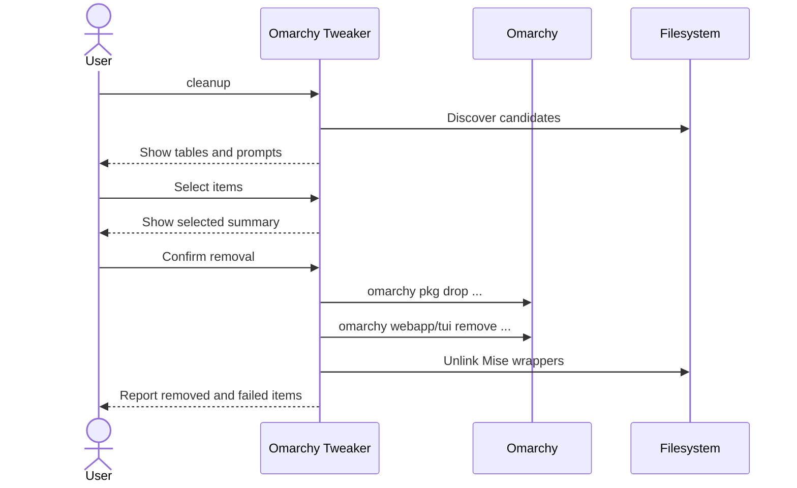

# Cleanup

Cleanup is the most system-changing workflow in Omarchy Tweaker. It discovers installed
Omarchy applications and wrappers, shows them in separate selectable lists, and removes
only what you explicitly choose.

!!! danger "Removal is permanent"
    Cleanup can uninstall packages and delete desktop launchers and wrapper files. Review
    the selected items and create a snapshot before confirming removal.

```bash
omarchy-tweaker cleanup
```

The default workflow offers a snapshot before cleanup:

```bash
omarchy-tweaker
```

Running `cleanup` directly does **not** create a snapshot automatically.

---

## Discovery

Cleanup never reads a configuration file. It inspects the current system at runtime.



| Category | Source | Rule |
|:--|:--|:--|
| **Packages** | Omarchy preinstall list | Installed packages only, filtered by `pacman -Qq`. |
| **Web apps** | `~/.local/share/applications/*.desktop` | `Exec` contains `omarchy-launch-webapp` or `omarchy-webapp-handler`. |
| **TUIs** | Same application directory | `Exec` contains `$TERMINAL` or `xdg-terminal-exec` with `-e`. |
| **Mise wrappers** | `~/.local/bin` | Regular, non-symlink file up to **128,000 bytes** containing `mise use -g`. |

### Packages

Package candidates come from the removable application list used by Omarchy's
`omarchy-remove-preinstalls` script:

```text
aether
cliamp
kdenlive
lazydocker
libreoffice-fresh
moonlight-qt
obs-studio
obsidian
omacalc
omacut
omawrite
pinta
xournalpp
```

The list is filtered with `pacman -Qq`, so only packages that are actually installed appear.

### Web apps and TUIs

Launchers are discovered in `~/.local/share/applications`. The displayed name is the
desktop file stem, for example `YouTube.desktop` becomes `YouTube`.

### Mise wrappers

The wrapper's full path is stored internally so removal targets the exact file that was
discovered.

!!! warning "Mise discovery is broad"
    The Mise scan finds installed wrappers, not only Omarchy preinstalls. A user-installed
    Mise wrapper can appear in the list. Review each entry before selecting it.

---

## Selection workflow

Cleanup presents categories in this order:

1. Packages
2. Web Apps
3. TUIs
4. Mise Wrappers

For each non-empty category, it prints a table of installed items and a checkbox prompt
with an instruction to press ++space++ to select and ++enter++ to confirm. Empty categories
print an informational message and are skipped.

After all categories, cleanup prints a **Selected for removal** table and asks for final
confirmation. The confirmation defaults to **no**. If nothing is selected, cleanup exits
without removing anything.

### Removal order



!!! note "No TTY, no removal"
    Cleanup requires an interactive terminal. Without one it prints a warning, exits
    successfully, and removes nothing. See **[Commands](commands.md)** for the exact
    non-interactive behavior.

---

## Removal behavior



| Category | Removal command | Timeout | Notes |
|:--|:--|:--:|:--|
| Packages | `omarchy pkg drop <package> ...` | 600 s | Runs `sudo pacman -Rns --noconfirm` inside a virtual terminal. |
| Web apps | `omarchy webapp remove <name>` | 60 s | Removed individually with a progress display. |
| TUIs | `omarchy tui remove <name>` | 60 s | Removed individually with a progress display. |
| Mise wrappers | `Path.unlink(missing_ok=True)` | — | Path must be absolute, name a file, and resolve inside the home directory. |

Cleanup sets `OMARCHY_REMOVE_NOTIFY=false` for removal commands so Omarchy does not send a
desktop notification for each item. Package removal may prompt for `sudo` authentication.

---

## Safety model

Cleanup is designed to be explicit and conservative:

- **Installed only** — package candidates are filtered by `pacman`.
- **Separate lists** — packages, web apps, TUIs, and Mise wrappers are never mixed into one
  ambiguous prompt.
- **Explicit selection** — nothing is selected by default.
- **Final confirmation** — removal happens only after a second confirmation.
- **Path validation** — Mise wrapper removal is restricted to the home directory.
- **Partial failure reporting** — failed items are reported and produce exit code `1`.
- **No automatic snapshot** — running `cleanup` directly does not create a restore point.

### What cleanup does not do

- It does not remove items you did not select.
- It does not search the whole filesystem for Mise wrappers.
- It does not manage packages outside the Omarchy preinstall list.
- It does not provide an undo operation.

---

## Related pages

- [Commands](commands.md)
- [Plugins](plugins.md)
- [Packages](packages.md)
- [Troubleshooting](troubleshooting.md)
- [Architecture](architecture.md)
- [Security Policy](security.md)
