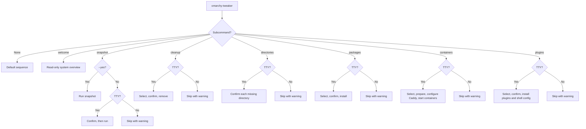
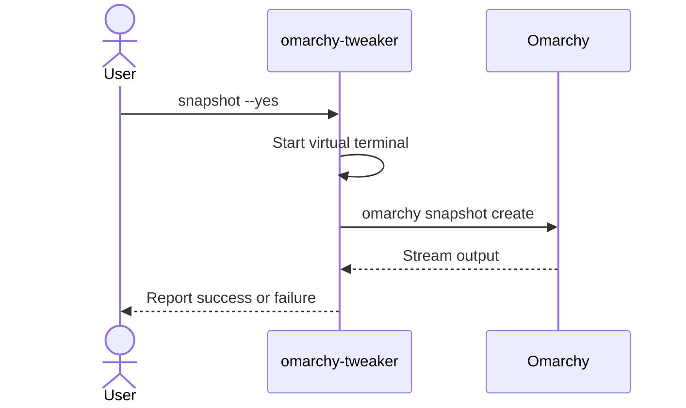

# Commands

Complete reference for the currently implemented Omarchy Tweaker commands.

| Command | Changes system | Requires TTY | Key option |
|:--|:--:|:--:|:--|
| *(none)* | Only if you confirm | For interactive steps | — |
| `welcome` | No | No | — |
| `snapshot` | Yes | Unless `--yes` | `--yes`, `-y` |
| `cleanup` | Yes | Yes | — |
| `directories` | Yes | Yes | — |
| `packages` | Yes | Yes | — |
| `containers` | Yes | Yes | — |
| `plugins` | Yes | Yes | — |



---

## Global behavior

```bash
omarchy-tweaker [OPTIONS] COMMAND [ARGS]...
```

| Behavior | Details |
|:--|:--|
| No arguments | Runs the default sequence: banner, snapshot, cleanup, directories, packages, containers, and plugins. |
| With a subcommand | Shows the banner, then runs the selected command. |
| `--help` | Shows global help and the available commands. |
| Completion | Disabled. |
| Shell execution | External commands use argument lists, not `shell=True`. |

!!! note "No arguments is not the same as `--help`"
    Running `omarchy-tweaker` starts the interactive default workflow. Use `omarchy-tweaker --help` to inspect commands without starting the workflow.

### Choose a command

| Goal | Command |
|:--|:--|
| Inspect the system and confirm the installation works | `omarchy-tweaker welcome` |
| Create a recovery point before making changes | `omarchy-tweaker snapshot` |
| Review and remove selected packages or launchers | `omarchy-tweaker cleanup` |
| Create the standard workspace directories | `omarchy-tweaker directories` |
| Install selected Pacman and AUR packages | `omarchy-tweaker packages` |
| Prepare and start selected Docker containers | `omarchy-tweaker containers` |
| Install selected Omarchy shell plugins | `omarchy-tweaker plugins` |
| Run the guided snapshot, cleanup, and directory sequence | `omarchy-tweaker` |
| See every command and option | `omarchy-tweaker --help` |

### Exit codes

| Code | Meaning |
|:--:|:--|
| `0` | The command completed, or the step was skipped safely. |
| `1` | A selected operation failed, such as snapshot creation, item removal, directory creation, package installation, container setup, or plugin installation. |

A skipped step is not a failure. For example, declining a snapshot, running cleanup without a TTY, declining every directory, selecting no packages, selecting no containers, or selecting no
plugins exits successfully.

---

## `welcome`

Show the welcome screen and a system overview.

```bash
omarchy-tweaker welcome
```

The screen includes:

- A welcome panel.
- Operating system and kernel.
- Desktop environment.
- CPU model, thread count, and architecture.
- GPU description when `lspci` is available.
- Memory and disk usage.
- Uptime.
- Hostname.

The command does not modify the system.

---

## `snapshot`

Create a system snapshot with `omarchy snapshot create`.

```bash
omarchy-tweaker snapshot
omarchy-tweaker snapshot --yes
omarchy-tweaker snapshot -y
```

| Option | Description |
|:--|:--|
| `--yes`, `-y` | Skip the confirmation prompt. |

### Behavior

1. Prints a **System Snapshot** section.
2. Asks for confirmation unless `--yes` is supplied.
3. Runs `omarchy snapshot create` inside a virtual terminal.
4. Streams command output into a bounded terminal panel.
5. Reports success or failure.

### Confirmation

The prompt defaults to **yes**. Declining skips the snapshot without failing the command.

### Non-interactive use

| Invocation | Result |
|:--|:--|
| `omarchy-tweaker snapshot` without a TTY | Skips with a warning. |
| `omarchy-tweaker snapshot --yes` without a TTY | Runs the snapshot command. |

### Timeout

The snapshot command has a **600 second** timeout.

### Requirements

- `omarchy` must be on `PATH`.
- Omarchy's snapshot tooling must be configured and working.

If the command fails, run `omarchy snapshot create` directly to inspect the underlying error.

---

### Snapshot flow



## `cleanup`

Discover installed Omarchy cleanup targets, present them as selectable lists, and remove only the items you explicitly choose.

```bash
omarchy-tweaker cleanup
```

Cleanup has no command-line options. It always uses the interactive selection workflow.

### Behavior

1. Discovers installed packages, web apps, TUIs, and Mise wrappers.
2. Prints a separate table and checkbox prompt for each non-empty category.
3. Shows a summary of selected items.
4. Asks for final confirmation.
5. Removes packages in a virtual terminal.
6. Removes launchers and Mise wrappers with a progress display.
7. Reports removed and failed items.

### Categories

| Category | Source |
|:--|:--|
| **Packages** | Omarchy preinstalled package list, filtered by `pacman -Qq`. |
| **Web Apps** | Desktop launchers using `omarchy-launch-webapp` or `omarchy-webapp-handler`. |
| **TUIs** | Desktop launchers using `$TERMINAL` or `xdg-terminal-exec` with `-e`. |
| **Mise Wrappers** | Regular, non-symlink files in `~/.local/bin` containing `mise use -g`. |

### Non-interactive use

`omarchy-tweaker cleanup` requires an interactive terminal. Without one, it prints a warning and skips without removing anything.

### Failure handling

If any selected item cannot be removed, cleanup reports the failed items and exits with code `1`.

See **[Cleanup](cleanup.md)** for discovery rules, removal commands, and safety details.

---

## `directories`

Create the standard workspace directories used by this personal Omarchy setup.

```bash
omarchy-tweaker directories
```

Directories has no command-line options. It asks about each missing target individually.

### Behavior

1. Inspects the fixed target paths beneath your home directory.
2. Leaves existing directories untouched.
3. Asks for confirmation before creating each missing directory.
4. Creates accepted directories one level at a time.
5. Skips children when their parent is unavailable.
6. Reports created, existing, skipped, and failed paths.

### Targets

| Path | Purpose |
|:--|:--|
| `~/Github` | Git repositories. |
| `~/Github/Clone` | Cloned repositories. |
| `~/Projects` | Personal projects. |
| `~/Projects/Containers` | Container projects. |
| `~/.ISO` | ISO images. |
| `~/.VM` | Virtual machines. |
| `~/.Cloud` | Cloud storage. |

### Non-interactive use

`omarchy-tweaker directories` requires an interactive terminal for missing directories.
Without one, it prints a warning and skips without creating anything. Existing directories
are recognized without prompting.

### Failure handling

An existing file, broken symlink, or creation error at a target path is reported as a
failure and exits with code `1`. Existing directories are never overwritten.

See **[Directories](directories.md)** for the full workflow and safety model.

---

## `packages`

Install selected Pacman and AUR packages from a fixed catalog.

```bash
omarchy-tweaker packages
```

Packages has no command-line options. It always uses the interactive selection workflow.
Package installation runs in the default sequence and is also available as the standalone `packages` command.

### Behavior

1. Lets you select Pacman packages.
2. Summarizes the selection and asks for confirmation.
3. Runs `sudo -v` so the password prompt appears before the live display starts, then
   verifies the cached timestamp with `sudo -n -v`.
4. Installs selected Pacman packages with
   `sudo pacman -S --noconfirm --needed --noprogressbar <packages...>`.
5. Lets you select AUR packages.
6. Summarizes the selection and asks for confirmation.
7. Installs selected AUR packages with
   `yay -S --noconfirm --needed --noprogressbar <packages...>`.
8. Reports success or failure for each group.

Each group runs inside a virtual terminal with a progress display in the same live view. A
failure in one group does not prevent the other group from being offered.

### Non-interactive use

`omarchy-tweaker packages` requires an interactive terminal. Without one, it prints a
warning and skips without installing anything.

### Failure handling

If any selected package group fails, packages reports the failure and exits with code `1`.
Each group has a **900 second** timeout.

### Requirements

- `pacman` must be on `PATH`.
- `yay` must be on `PATH` for the AUR group.
- `sudo` may be required for the Pacman group.
- Package repositories and the AUR must be reachable.

See **[Packages](packages.md)** for the full package catalog and safety details.

---

## `containers`

Prepare Docker Compose projects and start selected containers.

```bash
omarchy-tweaker containers
```

Containers has no command-line options. It always uses the interactive selection workflow.
Container setup runs in the default sequence after packages and is also available as the
standalone `containers` command.

### Behavior

1. Loads container definitions from `src/omarchy_tweaker/containers/`.
2. Lets you select containers.
3. Asks for confirmation before preparing anything.
4. Creates `~/Projects/Containers/<container>`, copies the compose file, and links the
   container's configuration files into the runtime directory.
5. Creates `.env` from `.env.example`, offering automatic generation for secrets and
   prompting for the remaining values. Existing `.env` files are kept and must not
   reference unset variables.
6. Creates configured host symlinks, backing up an existing destination first.
7. Resolves Compose `container_name` conflicts by offering to stop and rename the
   conflicting container.
8. Optionally copies each container Caddyfile into `/etc/caddy/omarchy-tweaker/` and adds
   a managed import block to the host Caddyfile.
9. Starts and enables Caddy when needed, then reloads it after the configuration changes.
10. Starts each prepared container with `docker compose up -d --remove-orphans`.

Each container runs inside a virtual terminal with a progress display in the same live view.

### Non-interactive use

`omarchy-tweaker containers` requires an interactive terminal. Without one, it prints a
warning and skips without preparing or starting anything.

### Failure handling

A preparation, Caddy, or Docker Compose failure is reported and exits with code `1`. A
failure for one container does not prevent the remaining selected containers from being
processed. Compose operations have a **900 second** timeout.

### Requirements

- `docker` and the Docker Compose plugin must be on `PATH`.
- Caddy must be installed for reverse-proxy configuration.
- `sudo` is required to update the host Caddyfile and reload Caddy.

See **[Containers](containers.md)** for the catalog layout, manifest format, symlinks, and
Caddy details.

---

## `plugins`

Install selected Omarchy shell plugins from a fixed catalog.

```bash
omarchy-tweaker plugins
```

Plugins has no command-line options. It always uses the interactive selection workflow.
Plugin installation runs in the default sequence and is also available as the standalone `plugins` command.

### Behavior

1. Loads the bundled plugin catalog from `src/omarchy_tweaker/config/plugins.ini`.
2. Lets you select plugins.
3. Asks for confirmation before cloning anything.
4. Installs each selected plugin with `omarchy plugin add <url> --yes --enable`.
   Plugins that are already installed are detected by repository URL and skipped.
5. Applies a configured `position` with `omarchy plugin enable <id> --section <position>`.
6. Runs the matching patch from `patches/` when the catalog enables one.
7. Reports success or failure for each plugin.
8. Replaces `~/.config/omarchy/shell.json` with the bundled shell configuration after
   successful installation, backing up any existing file first.

Each plugin runs inside a virtual terminal with a progress display in the same live view. A
failure in one plugin does not prevent the remaining selected plugins from being processed.

### Non-interactive use

`omarchy-tweaker plugins` requires an interactive terminal. Without one, it prints a
warning and skips without installing anything. The underlying `omarchy plugin add` command
is invoked non-interactively with `--yes`.

### Failure handling

If any selected plugin fails, plugins reports the failure and exits with code `1`. An
already-installed plugin is not a failure; it is reported and skipped. Plugin add operations
have a **300 second** timeout, enable operations have a **60 second** timeout, and patch
scripts have a **120 second** timeout.

If shell config installation fails, the plugin installation is still reported, but the
command exits with code `1`. The existing shell config is backed up to
`~/.config/omarchy/shell.json.bak.<timestamp>` before replacement, and the new file is made
read-only (`root:root`, mode `444`).

### Requirements

- `omarchy` must be on `PATH`.
- `git` must be available for `omarchy plugin add`.
- `bash` and `gum` are required by the bundled patch scripts.
- `sudo` is required to install and protect the shell configuration.
- Plugin repositories must be reachable.

See **[Plugins](plugins.md)** for the full catalog, placement rules, and patch details.

---

## Environment variables

| Variable | Purpose |
|:--|:--|
| `OMARCHY_TWEAKER_LOG_DIR` | Override the log directory. |
| `XDG_STATE_HOME` | Base directory for logs when the override is unset. |
| `OMARCHY_REMOVE_NOTIFY` | Set to `false` internally during removal to suppress Omarchy removal notifications. |
| `OMARCHY_TWEAKER_PATCHES_DIR` | Override the directory used for plugin patch scripts. |
| `OMARCHY_TWEAKER_CONTAINERS_DIR` | Override the bundled container catalog directory. |
| `OMARCHY_TWEAKER_CONTAINERS_ROOT` | Override the prepared-container directory. |
| `OMARCHY_TWEAKER_CADDY_CONFIG` | Override the host Caddyfile path. |
| `OMARCHY_TWEAKER_CADDY_DIR` | Override the managed Caddy snippet directory. |

Logs default to `$XDG_STATE_HOME/omarchy_tweaker/logs/` or `~/.local/state/omarchy_tweaker/logs/`.

---

## Examples

### Inspect the current system

```bash
omarchy-tweaker welcome
```

### Create a snapshot for automation

```bash
omarchy-tweaker snapshot --yes
```

### Review cleanup candidates without removing anything

```bash
omarchy-tweaker cleanup
```

Then press ++enter++ at each prompt without selecting items. Nothing is removed when the final selection is empty.

### Create the workspace directories

```bash
omarchy-tweaker directories
```

### Install selected packages

```bash
omarchy-tweaker packages
```

### Install selected plugins

```bash
omarchy-tweaker plugins
```

### Show global help

```bash
omarchy-tweaker --help
```

---

## Related pages

- [Getting Started](getting-started.md)
- [Cleanup](cleanup.md)
- [Directories](directories.md)
- [Packages](packages.md)
- [Plugins](plugins.md)
- [Troubleshooting](troubleshooting.md)
