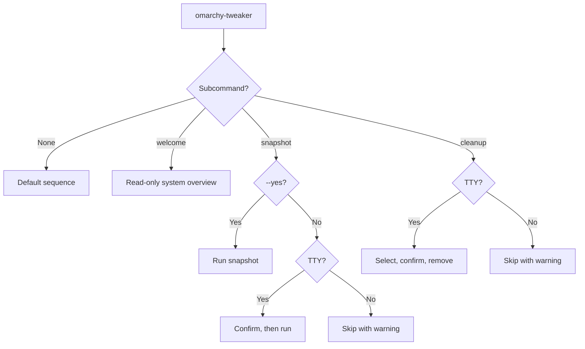
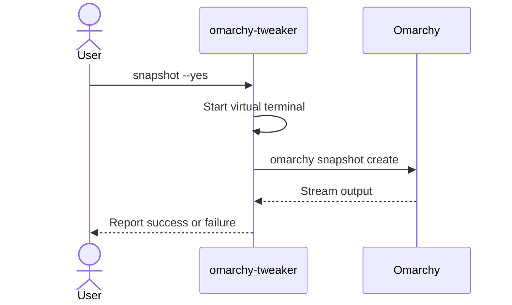

# Commands

Complete reference for the currently implemented Omarchy Tweaker commands.

| Command | Changes system | Requires TTY | Key option |
|:--|:--:|:--:|:--|
| *(none)* | Only if you confirm | For interactive steps | — |
| `welcome` | No | No | — |
| `snapshot` | Yes | Unless `--yes` | `--yes`, `-y` |
| `cleanup` | Yes | Yes | — |



---

## Global behavior

```bash
omarchy-tweaker [OPTIONS] COMMAND [ARGS]...
```

| Behavior | Details |
|:--|:--|
| No arguments | Runs the default sequence: banner, snapshot step, cleanup step. |
| With a subcommand | Shows the banner, then runs the selected command. |
| `--help` | Shows global help and the available commands. |
| Completion | Disabled. |
| Shell execution | External commands use argument lists, not `shell=True`. |

!!! note "No arguments is not the same as `--help`"
    Running `omarchy-tweaker` starts the interactive default workflow. Use `omarchy-tweaker --help` to inspect commands without starting the workflow.

### Choose a command

| Goal | Command |
|:--|:--|
| Inspect the system and confirm the installation works | `omarchy-tweaker welcome` |
| Create a recovery point before making changes | `omarchy-tweaker snapshot` |
| Review and remove selected packages or launchers | `omarchy-tweaker cleanup` |
| Run the guided snapshot-then-cleanup sequence | `omarchy-tweaker` |
| See every command and option | `omarchy-tweaker --help` |

### Exit codes

| Code | Meaning |
|:--:|:--|
| `0` | The command completed, or the step was skipped safely. |
| `1` | A selected operation failed, such as snapshot creation or item removal. |

A skipped step is not a failure. For example, declining a snapshot or running cleanup without a TTY exits successfully.

---

## `welcome`

Show the welcome screen and a system overview.

```bash
omarchy-tweaker welcome
```

The screen includes:

- A welcome panel.
- Operating system and kernel.
- Desktop environment.
- CPU model, thread count, and architecture.
- GPU description when `lspci` is available.
- Memory and disk usage.
- Uptime.
- Hostname.

The command does not modify the system.

---

## `snapshot`

Create a system snapshot with `omarchy snapshot create`.

```bash
omarchy-tweaker snapshot
omarchy-tweaker snapshot --yes
omarchy-tweaker snapshot -y
```

| Option | Description |
|:--|:--|
| `--yes`, `-y` | Skip the confirmation prompt. |

### Behavior

1. Prints a **System Snapshot** section.
2. Asks for confirmation unless `--yes` is supplied.
3. Runs `omarchy snapshot create` inside a virtual terminal.
4. Streams command output into a bounded terminal panel.
5. Reports success or failure.

### Confirmation

The prompt defaults to **yes**. Declining skips the snapshot without failing the command.

### Non-interactive use

| Invocation | Result |
|:--|:--|
| `omarchy-tweaker snapshot` without a TTY | Skips with a warning. |
| `omarchy-tweaker snapshot --yes` without a TTY | Runs the snapshot command. |

### Timeout

The snapshot command has a **600 second** timeout.

### Requirements

- `omarchy` must be on `PATH`.
- Omarchy's snapshot tooling must be configured and working.

If the command fails, run `omarchy snapshot create` directly to inspect the underlying error.

---

### Snapshot flow



## `cleanup`

Discover installed Omarchy cleanup targets, present them as selectable lists, and remove only the items you explicitly choose.

```bash
omarchy-tweaker cleanup
```

Cleanup has no command-line options. It always uses the interactive selection workflow.

### Behavior

1. Discovers installed packages, web apps, TUIs, and Mise wrappers.
2. Prints a separate table and checkbox prompt for each non-empty category.
3. Shows a summary of selected items.
4. Asks for final confirmation.
5. Removes packages in a virtual terminal.
6. Removes launchers and Mise wrappers with a progress display.
7. Reports removed and failed items.

### Categories

| Category | Source |
|:--|:--|
| **Packages** | Omarchy preinstalled package list, filtered by `pacman -Qq`. |
| **Web Apps** | Desktop launchers using `omarchy-launch-webapp` or `omarchy-webapp-handler`. |
| **TUIs** | Desktop launchers using `$TERMINAL` or `xdg-terminal-exec` with `-e`. |
| **Mise Wrappers** | Regular, non-symlink files in `~/.local/bin` containing `mise use -g`. |

### Non-interactive use

`omarchy-tweaker cleanup` requires an interactive terminal. Without one, it prints a warning and skips without removing anything.

### Failure handling

If any selected item cannot be removed, cleanup reports the failed items and exits with code `1`.

See **[Cleanup](cleanup.md)** for discovery rules, removal commands, and safety details.

---

## Environment variables

| Variable | Purpose |
|:--|:--|
| `OMARCHY_TWEAKER_LOG_DIR` | Override the log directory. |
| `XDG_STATE_HOME` | Base directory for logs when the override is unset. |
| `OMARCHY_REMOVE_NOTIFY` | Set to `false` internally during removal to suppress Omarchy removal notifications. |

Logs default to `$XDG_STATE_HOME/omarchy_tweaker/logs/` or `~/.local/state/omarchy_tweaker/logs/`.

---

## Examples

### Inspect the current system

```bash
omarchy-tweaker welcome
```

### Create a snapshot for automation

```bash
omarchy-tweaker snapshot --yes
```

### Review cleanup candidates without removing anything

```bash
omarchy-tweaker cleanup
```

Then press ++enter++ at each prompt without selecting items. Nothing is removed when the final selection is empty.

### Show global help

```bash
omarchy-tweaker --help
```

---

## Related pages

- [Getting Started](getting-started.md)
- [Cleanup](cleanup.md)
- [Troubleshooting](troubleshooting.md)
