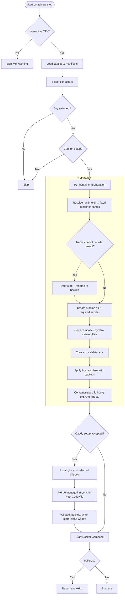
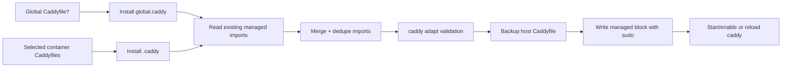

# Containers

The `containers` step prepares Docker Compose projects from Omarchy Tweaker's bundled catalog,
creates runtime configuration, wires host Caddy reverse-proxy routes, and starts the containers
you select.

```bash
omarchy-tweaker containers
```

!!! info "At a glance"
    - **Runs in:** default startup sequence (after package installation)
    - **Also available as:** standalone `containers` command
    - **Requires:** interactive TTY, Docker Compose, and Caddy for reverse-proxy setup
    - **Runtime root:** `~/Projects/Containers/<container>` (override: `OMARCHY_TWEAKER_CONTAINERS_ROOT`)

---

## Quick reference

| Area | Details |
|:--|:--|
| Catalog | `src/omarchy_tweaker/containers/` (override: `OMARCHY_TWEAKER_CONTAINERS_DIR`) |
| Runtime | `~/Projects/Containers/<slug>/` |
| Compose | Copied into runtime dir; started with `docker compose up -d` |
| Config files | Symlinked from catalog into runtime dir (except `.env`) |
| Environment | `.env` created from `.env.example` as mode `0600`, existing files preserved |
| Caddy snippets | `/etc/caddy/omarchy-tweaker/<slug>.caddy` + `global.caddy` |
| Host Caddy config | `/etc/caddy/Caddyfile` with managed `# BEGIN/END omarchy-tweaker` block |
| Failure mode | Per-container/prep/Caddy/Compose failures reported; step exits `1` on failure |

!!! warning "Operations with side effects"
    - Creates and updates files below the runtime directory.
    - Replacing host symlink destinations creates timestamped `.bak.<timestamp>` backups.
    - Host Caddy updates are validated, backed up, written with `sudo`, and reloaded.
    - Fixed `container_name` conflicts may stop and rename an existing external container (with confirmation).

---

## Catalog overview

Each container is a directory under `src/omarchy_tweaker/containers/` containing at least a
`docker-compose.yml`. A top-level catalog `Caddyfile` provides global host routes.

### Bundled catalog

| Container | Slug / Directory | Purpose | Compose services | Network model |
|:--|:--|:--|:--|:--|
| Atuin AI Server | `atuin/` | OpenAI-compatible chat backend for Atuin | `atuin-ai` | Host network |
| Open WebUI | `open-webui/` | Web UI for local LLM inference | `open-webui` | Host network |
| Dockhand | `dockhand/` | Docker management web UI | `dockhand` | Host network |
| OmniRoute | `omniroute/` | AI router/proxy with dashboard, API, WS, Redis | `omniroute`, `redis` | App: host, Redis: bridge + loopback publish |
| SnapOtter | `snapotter/` | File processing (convert/OCR/transcribe/AI) | `snapotter`, `postgres`, `redis` | Private bridge, app published to loopback |

### Container directory files

| File | Required | Behavior |
|:--|:--:|:--|
| `docker-compose.yml` | Yes | Identifies the container and is copied to the runtime directory. |
| `.env.example` | No | Template for runtime `.env` generation (created once, mode `0600`). |
| `Caddyfile` | No | Per-container reverse-proxy snippet installed into managed Caddy dir. |
| `container.toml` | No | Display metadata, host symlinks, runtime subdirectories, generated env keys. |
| `discover.sh` (OmniRoute) | No* | Runtime discovery script used by OmniRoute-specific preparation. |
| Other files | No | Symlinked into the runtime directory for live catalog-backed config. |

*A required part of the bundled OmniRoute workflow; missing/failing discovery skips OmniRoute startup.

### Manifest (`container.toml`)

```toml
[container]
name = "Display Name"
description = "Human-readable description."
directories = ["data"]

[symlinks]
"config.toml" = "~/.config/app/config.toml"

[env]
generate = ["SECRET_TOKEN"]
```

| Section | Key | Purpose |
|:--|:--|:--|
| `[container]` | `name` | Display name shown in selection UI (defaults from slug). |
| `[container]` | `description` | Selection/help text. |
| `[container]` | `directories` | Runtime subdirectories to ensure exist. |
| `[symlinks]` | `"source" = "dest"` | Link runtime file to host destination (file names only as source). |
| `[env]` | `generate` | Variables offered for automatic secret generation. |

!!! note
    A malformed manifest causes that container to be skipped with a logged error; other containers remain available.

---

## Port allocation and domains

All configured routes are designed to coexist without host-port collisions.

| Service | Type | Host port | Container/internal port | Domain / Route | Upstream |
|:--|:--|:--:|:--:|:--|:--|
| Omarchy site | Global host | `80` | — | `http://omarchy.localhost` | `127.0.0.1:80` |
| Hugo dev server | Global host | `1313` | — | `http://hugo.localhost` | `127.0.0.1:1313` |
| Ollama API | Global host | `11434` | — | `http://ollama.localhost` | `127.0.0.1:11434` |
| Atuin AI Server | Container | `6900` | `6900` | `atuin-ai.localhost`, `chat.atuin-ai.localhost`, `models.atuin-ai.localhost` | `127.0.0.1:6900` |
| Open WebUI | Container | `6901` | `PORT` (`6901`) | `open-webui.localhost` | `127.0.0.1:6901` |
| Dockhand | Container | `6902` | `PORT` (`6902`) | `dockhand.localhost` | `127.0.0.1:6902` |
| OmniRoute dashboard | Container | `6904` | `6904` | `omniroute.localhost` | `127.0.0.1:6904` |
| OmniRoute API | Container | `6905` | `6905` | `api.omniroute.localhost` | `127.0.0.1:6905` |
| OmniRoute Live WS | Container | `6906` | `6906` | `ws.omniroute.localhost` | `127.0.0.1:6906` |
| OmniRoute Redis | Container (internal publish) | `6379` | `6379` | — | `127.0.0.1:6379` (loopback publish) |
| SnapOtter app | Container | `6907` | `1349` | `snapotter.localhost` | `127.0.0.1:6907` |

!!! tip "Changing ports safely"
    If you customize a port, keep these in sync: compose port mapping / host service, `.env` values
    (where used), and the corresponding Caddy upstream.

---

## End-to-end workflow



### Runtime layout and behavior

| Item | Behavior |
|:--|:--|
| Runtime directory | `~/Projects/Containers/<slug>` |
| `docker-compose.yml` | Copied into runtime directory |
| Other catalog files | Symlinked into runtime directory (catalog edits remain visible) |
| `.env` | Regular file, mode `0600`, never symlinked; existing file is kept |
| Existing host symlink targets | Backed up as `<path>.bak.<timestamp>` before replacement |
| Fixed `container_name` conflicts | Existing external container may be stopped/renamed `<name>-backup-<timestamp>` |

!!! info "Environment variables"
    - `env.generate` entries and names containing `TOKEN`, `SECRET`, or `PASSWORD` can be auto-generated.
    - Other values are prompted interactively; placeholders like `replace_with_*` / `your_*` and blank values are rejected.
    - Existing `.env` files are preserved, but unresolved `${VAR}` references are validated and reported as errors before start.

---

## Caddy integration

Caddy is configured through managed snippet files and a single managed import block in the host
Caddyfile. This keeps Omarchy Tweaker routes additive and avoids clobbering unrelated host config.

### Global and per-container routes

| Source | Installed snippet | Scope |
|:--|:--|:--|
| `src/omarchy_tweaker/containers/Caddyfile` | `/etc/caddy/omarchy-tweaker/global.caddy` | Global host routes (not tied to one container) |
| `containers/<slug>/Caddyfile` | `/etc/caddy/omarchy-tweaker/<slug>.caddy` | Container-specific routes |

**Current global routes (`global.caddy`):**

| Domain | Upstream | Access log |
|:--|:--|:--|
| `http://omarchy.localhost` | `127.0.0.1:80` | `/var/log/caddy/omarchy.log` |
| `http://hugo.localhost` | `127.0.0.1:1313` | `/var/log/caddy/hugo.log` |
| `http://ollama.localhost` | `127.0.0.1:11434` | `/var/log/caddy/ollama.log` |

### Managed update flow



**Managed block example:**

```caddy
# BEGIN omarchy-tweaker
# Managed by Omarchy Tweaker. Do not edit this block by hand.
import "/etc/caddy/omarchy-tweaker/global.caddy"
import "/etc/caddy/omarchy-tweaker/atuin.caddy"
# END omarchy-tweaker
```

!!! note "Important behavior"
    - Imports from previously configured containers are preserved when running setup for a different selection.
    - `caddy adapt` validates the generated config before write; backups are created before modification.
    - Snippets live under `/etc/caddy/omarchy-tweaker/` so the Caddy service can read them.
    - Overrides: `OMARCHY_TWEAKER_CADDY_CONFIG`, `OMARCHY_TWEAKER_CADDY_DIR`.

---

## Container details

=== "Atuin AI Server"

    **Path:** `src/omarchy_tweaker/containers/atuin/`
    **Runtime:** `~/Projects/Containers/atuin`

    | Item | Value |
    |:--|:--|
    | Compose container | `Atuin-Ai` |
    | Network | `network_mode: host` |
    | Port | `6900` |
    | Generated env | `AUTH_TOKEN` |
    | Prompted env | `ATUIN_API_KEY` (OmniRoute API key) |
    | Compose mount | `./config.toml:/etc/atuin-ai/config.toml:ro` (runtime-linked catalog config) |
    | Host symlinks | `config.toml` → `~/.config/atuin-ai-server/config.toml`<br>`atuin.toml` → `~/.config/atuin/config.toml` |

    **Routes**

    | Domain | Path | Upstream | Log |
    |:--|:--|:--|:--|
    | `atuin-ai.localhost` | `/` | `127.0.0.1:6900` | `/var/log/caddy/atuin-ai.log` |
    | `chat.atuin-ai.localhost` | `/api/cli/chat` | `127.0.0.1:6900` | `/var/log/caddy/atuin-ai.log` |
    | `models.atuin-ai.localhost` | `/api/cli/models` | `127.0.0.1:6900` | `/var/log/caddy/atuin-ai.log` |

    !!! info "Configuration notes"
        - `config.toml` listens on port `6900`, targets `http://atuin-ai.localhost/v1`, reads the upstream key from `ATUIN_API_KEY` (`[api_key] env = "ATUIN_API_KEY"`), and defines OmniRoute/local Ollama model aliases.
        - `atuin.toml` is symlinked over `~/.config/atuin/config.toml` (original backed up) so client and server share catalog-backed configuration. Review and update any required tokens/values for your environment.

        If Atuin prompts for login, point the CLI at the local AI endpoint and use `oss` protocol with the server's `AUTH_TOKEN` (not an Atuin Hub token).

        | Setting | Value | Purpose |
        |:--|:--|:--|
        | `ai.endpoint` | `http://atuin-ai.localhost` | Local Atuin AI server URL |
        | `ai.endpoint_protocol` | `oss` | Bypass Atuin Hub authentication |
        | `ai.api_token` | `AUTH_TOKEN` from container `.env` | Authenticate against the self-hosted server |
        | `ai.model` | e.g. `best-fast` | Default model alias from `config.toml` |

        ```bash
        atuin config set ai.endpoint http://atuin-ai.localhost
        atuin config set ai.endpoint_protocol oss
        atuin config set ai.api_token 'YOUR_AUTH_TOKEN'
        atuin config set ai.enabled true
        atuin config set ai.model best-fast
        ```

    !!! warning "Keep tokens private"
        Replace `YOUR_AUTH_TOKEN` with the real `AUTH_TOKEN` from `~/Projects/Containers/atuin/.env`. Do not commit it to version control.

=== "Open WebUI"

    **Path:** `src/omarchy_tweaker/containers/open-webui/`
    **Runtime:** `~/Projects/Containers/open-webui`

    | Item | Value |
    |:--|:--|
    | Compose container | `OpenWebUi` |
    | Network | `network_mode: host` |
    | Port | `PORT` (default `6901`) |
    | Generated env | `WEBUI_SECRET_KEY` |
    | Prompted env | `PORT` |
    | Optional env | `ENABLE_EASTER_EGGS`, `FORWARDED_ALLOW_IPS`, `OLLAMA_BASE_URL` → `OLLAMA_BASE_URLS`, `OMNIROUTE_URL` → `OPENAI_API_BASE_URL` |
    | Persistent data (host bind mount) | `${HOME}/Projects/Containers/open-webui/data:/app/backend/data` |

    **Route:** `open-webui.localhost` → `127.0.0.1:6901` (`/var/log/caddy/open-webui.log`)

=== "Dockhand"

    **Path:** `src/omarchy_tweaker/containers/dockhand/`
    **Runtime:** `~/Projects/Containers/dockhand`

    | Item | Value |
    |:--|:--|
    | Compose container | `dockhand` |
    | Network | `network_mode: host` |
    | Port | `PORT` (default `6902`) |
    | Prompted env | `PORT` |
    | Mounts | `${HOME}/Projects/Containers/dockhand/data:/app/data`, `/var/run/docker.sock:/var/run/docker.sock` |

    **Route:** `dockhand.localhost` → `127.0.0.1:6902` (`/var/log/caddy/dockhand.log`)

    !!! warning "Docker socket access"
        Mounting `/var/run/docker.sock` grants Dockhand control over the host Docker daemon.

=== "OmniRoute"

    **Path:** `src/omarchy_tweaker/containers/omniroute/`
    **Runtime:** `~/Projects/Containers/omniroute`

    | Item | Value |
    |:--|:--|
    | Services | `omniroute` (app), `omniroute-redis` (Redis) |
    | App network | `network_mode: host` (`DASHBOARD_PORT=6904`, `API_PORT=6905`, `LIVE_WS_PORT=6906`) |
    | Redis network | `omniroute-internal` bridge, published `127.0.0.1:6379:6379` |
    | Persistent mounts | `${HOME}/Projects/Containers/omniroute/data:/app/data`, `${HOME}/Projects/Containers/omniroute/redis:/data` |
    | Generated env | `OMNIROUTE_WS_BRIDGE_SECRET` |
    | Runtime artifacts | `.env` (0600), `compose.agents.yaml` (generated), runtime data dir |

    **Routes**

    | Domain | Purpose | Upstream | Log |
    |:--|:--|:--|:--|
    | `omniroute.localhost` | Dashboard | `127.0.0.1:6904` | `/var/log/caddy/omniroute-dashboard.log` |
    | `api.omniroute.localhost` | API | `127.0.0.1:6905` | `/var/log/caddy/omniroute-api.log` |
    | `ws.omniroute.localhost` | Live WebSocket | `127.0.0.1:6906` | `/var/log/caddy/omniroute-ws.log` |

    !!! info "Beyond the standard container flow"
        OmniRoute adds host CLI install/update checks, agent/tool discovery (`discover.sh` → `compose.agents.yaml`), onboarding bootstrap-token capture, and optional shell export persistence.

    ```mermaid
    flowchart LR
      A[Host CLI check/install/update] --> B[Prepare runtime & .env]
      B --> C[discover.sh]
      C -->|ok| D[docker compose -f docker-compose.yml -f compose.agents.yaml up -d]
      C -->|fail/missing| X[Skip OmniRoute, continue others]
      D --> E[Read onboarding bootstrap token]
      E --> F[Print/persist CLI exports]
    ```

    **Discovery highlights (`compose.agents.yaml`)**
    - Explicit `CLI_<TOOL>_BIN` paths and lookup hints (`CLI_EXTRA_PATHS`, `PATH` adjustments).
    - Host mounts for Node/runtime/tool locations and agent config dirs into container home.
    - `CLI_CONFIG_HOME=/home/node`; agent-specific vars like `PI_CODING_AGENT_DIR`/`HERMES_HOME` set when detected.

    **CLI connection exports**

    | Variable | Source | Notes |
    |:--|:--|:--|
    | `OMNIROUTE_BASE_URL` | `BASE_URL` or `API_PORT` fallback | Always emitted |
    | `OMNIROUTE_API_KEY` | Dashboard-created key | Relevant when `REQUIRE_API_KEY=true`; placeholder commented by default |

    !!! warning "Onboarding token"
        Fresh installs may log a one-time `[BOOTSTRAP]` token for `http://omniroute.localhost/dashboard/onboarding`.
        Retrieve later with `docker logs omniroute | grep BOOTSTRAP` if needed; treat as sensitive/single-use.

    !!! note "Runtime data permissions"
        Omarchy Tweaker ensures `~/Projects/Containers/omniroute/data` is user-writable before start and can offer `chown` repair if root-owned.

=== "SnapOtter"

    **Path:** `src/omarchy_tweaker/containers/snapotter/`
    **Runtime:** `~/Projects/Containers/snapotter`

    | Item | Value |
    |:--|:--|
    | Services | `snapotter`, `snapotter-postgres`, `snapotter-redis` |
    | Network | `snapotter-internal` bridge (DB/Redis not host-published) |
    | Published port | `127.0.0.1:${PORT:-6907}:1349` (internal app port `1349`) |
    | Generated env | `SNAPOTTER_PASSWORD`, `POSTGRES_PASSWORD` |
    | Prompted env | `SNAPOTTER_PASSWORD` |
    | Key `.env` values | `PORT=6907`, `SNAPOTTER_USERNAME`, `SNAPOTTER_PASSWORD`, `POSTGRES_USER`, `POSTGRES_PASSWORD`, `POSTGRES_DB`, `SNAPOTTER_INTERNAL_PORT=1349` |
    | Persistent data (host bind mounts) | `${HOME}/Projects/Containers/snapotter/data:/data`<br>`${HOME}/Projects/Containers/snapotter/pgdata:/var/lib/postgresql/data`<br>`${HOME}/Projects/Containers/snapotter/redisdata:/data` |

    **Route:** `snapotter.localhost` → `127.0.0.1:6907` (`/var/log/caddy/snapotter.log`)

    !!! warning "First login"
        Default user is `admin` (`SNAPOTTER_USERNAME`); SnapOtter forces a password change on first login. Update credentials after initial access.

---

## Operations, overrides, and failure handling

| Topic | Behavior |
|:--|:--|
| Interactivity | Non-interactive runs skip container setup with a warning (no files started/prepared). |
| Caddy dependency | Caddy is expected to be installed (available in package catalog); container step does not install it. |
| Validation | Generated Caddy config validated via `caddy adapt` before write. |
| Backups | Host Caddyfile and replaced symlink destinations are backed up with timestamps. |
| Timeouts | Compose operations: 900s; compose config: 60s; sudo: 120s; Caddy ops: 60s; npm install: 600s; discovery: 60s. |
| Partial failure | One container's failure does not stop processing remaining selected containers; step reports failures and exits `1`. |

**Environment overrides**

| Variable | Purpose |
|:--|:--|
| `OMARCHY_TWEAKER_CONTAINERS_DIR` | Override bundled catalog location |
| `OMARCHY_TWEAKER_CONTAINERS_ROOT` | Override runtime root (`~/Projects/Containers` default target) |
| `OMARCHY_TWEAKER_CADDY_CONFIG` | Override host Caddyfile path |
| `OMARCHY_TWEAKER_CADDY_DIR` | Override managed Caddy snippet directory |

!!! success "Design goals"
    - **Predictable:** explicit selection, confirmation, and additive Caddy management.
    - **Safe-ish:** backups, validation, preserved existing `.env`, and conflict handling.
    - **Portable catalog:** host-specific paths generated at runtime where needed (e.g. OmniRoute mounts/env).
