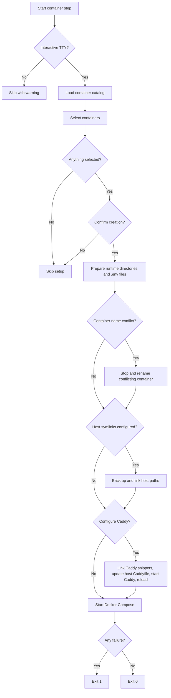

# Containers

The container step prepares Docker Compose projects from the bundled container catalog and
starts the containers you select. It also configures a managed reverse-proxy route through
the host Caddy installation.

```bash
omarchy-tweaker containers
```

Container setup runs in the default startup sequence after package installation and is also
available as the standalone `containers` command.

!!! warning "Destructive filesystem operations"
    Preparing a container creates files below `~/Projects/Containers/<container>`. Host
    symlinks back up an existing destination before replacing it. The Caddy step backs up
    the host Caddyfile before adding the managed import block.

---

## Workflow



---

## Catalog layout

Each container lives in its own directory below `src/omarchy_tweaker/containers/`:

```text
containers/atuin/
├── .env.example
├── Caddyfile
├── config.toml
├── container.toml
└── docker-compose.yml
```

| File | Required | Purpose |
|:--|:--:|:--|
| `docker-compose.yml` | Yes | Compose definition. Also identifies the directory as a container. |
| `.env.example` | No | Template used to create the container's `.env` file. |
| `Caddyfile` | No | Reverse-proxy route for the host Caddy installation. |
| `container.toml` | No | Display name, description, host symlinks, and generated secrets. |
| Other files | No | Configuration files linked into the runtime directory. |

---

## Runtime layout

Prepared containers live below `~/Projects/Containers/<container>`. The compose file is
copied there. Other container files are symlinked into the runtime directory, so edits in the
catalog are immediately visible without copying. The `.env` file is written as a regular file
with mode `0600` and is never linked.

The runtime location can be overridden with `OMARCHY_TWEAKER_CONTAINERS_ROOT`. The catalog
location can be overridden with `OMARCHY_TWEAKER_CONTAINERS_DIR`.

### Container name conflicts

A Compose file may set a fixed `container_name`. If a container with that name already exists
outside the current Compose project, Omarchy Tweaker offers to stop and rename the existing
container to `<name>-backup-<timestamp>`. The old container is preserved but stopped so the
new Compose project can create its container. Declining the prompt skips that container.

---

## Environment files

When a container has a `.env.example`, Omarchy Tweaker creates `.env` in the runtime directory
and keeps an existing `.env` untouched. Docker Compose interpolates values in an existing
`.env`, so any `${VARIABLE}` references it contains must also be set in the environment or in
the same file. An existing `.env` that references an unset variable is reported as an error
before anything is started.

- Variables listed in the manifest's `env.generate` list offer automatic secret generation.
- Variables whose names contain `TOKEN`, `SECRET`, or `PASSWORD` also offer automatic generation.
- Other variables are prompted for interactively.
- Placeholder values such as `replace_with_...` and `your_...` are rejected.
- Blank values are rejected.

```toml
[env]
generate = ["AUTH_TOKEN"]
```

---

## Host symlinks

The manifest's `[symlinks]` table maps a file inside the container directory to a host path.
The host path becomes a symlink to the prepared runtime file. An existing destination is
backed up first with a `.bak.<timestamp>` suffix.

```toml
[symlinks]
"config.toml" = "~/.config/atuin-ai-server/config.toml"
"atuin.toml" = "~/.config/atuin/config.toml"
```

Symlink sources must be plain file names inside the container directory. Relative
destinations are resolved beneath the home directory.

!!! warning "Symlinks replace host files"
    Linking `atuin.toml` replaces `~/.config/atuin/config.toml` with a symlink to the
    catalog file. The original is backed up first. Replace the placeholder
    `api_token = "<ATUIN_API_KEY>"` in the catalog file with the real key from the
    container's `.env` before relying on it.

---

## Manifest

```toml
[container]
name = "Atuin AI Server"
description = "Atuin AI chat server with an OpenAI-compatible API."

[symlinks]
"config.toml" = "~/.config/atuin-ai-server/config.toml"
"atuin.toml" = "~/.config/atuin/config.toml"

[env]
generate = ["AUTH_TOKEN"]
```

The `container` section provides the display name and description. When omitted, the
directory name is converted into a display name. A malformed manifest causes that container to
be skipped with a logged error.

The bundled catalog currently contains one container:

| Container | Description |
|:--|:--|
| Atuin AI Server | Atuin AI chat server with an OpenAI-compatible API. |

---

## Caddy

Each container may provide a `Caddyfile`. When Caddy setup is accepted, Omarchy Tweaker:

1. Copies the container Caddyfile into `/etc/caddy/omarchy-tweaker/`.
2. Adds or replaces a managed block in `/etc/caddy/Caddyfile` that imports those snippets.
3. Validates the generated configuration with `caddy adapt`.
4. Backs up the host Caddyfile.
5. Writes the updated Caddyfile with `sudo`.
6. Starts and enables the Caddy service when it is not running, then reloads it through
   `systemctl reload caddy`, falling back to `caddy reload`.

`caddy adapt` checks the generated configuration without opening a log file, so validation
does not require elevated privileges. The running Caddy service writes access logs below
`/var/log/caddy`, which is writable by the service user.

Snippets live in a system directory so the unprivileged Caddy service can read them even when
home directories are protected. The host Caddyfile path can be overridden with
`OMARCHY_TWEAKER_CADDY_CONFIG`. The snippet directory can be overridden with
`OMARCHY_TWEAKER_CADDY_DIR`.

!!! note "Caddy must be installed"
    Caddy is part of the package catalog. The container step does not install it.

---

## Non-interactive use

`omarchy-tweaker containers` requires an interactive terminal. Without one, it prints a
warning and skips without preparing or starting anything.

## Failure handling

A preparation, Caddy, or Docker Compose failure is reported and exits with code `1`. A
failure for one container does not prevent the remaining selected containers from being
processed.
