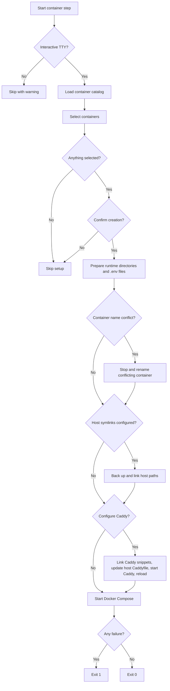
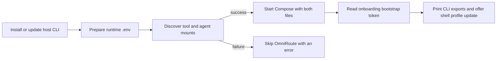

# Containers

The container step prepares Docker Compose projects from the bundled container catalog and
starts the containers you select. It also configures a managed reverse-proxy route through
the host Caddy installation.

```bash
omarchy-tweaker containers
```

Container setup runs in the default startup sequence after package installation and is also
available as the standalone `containers` command.

!!! warning "Destructive filesystem operations"
    Preparing a container creates files below `~/Projects/Containers/<container>`. Host
    symlinks back up an existing destination before replacing it. The Caddy step backs up
    the host Caddyfile before adding the managed import block.

---

## Workflow



---

## Catalog layout

Each container lives in its own directory below `src/omarchy_tweaker/containers/`:

| File | Required | Purpose |
|:--|:--:|:--|
| `docker-compose.yml` | Yes | Compose definition. Also identifies the directory as a container. |
| `.env.example` | No | Template used to create the container's `.env` file. |
| `Caddyfile` | No | Reverse-proxy route for the host Caddy installation. |
| `container.toml` | No | Display name, description, host symlinks, and generated secrets. |
| Other files | No | Configuration files linked into the runtime directory. |

The catalog currently contains five containers:

| Container | Directory | Description |
|:--|:--|:--|
| Atuin AI Server | `containers/atuin/` | Atuin AI chat server with an OpenAI-compatible API. |
| Open WebUI | `containers/open-webui/` | Web UI for local LLM inference with an OpenAI-compatible API. |
| Dockhand | `containers/dockhand/` | Web UI for managing Docker containers, images, and volumes. |
| OmniRoute | `containers/omniroute/` | Smart AI router with an OpenAI-compatible API and auto fallback. |
| SnapOtter | `containers/snapotter/` | Self-hosted file-processing suite: convert, compress, OCR, transcribe, and run local AI. |

---

## Runtime layout

Prepared containers live below `~/Projects/Containers/<container>`. The compose file is
copied there. Other container files are symlinked into the runtime directory, so edits in the
catalog are immediately visible without copying. The `.env` file is written as a regular file
with mode `0600` and is never linked.

The runtime location can be overridden with `OMARCHY_TWEAKER_CONTAINERS_ROOT`. The catalog
location can be overridden with `OMARCHY_TWEAKER_CONTAINERS_DIR`.

### Container name conflicts

A Compose file may set a fixed `container_name`. If a container with that name already exists
outside the current Compose project, Omarchy Tweaker offers to stop and rename the existing
container to `<name>-backup-<timestamp>`. The old container is preserved but stopped so the
new Compose project can create its container. Declining the prompt skips that container.

---

## Environment files

When a container has a `.env.example`, Omarchy Tweaker creates `.env` in the runtime directory
and keeps an existing `.env` untouched. Docker Compose interpolates values in an existing
`.env`, so any `${VARIABLE}` references it contains must also be set in the environment or in
the same file. An existing `.env` that references an unset variable is reported as an error
before anything is started.

- Variables listed in the manifest's `env.generate` list offer automatic secret generation.
- Variables whose names contain `TOKEN`, `SECRET`, or `PASSWORD` also offer automatic generation.
- Other variables are prompted for interactively.
- Placeholder values such as `replace_with_...` and `your_...` are rejected.
- Blank values are rejected.

```toml
[env]
generate = ["AUTH_TOKEN"]
```

---

## Host symlinks

The manifest's `[symlinks]` table maps a file inside the container directory to a host path.
The host path becomes a symlink to the prepared runtime file. An existing destination is
backed up first with a `.bak.<timestamp>` suffix.

Symlink sources must be plain file names inside the container directory. Relative
destinations are resolved beneath the home directory.

!!! warning "Symlinks replace host files"
    A symlink replaces the destination with a link to the catalog file. The original is
    backed up first. Review the catalog file for placeholder values before relying on it.

---

## Manifest

```toml
[container]
name = "Atuin AI Server"
description = "Atuin AI chat server with an OpenAI-compatible API."

[symlinks]
"config.toml" = "~/.config/atuin-ai-server/config.toml"

[env]
generate = ["AUTH_TOKEN"]
```

The `container` section provides the display name and description. When omitted, the
directory name is converted into a display name. A malformed manifest causes that container to
be skipped with a logged error.

---

## Container: Atuin AI Server

Atuin AI Server is an OpenAI-compatible chat backend for Atuin. Its directory is
`src/omarchy_tweaker/containers/atuin/`.

```text
containers/atuin/
├── .env.example
├── atuin.toml
├── Caddyfile
├── config.toml
├── container.toml
└── docker-compose.yml
```

- Runtime directory: `~/Projects/Containers/atuin`.
- Compose container name: `Atuin-Ai`.
- Network: `network_mode: host`, proxying port `6900`.
- Host symlinks:
  - `config.toml` → `~/.config/atuin-ai-server/config.toml`
  - `atuin.toml` → `~/.config/atuin/config.toml`
- Generated secret: `AUTH_TOKEN`.
- Prompted value: `ATUIN_API_KEY` (the OmniRoute API key).

The `atuin.toml` symlink replaces `~/.config/atuin/config.toml` with a link to the catalog
file, so the Atuin client and the AI server share one configuration. The original file is
backed up first. Replace the placeholder `api_token = "<ATUIN_API_KEY>"` in the catalog file
with the real key from the container's `.env` before relying on it.

`config.toml` lists the OmniRoute models (`main`, `best-fast`, `best-free`, `smart`,
`best-chat`, `best-reasoning`) and local Ollama models routed through OmniRoute.

### Caddy routes

| Domain | Path | Upstream |
|:--|:--|:--|
| `atuin-ai.localhost` | `/` | `127.0.0.1:6900` |
| `chat.atuin-ai.localhost` | `/api/cli/chat` | `127.0.0.1:6900` |
| `models.atuin-ai.localhost` | `/api/cli/models` | `127.0.0.1:6900` |

Access log: `/var/log/caddy/atuin-ai.log`.

---

## Container: Open WebUI

Open WebUI is a web interface for local LLM inference with an OpenAI-compatible API. Its
directory is `src/omarchy_tweaker/containers/open-webui/`.

```text
containers/open-webui/
├── .env.example
├── Caddyfile
├── container.toml
└── docker-compose.yml
```

- Runtime directory: `~/Projects/Containers/open-webui`.
- Compose container name: `OpenWebUi`.
- Network: `network_mode: host`. The container listens on `PORT` from `.env`, which
  defaults to `6901`.
- Host symlinks: none.
- Generated secret: `WEBUI_SECRET_KEY`.
- Prompted value: `PORT`.
- Optional values with defaults: `ENABLE_EASTER_EGGS`, `FORWARDED_ALLOW_IPS`,
  `OLLAMA_BASE_URL` (mapped to `OLLAMA_BASE_URLS`), `OMNIROUTE_URL` (mapped to
  `OPENAI_API_BASE_URL`).

Open WebUI stores its database and uploads in `~/Projects/Containers/open-webui/data`. The
compose file mounts that path directly, so it is not listed in `[symlinks]`. Create the
directory before starting the container, or the bind mount will be created empty by Docker.

### Caddy routes

| Domain | Upstream |
|:--|:--|
| `open-webui.localhost` | `127.0.0.1:6901` |

Access log: `/var/log/caddy/open-webui.log`.

---

## Container: Dockhand

Dockhand is a web UI for managing Docker containers, images, and volumes. Its directory is
`src/omarchy_tweaker/containers/dockhand/`.

```text
containers/dockhand/
├── .env.example
├── Caddyfile
├── container.toml
└── docker-compose.yml
```

- Runtime directory: `~/Projects/Containers/dockhand`.
- Compose container name: `dockhand`.
- Network: `network_mode: host`. The container listens on `PORT` from `.env`, which
  defaults to `6902`.
- Host symlinks: none.
- Prompted value: `PORT`.
- Data is bind-mounted at `~/Projects/Containers/dockhand/data`, and the Docker socket is
  mounted at `/var/run/docker.sock` so Dockhand can manage the host daemon.

### Caddy routes

| Domain | Upstream |
|:--|:--|
| `dockhand.localhost` | `127.0.0.1:6902` |

Access log: `/var/log/caddy/dockhand.log`.

---

## Container: OmniRoute

OmniRoute is a smart AI router with an OpenAI-compatible API and automatic provider
fallback. Its directory is `src/omarchy_tweaker/containers/omniroute/`.

!!! info "Four steps beyond the standard workflow"
    OmniRoute needs host tooling that the other containers do not: a host CLI, host
    tool and agent mounts, an onboarding bootstrap token, and a CLI connection to the
    container API. Each step is covered below in the order Omarchy Tweaker runs it.

### Layout

```text
containers/omniroute/
├── .env.example
├── Caddyfile
├── container.toml
├── discover.sh
└── docker-compose.yml
```

| Setting | Value |
|:--|:--|
| Runtime directory | `~/Projects/Containers/omniroute` |
| Containers | `omniroute` and `omniroute-redis` |
| App network | `network_mode: host` |
| Redis network | Private bridge network, published on `127.0.0.1:6379` |
| API port | `API_PORT` (`6905`) |
| Dashboard port | `DASHBOARD_PORT` (`6904`) |
| Live WebSocket port | `LIVE_WS_PORT` (`6906`) |
| Generated secret | `OMNIROUTE_WS_BRIDGE_SECRET` |
| Persistent data | `${HOME}/Projects/Containers/snapotter/data` and `./redis` below the runtime directory |

!!! tip "The catalog is portable"
    `docker-compose.yml` only uses the relative mounts `${HOME}/Projects/Containers/snapotter/data` and `./redis`. Host-specific
    paths are discovered at runtime instead of being committed to the catalog.
    `compose.agents.yaml` is a generated Compose override, not a file mounted into the
    container.

!!! warning "Runtime data must be writable"
    Omarchy Tweaker creates `~/Projects/Containers/omniroute/data` as your user before
    Compose starts, so the container (which runs as the same UID) can write its SQLite
    database and generated secrets. If the directory already exists but is owned by root,
    the step offers to fix it with `sudo chown -R "$(id -u):$(id -g)"`. Declining stops
    preparation instead of starting a container that cannot save data.

### Startup pipeline



| Step | Timing | Result |
|:--|:--|:--|
| Host CLI installation | Before preparation | Global `omniroute` npm package is present and current |
| Agent and tool discovery | Before start | `compose.agents.yaml` contains explicit CLI paths, environment overrides, and detected host mounts |
| Onboarding bootstrap token | After start | One-time token is printed for the wizard |
| Host CLI connection | After start | Export lines are printed and optionally saved |

### 1. Host CLI installation

The host `omniroute` CLI routes agent traffic to the container, so Omarchy Tweaker keeps it
available on the host through the global npm package `omniroute`.

- **Missing package:** you are offered `npm install -g omniroute`.
- **Installed package:** Omarchy Tweaker checks for a newer release with `npm outdated -g`
  and offers to update it.
- **Declined or failed installation:** a warning is shown and container setup continues
  with the generated mounts and CLI exports.

!!! note "npm is required"
    The check uses the `npm` from your `PATH`. When `npm` is not installed, the
    installation step cannot run: a warning is shown and container startup is not blocked.

### 2. Agent and tool discovery

Before the container starts, the bundled `discover.sh` runs inside the runtime directory. It
reads `HOST_NODE_BIN` from the rendered `.env`, resolves each installed CLI to its real
binary, and writes the result to `compose.agents.yaml`.

| Host path | Container path | Mode | Purpose |
|:--|:--|:--:|:--|
| `HOST_NODE_BIN` | `/host-node/bin` | Read-only | Node runtime for the CLI bridge |
| `~/.local/bin` | `/host-local/bin` | Read-only | Locally installed CLIs (kept last on `PATH`) |
| `~/.local/share/mise/installs` | Same path | Read-only | Mise-managed agent binaries |
| `~/.local/share/uv/python` | Same path | Read-only | Python runtime used by a mise-managed Hermes |
| `~/.config/opencode` | `/home/node/.config/opencode` | Read-write | OpenCode config, which ignores `CLI_CONFIG_HOME` |
| Installed agent directories | `/home/node/...` | Read-write | Agent configuration (Claude Code, Codex, Gemini, Pi, Hermes, and others) |

Agent configuration directories are mounted directly into the container user's home
(`/home/node`), and `CLI_CONFIG_HOME` is set to `/home/node`. This keeps the paths OmniRoute
checks (`~/.claude`, `~/.codex`, `~/.gemini`, `~/.config/opencode`, and so on) identical
inside and outside the container.

`discover.sh` writes two things into the generated file:

- **Explicit binaries.** Each detected tool gets a `CLI_<TOOL>_BIN` variable
  (`CLI_CLAUDE_BIN`, `CLI_CODEX_BIN`, `CLI_GEMINI_BIN`, `CLI_OPENCODE_BIN`, `CLI_PI_BIN`,
  `CLI_HERMES_BIN`, `CLI_OMP_BIN`, `CLI_GROK_BUILD_BIN`, and so on) pointing at the real
  executable. Symlinks are resolved first, so npm-installed tools that link into a sibling
  `lib` directory also work through the mounted mise tree.
- **Lookup hints.** `CLI_EXTRA_PATHS` lists the real tool directories, with `/host-local/bin`
  last. This prevents mise shims in `~/.local/bin` from shadowing the real binaries: those
  shims call `mise`, which is not installed inside the container, so OmniRoute would report
  every agent as unavailable. The same directories are prepended to `PATH`, so
  `docker exec omniroute command -v claude` also resolves.

`PI_CODING_AGENT_DIR` and `HERMES_HOME` are set when those agents are present, because
neither reads `CLI_CONFIG_HOME`.

The container starts with both Compose files, so the generated environment and mounts are
always applied:

=== "Validate"

    ```bash
    docker compose -f docker-compose.yml -f compose.agents.yaml config
    ```

=== "Start"

    ```bash
    docker compose -f docker-compose.yml -f compose.agents.yaml up -d --remove-orphans
    ```

!!! note "Generated at runtime"
    `compose.agents.yaml` is not shipped in the catalog and is gitignored. It is rebuilt on
    every run from the host paths that actually exist.

!!! warning "Discovery failure skips only OmniRoute"
    If `discover.sh` is missing or fails, OmniRoute is not started and the step reports an
    error. Other selected containers continue normally. Finding no agents is not a failure:
    the container still starts with the tool mounts.

### 3. Onboarding bootstrap token

The onboarding wizard lives at `<dashboard>/dashboard/onboarding`, for example
`http://omniroute.localhost/dashboard/onboarding`. OmniRoute logs a one-time bootstrap token
when the wizard is opened for the first time.

1. Omarchy Tweaker prints the onboarding URL.
2. It checks the container logs from the start of the current run.
3. If the token is missing, it offers to wait up to **five minutes** while you open the page
   and begin the wizard.
4. When the token appears, it is printed in a panel so you can paste it into the wizard.

??? example "What the log line looks like"

    ```text
    2026-11-15T01:13:52.907676177Z [omniroute] [BOOTSTRAP] Fresh install detected from a
    non-loopback peer (e.g. a Docker port-forwarded connection) with no password configured
    yet. Paste this ONE-TIME bootstrap token into the onboarding wizard to continue:
    S8Dll5Lmy4MobPxaLSaW38Ma73zD45Jm
    ```

If you decline the wait, or the token does not appear in time, the following command prints it
later:

```bash
docker logs omniroute | grep BOOTSTRAP
```

!!! warning "The token is single-use"
    The log scan is limited to the current run, so an old token is never reused. Treat the
    token like a password and paste it only into the onboarding wizard.

### 4. Connecting the host CLI

After the container starts, Omarchy Tweaker prints the exports that point the host CLI at the
container API and offers to persist them.

| Variable | Source | Notes |
|:--|:--|:--|
| `OMNIROUTE_BASE_URL` | `BASE_URL`, falling back to `API_PORT` | Always printed |
| `OMNIROUTE_API_KEY` | Created in the dashboard | Only relevant when `REQUIRE_API_KEY=true`; the placeholder is commented out |

=== "Persist automatically"

    When you accept the prompt, the lines are written to `~/.zshrc` in a managed block:

    ```bash
    # >>> omarchy-tweaker omniroute >>>
    export OMNIROUTE_BASE_URL=http://127.0.0.1:6905
    # <<< omarchy-tweaker omniroute <<<
    ```

=== "Add manually"

    When you decline, or the session is not interactive, the exact lines are printed:

    ```bash
    export OMNIROUTE_BASE_URL=http://127.0.0.1:6905
    ```

    Add them to your shell profile yourself and reload it.

!!! tip "Safe, repeatable updates"
    An existing managed block is replaced rather than duplicated. A key you filled into
    `OMNIROUTE_API_KEY` is preserved, and the previous profile is backed up to
    `~/.zshrc.<timestamp>.bak` before it is modified.

!!! note "API keys are dashboard-managed"
    OmniRoute stores API keys in the container database, so no key is generated in `.env`.
    Create one in the dashboard and uncomment the `OMNIROUTE_API_KEY` line with that value.

### Caddy routes

| Domain | Upstream |
|:--|:--|
| `omniroute.localhost` | `127.0.0.1:6904` (dashboard) |
| `api.omniroute.localhost` | `127.0.0.1:6905` (API) |
| `ws.omniroute.localhost` | `127.0.0.1:6906` (Live WebSocket) |

Access logs: `/var/log/caddy/omniroute-dashboard.log`, `omniroute-api.log`, and
`omniroute-ws.log`.

---

## Caddy

Each container may provide a `Caddyfile`. When Caddy setup is accepted, Omarchy Tweaker:

1. Copies the container Caddyfile into `/etc/caddy/omarchy-tweaker/`.
2. Adds or replaces a managed block in `/etc/caddy/Caddyfile` that imports those snippets.
3. Validates the generated configuration with `caddy adapt`.
4. Backs up the host Caddyfile.
5. Writes the updated Caddyfile with `sudo`.
6. Starts and enables the Caddy service when it is not running, then reloads it through
   `systemctl reload caddy`, falling back to `caddy reload`.

`caddy adapt` checks the generated configuration without opening a log file, so validation
does not require elevated privileges. The running Caddy service writes access logs below
`/var/log/caddy`, which is writable by the service user.

Snippets live in a system directory so the unprivileged Caddy service can read them even when
home directories are protected. The host Caddyfile path can be overridden with
`OMARCHY_TWEAKER_CADDY_CONFIG`. The snippet directory can be overridden with
`OMARCHY_TWEAKER_CADDY_DIR`.

!!! note "Caddy must be installed"
    Caddy is part of the package catalog. The container step does not install it.

---

## Container: SnapOtter

SnapOtter is a self-hosted file-processing suite. It converts, compresses, OCRs, transcribes,
and runs local AI across image, video, audio, PDF, and documents through a UI, REST API, and
pipelines. Its directory is `src/omarchy_tweaker/containers/snapotter/`.

```text
containers/snapotter/
├── .env.example
├── Caddyfile
├── container.toml
└── docker-compose.yml
```

- Runtime directory: `~/Projects/Containers/snapotter`.
- Compose containers: `snapotter`, `snapotter-postgres`, and `snapotter-redis`.
- Network: private bridge network `snapotter-internal`. Redis and PostgreSQL are not published
  to the host; only the SnapOtter app is reachable.
- Published port: `PORT` (`6906`) on `127.0.0.1`, forwarded to the image's internal port `1349`.
- Persistent data: `${HOME}/Projects/Containers/snapotter/data` (app files), `${HOME}/Projects/Containers/snapotter/pgdata` (PostgreSQL), and `${HOME}/Projects/Containers/snapotter/redisdata` (Redis)
  below the runtime directory.
- Generated secrets: `SNAPOTTER_PASSWORD` and `POSTGRES_PASSWORD`.
- Prompted value: `SNAPOTTER_PASSWORD` (also used as the app login and the PostgreSQL password
  unless overridden).

### Caddy routes

| Domain | Upstream |
|:--|:--|
| `snapotter.localhost` | `127.0.0.1:6906` |

Access log: `/var/log/caddy/snapotter.log`.

!!! warning "First login"
    The default username is `admin`. SnapOtter forces a password change on first login. Change
    `DEFAULT_USERNAME` and `DEFAULT_PASSWORD` after the first login.

---

## Non-interactive use

`omarchy-tweaker containers` requires an interactive terminal. Without one, it prints a
warning and skips without preparing or starting anything.

## Failure handling

A preparation, Caddy, or Docker Compose failure is reported and exits with code `1`. A
failure for one container does not prevent the remaining selected containers from being
processed. Compose operations have a **900 second** timeout.
