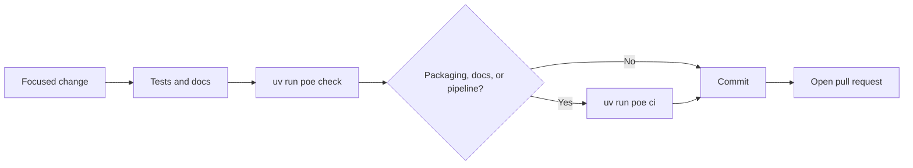
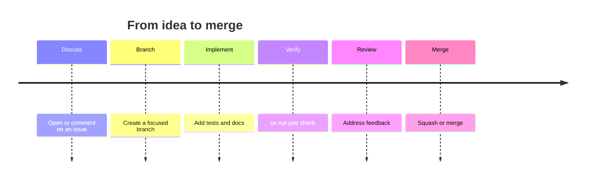

# Contributing

Thank you for your interest in contributing to **Omarchy Tweaker**.

Omarchy Tweaker is a personal customization and automation toolkit for
[Omarchy](https://omarchy.org) on Arch Linux. It is primarily developed for the
maintainer's personal environment and is **not** intended as a universal, one-size-fits-all
installer.

!!! note "Project status"
    The repository is in early implementation. The CLI, default startup sequence, snapshot
    workflow, cleanup workflow, directory setup, package installation, session logging, Rich
    error handling, and terminal UI toolkit are implemented and tested. Planned features such
    as dotfile management and theme automation are not implemented. Please do not assume a
    planned feature exists.

---

## Getting Started

Follow the [Development Guide](development.md#quick-start) to clone the repository, install
dependencies, install Git hooks, and run the initial quality checks. Once the environment is
ready, start with a focused change and run `uv run poe check` before committing.

---

## Development Workflow

All development tasks are managed through **Poe the Poet**:

```bash
uv run poe <task>
```

Before committing, run the relevant checks:

```bash
uv run poe check
```

The Git hooks installed by pre-commit enforce three stages:

| Stage | Checks |
|---|---|
| `pre-commit` | Git hygiene, file validation, Ruff lint/format, Bandit, Codespell. |
| `commit-msg` | Conventional Commits validation. |
| `pre-push` | Strict Mypy type checking and the full Pytest suite. |

---

## Code Style

- Follow the conventions documented in
  [`AGENTS.md`](https://github.com/Armoghans-Organization/Omarchy-Tweaker/blob/main/AGENTS.md).
- Type annotations are required; **Mypy strict mode** is enforced.
- Use **Google-style docstrings**.
- Keep CLI command definitions separate from business logic.
- Follow PEP 8 and the Ruff configuration in `pyproject.toml`
  (line length `100`, target `py313`, rule families `E`, `F`, `I`, `UP`, `B`, `SIM`,
  `PERF`).
- Do not add inline suppressions merely to silence warnings. Any necessary suppression must
  have a clear justification.

---

## Testing

- Add or update tests for new functionality.
- Use Pytest with Pytest-Mock and Pytest-Cov.
- Mock external commands, package-manager operations, filesystem writes, and system
  service changes.
- Do not modify the real host system during tests.
- Name tests descriptively, for example
  `test_install_package_handles_command_failure`.
- Treat coverage as a signal, not a target. Prioritize critical functionality and failure
  paths.

Run the suite with:

```bash
uv run poe test
uv run poe coverage
```

---

## System Safety

This project interacts directly with system configurations and package management. Treat
all system modifications as potentially destructive. Never execute privileged or destructive
operations without authorization, and follow the safeguards in the [Security Policy](security.md)
and `AGENTS.md`.

---

## Commit Messages

Use [Conventional Commits](https://www.conventionalcommits.org/):

```text
<type>(optional-scope): <description>
```

Allowed types: `feat`, `fix`, `docs`, `style`, `refactor`, `perf`, `test`, `build`, `ci`,
`chore`, and `revert`. Headers are limited to **100 characters**.

Examples:

```text
feat: add package management commands
fix: handle missing configuration files
refactor(core): separate system operations from the CLI
docs: improve installation documentation
```

Mark breaking changes with `!` after the type or scope, and/or a `BREAKING CHANGE:` footer.

---

## Pull Requests



### Pull request lifecycle



Before opening a pull request, ensure that:

- [ ] `uv run poe check` passes locally.
- [ ] New functionality is tested.
- [ ] Documentation is updated when required.
- [ ] No unrelated files were modified.
- [ ] Generated artifacts, secrets, and virtual environments are not staged.

Use the repository's pull request template. For changes affecting packaging, documentation,
or the pipeline, confirm that `uv run poe ci` also passes.

---

## Community Standards

- [Code of Conduct](https://github.com/Armoghans-Organization/Omarchy-Tweaker/blob/main/CODE_OF_CONDUCT.md)
- [Security Policy](security.md)
- [Support](https://github.com/Armoghans-Organization/Omarchy-Tweaker/blob/main/SUPPORT.md)

---

## License

Released under the MIT License. See
[LICENSE](https://github.com/Armoghans-Organization/Omarchy-Tweaker/blob/main/LICENSE).
