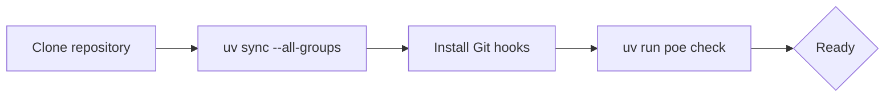
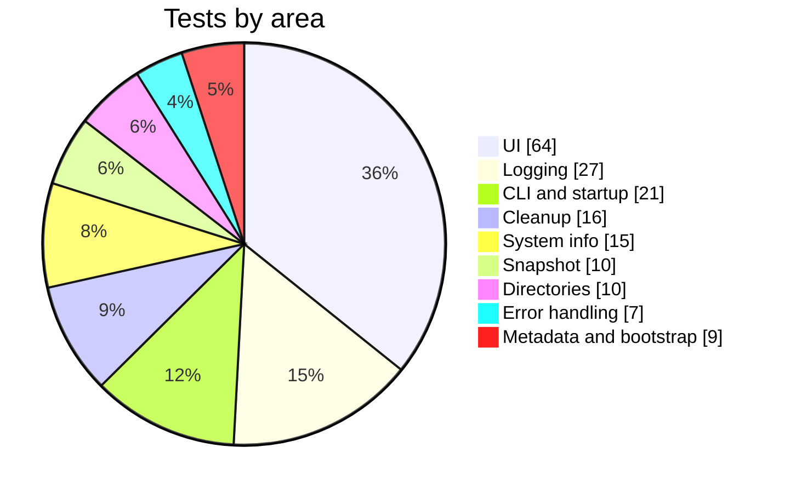
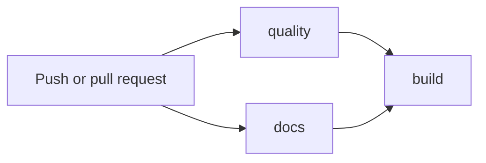
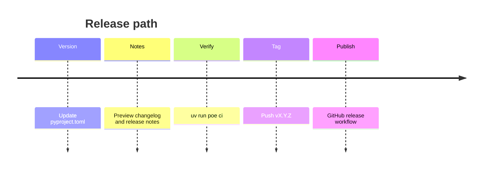

# Development Guide

This page describes how the Omarchy Tweaker development environment is set up, how the
quality tooling is configured, and how to work on the project day to day.

Omarchy Tweaker is a terminal-first, Python 3.13+ toolkit for customizing and automating
personal Omarchy (Arch Linux) installations. The repository is in **early implementation**:
the CLI, default startup workflow, snapshot step, cleanup workflow, directory setup,
session logging, Rich error handling, and reusable terminal UI toolkit are implemented and
tested.

The project is intentionally small. New behavior should follow the existing module patterns
rather than introducing a new framework or a speculative package layout.

---

## Quick Start

For the impatient, a complete local setup looks like this:

```bash
git clone https://github.com/Armoghans-Organization/Omarchy-Tweaker.git
cd Omarchy-Tweaker
uv sync --all-groups
uv run pre-commit install --install-hooks
uv run poe check
```

If every task passes, the environment is ready.



---

## Requirements

| Requirement | Version | Notes |
|---|---|---|
| Linux | Any modern distribution | Targets Omarchy / Arch Linux. |
| Python | 3.13 or newer | Pinned to `3.13` in `.python-version`. |
| [uv](https://docs.astral.sh/uv/) | Latest | Dependency management and task execution. |
| Git | Latest | Version control and Git hooks. |

`uv` can install and manage the required Python interpreter, so a system Python 3.13 is
not strictly necessary.

### Optional Tools

These are not required for development but are used by the developer workspace helpers:

- **Zellij** — terminal multiplexer used by `session.sh` / `session.kdl`.
- **gum** — styled shell output used by `session.sh`.

---

## Setup

### 1. Clone the repository

```bash
git clone https://github.com/Armoghans-Organization/Omarchy-Tweaker.git
cd Omarchy-Tweaker
```

### 2. Install dependencies

```bash
uv sync --all-groups
```

!!! info "Dependency groups"
    `--all-groups` installs the runtime, development (`dev`), and documentation (`docs`)
    dependency groups. CI uses `uv sync --locked` so the lockfile is never silently
    modified.

The `dev` group provides the full quality toolchain:

- `ruff` — linting and formatting.
- `mypy` — strict static typing.
- `pytest`, `pytest-mock`, `pytest-cov`, `pytest-rich` — testing and coverage.
- `bandit` — Python security analysis.
- `codespell` — spelling checks.
- `pre-commit` — Git hook management.
- `poethepoet` — task runner.

The `docs` group provides:

- `zensical` — documentation site generator.
- `git-cliff` — changelog and release-note generation.

### 3. Install Git hooks

```bash
uv run pre-commit install --install-hooks
```

The project installs three hook types by default (see
[`.pre-commit-config.yaml`](https://github.com/Armoghans-Organization/Omarchy-Tweaker/blob/main/.pre-commit-config.yaml)):

- `pre-commit` — fast checks on staged files.
- `commit-msg` — Conventional Commits validation.
- `pre-push` — full-project type checking and test suite.

### 4. Verify the setup

```bash
uv run poe check
```

This runs linting, formatting checks, type checking, and the test suite.

### 5. Optional: launch the developer workspace

```bash
./session.sh
```

This creates a dedicated Zellij session using `session.kdl`.

---

## Project Layout

```text
Omarchy-Tweaker/
├── .github/
│   ├── templates/                  # Git Cliff changelog / release-note templates
│   └── workflows/                  # ci.yml, docs.yml, release.yml
├── docs/                           # Zensical documentation sources
│   ├── changelog.md                # GENERATED — do not edit by hand
│   ├── commands.md                 # CLI reference
│   ├── cleanup.md                  # Cleanup workflow reference
│   ├── directories.md              # Workspace directory reference
│   ├── development.md              # This page
│   ├── getting-started.md          # Installation and first run
│   ├── index.md                    # Documentation home
│   ├── architecture.md             # Runtime flow and module design
│   ├── release-notes.md            # GENERATED — do not edit by hand
│   ├── security.md                 # Security policy
│   ├── troubleshooting.md          # Common issues
│   ├── overrides/                  # Theme overrides
│   ├── stylesheets/                # Custom CSS
│   ├── favicons/ · images/         # Static assets
├── src/
│   ├── omarchy_tweaker/
│   │   ├── __init__.py             # Application entry and dispatch
│   │   ├── __main__.py             # python -m omarchy_tweaker
│   │   ├── app_metadata.py         # Name and version metadata
│   │   ├── cli.py                  # Typer application and callback
│   │   ├── startup.py              # Typer-free default sequence
│   │   ├── commands/               # Thin CLI command wrappers
│   │   ├── screens/                # Banner and welcome screens
│   │   └── functions/              # Cleanup, directories, snapshot, logging, UI, system info
│   └── omarchy_tweaker_bootstrap/
│       ├── __init__.py             # Early entry point
│       └── error_handling.py       # Rich exception rendering
├── tests/
│   ├── __init__.py
│   ├── test_cleanup.py
│   ├── test_cli.py
│   ├── test_directory.py
│   ├── test_logger.py
│   ├── test_main.py
│   ├── test_snapshot.py
│   ├── test_system_info.py
│   └── test_ui.py
├── .gitignore
├── .pre-commit-config.yaml         # Git hook definitions
├── .python-version                 # Pinned interpreter (3.13)
├── AGENTS.md                       # AI agent development guidelines
├── cliff.toml                      # Git Cliff configuration
├── CODE_OF_CONDUCT.md
├── CONTRIBUTING.md
├── LICENSE
├── pyproject.toml                  # Project metadata, tooling, and Poe tasks
├── Readme.md
├── SECURITY.md
├── session.kdl / session.sh        # Optional Zellij developer workspace
├── SUPPORT.md
├── uv.lock                         # Locked dependency graph
└── zensical.toml                   # Documentation site configuration
```

### Generated Artifacts

The following are produced by tasks and must **never be committed**:

- `dist/`, `build/` — package builds.
- `site/` — compiled documentation.
- `.cache/`, `.pytest_cache/`, `.mypy_cache/`, `.ruff_cache/`.
- `.coverage`, `htmlcov/`.
- `bandit-report.json`.
- `docs/changelog.md`, `docs/release-notes.md` — regenerated from Git history.

The `src/omarchy_tweaker/` layout is intentionally flat. Commands, screens, and reusable
functions live in separate packages, but there is no implemented `cli/`, `core/`, or
`models/` subpackage. See [Architecture](architecture.md) for module responsibilities and
extension points.

---

## Toolchain and Configuration

All tooling is configured in `pyproject.toml`.

### Ruff — Linting and Formatting

| Setting | Value |
|---|---|
| Line length | `100` |
| Target version | `py313` |
| Format quote style | `double` |
| Enabled rule families | `E`, `F`, `I`, `UP`, `B`, `SIM`, `PERF` |
| Ignored rule | `B008` (function call in default argument) |
| First-party import | `omarchy_tweaker` |
| Tests-only ignore | `E501` (long lines) under `tests/**/*.py` |

Do not add inline suppressions merely to silence a warning. If a suppression is genuinely
required, it must have a clear justification.

### Mypy — Strict Typing

| Setting | Value |
|---|---|
| Mode | `strict = true` |
| Checked paths | `src`, `tests` |
| Python version | `3.13` |
| Extras | `pretty`, `show_error_codes`, `warn_unused_configs`, `warn_redundant_casts`, `warn_unused_ignores` |

All public functions, methods, and modules should carry complete type annotations. Do not
weaken strict mode to make code pass; resolve the underlying typing issue instead.

### Bandit — Security Analysis

| Setting | Value |
|---|---|
| Target | `src` |
| Excluded directories | `tests`, `.venv`, `build`, `dist` |
| Severity threshold | `LOW` |
| Confidence threshold | `MEDIUM` |
| Skipped checks | none |

### Pytest and Coverage

| Setting | Value |
|---|---|
| Test paths | `tests` |
| File pattern | `test_*.py` |
| Default flags | `-ra` |
| Coverage source | `omarchy_tweaker` |
| Branch coverage | enabled |
| Excluded from coverage | `tests`, `pragma: no cover`, `__repr__`, `TYPE_CHECKING` blocks |

External commands, package-manager calls, privileged operations, filesystem writes, and
service changes must be mocked. Tests must never modify the host system.

### Poe the Poet — Task Runner

Tasks are defined under `[tool.poe.tasks]` in `pyproject.toml`.

---

## Task Runner

Run any task with `uv run poe <task>`.

### Linting

| Command | Purpose |
|---|---|
| `uv run poe lint` | Check code with Ruff. |
| `uv run poe lint-fix` | Apply supported Ruff fixes automatically. |

### Formatting

| Command | Purpose |
|---|---|
| `uv run poe format` | Format Python files with Ruff. |
| `uv run poe format-check` | Verify formatting without modifying files. |

### Type Checking

| Command | Purpose |
|---|---|
| `uv run poe typecheck` | Run strict Mypy checks. |

### Testing and Coverage

| Command | Purpose |
|---|---|
| `uv run poe test` | Run the test suite verbosely (`pytest -v`). |
| `uv run poe coverage` | Run tests with a terminal coverage report. |

### Security

| Command | Purpose |
|---|---|
| `uv run poe security` | Scan `src` with Bandit using project thresholds. |
| `uv run poe security-report` | Write a JSON Bandit report to `bandit-report.json`. |

### Changelog and Release Notes

| Command | Purpose |
|---|---|
| `uv run poe changelog` | Generate `docs/changelog.md` from Git history. |
| `uv run poe changelog-preview` | Preview unreleased changelog entries. |
| `uv run poe release-notes` | Generate `docs/release-notes.md` for the latest release. |
| `uv run poe release-notes-preview` | Preview unreleased release notes. |
| `uv run poe docs-generate` | Run `changelog` and `release-notes` together. |

### Documentation

| Command | Purpose |
|---|---|
| `uv run poe docs` | Generate docs content and start the live server. |
| `uv run poe docs-serve` | Serve the site with live reload. |
| `uv run poe docs-build` | Generate docs content and build the site. |
| `uv run poe docs-compile` | Build the site with strict validation. |
| `uv run poe docs-deploy` | Generate docs content and deploy to GitHub Pages. |
| `uv run poe docs-publish` | Deploy via Zensical's `gh-deploy`. |

### Building and Cleanup

| Command | Purpose |
|---|---|
| `uv run poe build` | Build the sdist and wheel with `uv build`. |
| `uv run poe clean` | Remove `dist`, `build`, `.coverage`, `site`, and generated docs. |

### Combined Checks

| Command | Purpose |
|---|---|
| `uv run poe check` | `lint` + `format-check` + `typecheck` + `test`. |
| `uv run poe pre-commit` | Same four checks, intended for local pre-commit use. |
| `uv run poe ci` | `lint` + `format-check` + `typecheck` + `coverage` + `docs-build` + `build`. |

!!! note "`poe pre-commit` is not the Git hook runner"
    `uv run poe pre-commit` runs the same quality checks as `poe check`. To execute the
    actual Git hooks, use `uv run pre-commit run --all-files`.

---

## Git Hooks (pre-commit)

The repository uses [pre-commit](https://pre-commit.com/) to enforce quality gates before
code reaches the remote. Local hooks invoke tools through `uv run --locked` so the
environment matches the lockfile exactly.

### Hook Stages

| Stage | Hooks | Purpose |
|---|---|---|
| `pre-commit` | Git hygiene, file validation, Ruff lint/format, Bandit, Codespell | Fast checks on staged files. |
| `commit-msg` | Conventional Commits | Message validation. |
| `pre-push` | Mypy, Pytest | Full-project verification. |

### Hook Categories

| Category | Hooks |
|---|---|
| `[GIT]` | trailing whitespace, EOF newline, LF endings, merge conflicts, large files, case conflicts. |
| `[CONFIG]` | TOML, YAML, JSON, and XML validation. |
| `[PYTHON]` | syntax validation, debugger-statement detection. |
| `[SECURITY]` | private-key detection, Bandit. |
| `[SCRIPTS]` | shebang and executable-permission validation. |
| `[QUALITY]` | Ruff linting and formatting. |
| `[DOCS]` | Codespell spelling validation. |
| `[COMMIT]` | Conventional Commits enforcement. |
| `[TYPES]` | Mypy strict type checking. |
| `[TESTS]` | Pytest full suite. |

Most hooks are configured with `verbose: true`, so the terminal shows exactly which hook
is running, which files it touched, and the full tool output.

### Common Commands

| Command | Purpose |
|---|---|
| `uv run pre-commit install --install-hooks` | Install all configured hook types and environments. |
| `uv run pre-commit uninstall` | Remove installed hooks. |
| `uv run pre-commit run` | Run hooks against staged files. |
| `uv run pre-commit run --all-files` | Run every hook against every file. |
| `uv run pre-commit run <hook-id> --all-files` | Run a single hook (for example `ruff`). |
| `uv run pre-commit autoupdate` | Update hook repositories to their latest revisions. |
| `uv run pre-commit clean` | Clear cached hook environments. |

To skip a specific hook for one run:

```bash
SKIP=codespell uv run pre-commit run --all-files
```

!!! tip "Hooks that report `(no files to check)Skipped`"
    The JSON and XML validators skip automatically when the repository contains no matching
    files. This is expected and is not an error.

---

## Daily Development Workflow

A typical change follows this loop:

1. Create a branch (only with explicit authorization for AI agents — see `AGENTS.md`).
2. Make a focused change with tests and documentation updates.
3. Run the fast feedback loop:

   ```bash
   uv run poe lint-fix
   uv run poe format
   uv run poe test
   ```

4. Run the full gate before committing:

   ```bash
   uv run poe check
   ```

5. Commit using a Conventional Commit message.
6. Push (the `pre-push` hooks run Mypy and Pytest automatically).

For documentation, packaging, or pipeline changes, run the full pipeline instead:

```bash
uv run poe ci
```

---

## Testing

Tests live under `tests/` and use Pytest with Pytest-Mock and Pytest-Cov.

### Running Tests

```bash
uv run poe test
uv run poe coverage
```

Run a single test or file directly:

```bash
uv run pytest tests/test_main.py -v
uv run pytest tests/test_directory.py -v
uv run pytest tests/test_cleanup.py::test_run_cleanup_step_removes_only_selected_items -v
uv run pytest -k "cleanup or directory" -v
```

### Guidelines

- Test public behavior, invalid input, error conditions, and edge cases.
- Name tests descriptively, for example `test_install_package_handles_command_failure`.
- Use `pytest-mock` (`mocker`) to isolate external dependencies.
- Use `tmp_path` for filesystem work instead of touching real user directories.
- Never install, remove, or modify real packages or system services during tests.
- Treat coverage as a signal, not a target: prioritize critical paths and failure handling
  over an arbitrary percentage.

### Current Coverage

The suite currently contains **179 tests** covering:



- Application metadata and bootstrap entry points.
- CLI dispatch, banner behavior, command registration, and exit codes.
- The default startup sequence.
- Snapshot success, skip, timeout, missing-command, and OS-error paths.
- Cleanup discovery, selection, removal, path validation, and failure reporting.
- Directory targets, creation, parent checks, conflict handling, and non-interactive skips.
- Session logging, log-directory resolution, shutdown reports, and interrupt handling.
- Rich error handling for main-thread, thread, unraisable, and syntax errors.
- System information formatting and fallbacks.
- UI helpers, prompts, progress, and virtual-terminal behavior.

External commands, package-manager calls, privileged operations, filesystem writes, and
service changes are mocked. Tests must never modify the host system.

---

## Commit Message Conventions

Commit messages are validated by the `conventional-pre-commit` hook in strict mode.

Format:

```text
<type>(optional-scope): <description>
```

Allowed types: `feat`, `fix`, `docs`, `style`, `refactor`, `perf`, `test`, `build`, `ci`,
`chore`, and `revert`. The header is limited to **100 characters**.

Examples:

```text
feat: add package management commands
fix: handle missing configuration files
refactor(core): separate system operations from the CLI
docs: improve installation documentation
test: add package manager tests
chore: update development dependencies
```

Indicate a breaking change with `!` after the type or scope, and/or a `BREAKING CHANGE:`
footer:

```text
feat(cli)!: rename the bootstrap command
```

Keep messages descriptive enough for `git-cliff` to build meaningful changelogs.

---

## Documentation

Documentation is built with [Zensical](https://zensical.org/docs) and configured in
`zensical.toml`. The site navigation exposes:

- Home → `index.md`
- Getting Started → `getting-started.md`
- Usage → `commands.md`, `cleanup.md`, and `directories.md`
- Project → `architecture.md`, `development.md`, `contributing.md`, and `security.md`
- Troubleshooting → `troubleshooting.md`
- Changelog → `changelog.md` (generated)
- Release Notes → `release-notes.md` (generated)

### Local Preview

```bash
uv run poe docs-serve
```

This starts a live-reload server. To build the site without serving it:

```bash
uv run poe docs-build
```

`docs-build` regenerates the changelog and release notes before compiling the site with
`--clean --strict`, so broken links and invalid content fail the build.

### Editing Documentation

- Source pages live in `docs/`.
- Theme overrides live in `docs/overrides/`.
- Custom styling lives in `docs/stylesheets/extra.css`.
- **Never** edit `docs/changelog.md` or `docs/release-notes.md` by hand; they are
  generated from Git history.
- Keep documentation accurate. Do not document features that are not implemented.

### Deployment

The `Documentation` workflow (`.github/workflows/docs.yml`) builds and deploys the site to
GitHub Pages on pushes to `main` and on `v*` tags. It uses `uv run --frozen --group docs`
to guarantee a reproducible build.

---

## CI/CD Pipeline



### `ci.yml` — Continuous Integration

Triggered on pushes and pull requests to `main`, and manually via `workflow_dispatch`.

| Job | What it does |
|---|---|
| `quality` | Runs on Python **3.13** and **3.14**; installs with `uv sync --locked`; runs `lint`, `format-check`, `typecheck`, and `coverage`. |
| `docs` | Installs the `docs` group and runs `poe docs-build`. |
| `build` | Depends on `quality` and `docs`; runs `uv build`, validates with `twine check`, and uploads the distributions. |

### `docs.yml` — Documentation Deployment

Pushes to `main` or `v*` tags build the site and publish it to GitHub Pages.

### `release.yml` — Release Automation

Triggered by tags matching `v*`. It:

1. Verifies that the Git tag matches the `pyproject.toml` version.
2. Builds the sdist and wheel.
3. Validates artifacts with `twine check`.
4. Generates `RELEASE_NOTES.md`, `CHANGELOG.md`, and the documentation copies with
   `git-cliff`.
5. Creates or updates the GitHub Release and uploads the artifacts.

---

## Release Process

The project follows [Semantic Versioning](https://semver.org/) (`MAJOR.MINOR.PATCH`).

1. Update `version` in `pyproject.toml`.
2. Regenerate and review the changelog and release notes:

   ```bash
   uv run poe changelog-preview
   uv run poe release-notes-preview
   ```

3. Run the full pipeline:

   ```bash
   uv run poe ci
   ```

4. Commit and push the version bump.
5. Create and push a tag that matches the version exactly:

   ```bash
   git tag v0.1.0
   git push origin v0.1.0
   ```

The `release.yml` workflow rejects a tag whose version does not match `pyproject.toml`.

---

### Release path



## Troubleshooting

### `uv.lock` is out of date

Symptom: `uv run --locked` fails, or pre-commit hooks error while resolving dependencies.

```bash
uv lock
uv sync --all-groups
```

Commit the updated `uv.lock` when dependency changes require it. Do not edit the lockfile
manually.

### A pre-commit hook fails

```bash
uv run pre-commit run <hook-id> --all-files
```

Inspect the output, fix the issue, re-stage, and commit again. Use `SKIP=<hook-id>` only
when a hook is genuinely not applicable.

### Hooks report `(no files to check)Skipped`

Expected for validators whose file types are absent (for example JSON or XML). No action is
needed.

### Mypy strict errors appear during push

The `pre-push` stage runs full-project Mypy. Fix the annotations rather than adding
`# type: ignore`. Verify locally with `uv run poe typecheck`.

### Bandit generates `bandit-report.json`

That file is a generated artifact and is excluded from hooks and Git. Remove it with
`uv run poe clean` or delete it manually.

### Documentation build fails on missing generated files

Run `uv run poe docs-generate` (or `uv run poe docs-build`, which does it automatically)
before building.

---

## Contribution Checklist

Before opening a pull request, confirm that:

- [ ] The change is focused and does not include unrelated refactoring.
- [ ] Tests cover new behavior and failure paths.
- [ ] Documentation is updated where behavior changed.
- [ ] `uv run poe check` passes.
- [ ] `uv run poe ci` passes for packaging, docs, or pipeline changes.
- [ ] Commit messages follow Conventional Commits.
- [ ] No generated artifacts, secrets, or virtual environments are staged.

Additional contribution expectations are described in `CONTRIBUTING.md` and `AGENTS.md`.
