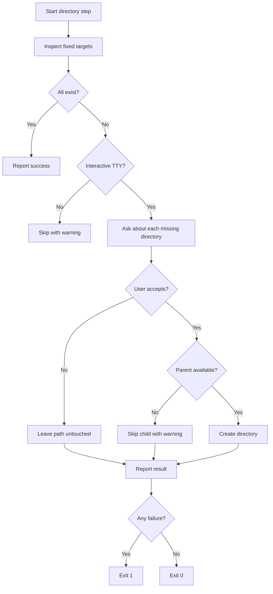

# Directories

The directory step creates the standard folders used by this personal Omarchy setup. It
creates only missing directories, asks before each one, and never overwrites an existing
path.

```bash
omarchy-tweaker directories
```

The default workflow runs this step after cleanup:

```bash
omarchy-tweaker
```

---

## Targets

| Path | Purpose |
|:--|:--|
| `~/Github` | Git repositories. |
| `~/Github/Clone` | Cloned repositories. |
| `~/Projects` | Personal projects. |
| `~/Projects/Containers` | Container projects. |
| `~/.ISO` | ISO images. |
| `~/.VM` | Virtual machines. |
| `~/.Cloud` | Cloud storage. |

All targets are fixed paths beneath your home directory. The step does not scan the
filesystem or create arbitrary locations.

---

## Workflow



1. Existing directories are reported and left untouched.
2. Each missing directory gets its own confirmation prompt, defaulting to **yes**.
3. Declining a prompt leaves that path untouched.
4. A child directory is skipped when its parent is unavailable.
5. An existing file or broken symlink at a target path is reported as a failure.
6. Any creation failure makes the command exit with code `1`.

!!! note "No implicit parent creation"
    Directories are created one level at a time in the order shown above. If you decline
    `~/Github`, the step will not create `~/Github/Clone` behind your back.

---

## Non-interactive use

Directory creation requires an interactive terminal.

| Invocation | Result |
|:--|:--|
| `omarchy-tweaker directories` without a TTY | Skips with a warning. |
| `omarchy-tweaker directories` with a TTY | Asks about each missing directory. |

A skip is not a failure. Existing directories are still recognized without prompting.

---

## Safety model

- **Fixed targets** — only the documented home-relative paths are considered.
- **Missing only** — existing directories are never modified.
- **Per-directory confirmation** — each missing path is opt-in.
- **No overwrite** — files, symlinks, and other non-directory paths are refused.
- **No privilege escalation** — the step never invokes `sudo` or changes ownership.
- **No parent surprises** — missing parents are not created implicitly.

---

## Examples

### Create the workspace folders

```bash
omarchy-tweaker directories
```

### Run the full guided workflow

```bash
omarchy-tweaker
```

### Check the result

```bash
ls -ld ~/Github ~/Github/Clone ~/Projects ~/Projects/Containers ~/.ISO ~/.VM ~/.Cloud
```

---

## Related pages

- [Commands](commands.md)
- [Getting Started](getting-started.md)
- [Architecture](architecture.md)
- [Troubleshooting](troubleshooting.md)
