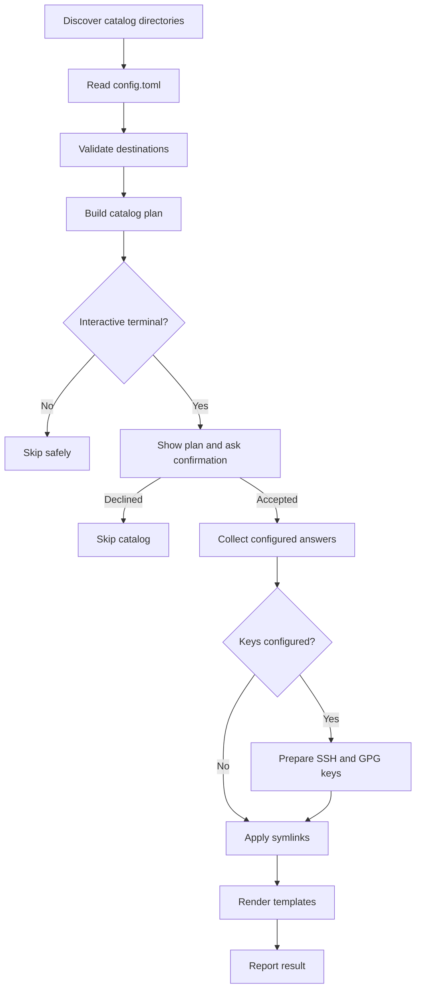

# Dotfiles

This page explains what the `dotfiles` feature currently is, how it discovers catalogs,
how it applies them, and what safety behavior it provides.

For day-to-day usage of the bundled Bat, Git, Lazygit, Tig, Tmux, Starship, Superfile, and
Zellij setups, see **[Bat Dotfiles](bat.md)**, **[Git Dotfiles](git.md)**,
**[Lazygit Dotfiles](lazygit.md)**, **[Tig Dotfiles](tig.md)**, **[Tmux Dotfiles](tmux.md)**,
**[Starship Dotfiles](starship.md)**, **[Superfile Dotfiles](superfile.md)**, and
**[Zellij Dotfiles](zellij.md)**.

!!! note "Current scope"
    The dotfile system is a bundled-catalog installer, not a general-purpose dotfile
    manager. It applies catalogs packaged with Omarchy Tweaker or a catalog directory
    supplied through the documented source override.

---

## What the feature is

The `dotfiles` command applies small, self-contained catalogs. Each catalog contains:

- A `config.toml` file that declares destinations, prompts, templates, and key options.
- Bundled source files that are linked into the home directory.
- Bundled templates that are rendered into the home directory.

The Python code does not hardcode destination paths. The catalog configuration is the
source of truth, so a catalog can be changed or added without rewriting command logic.

```bash
omarchy-tweaker dotfiles
```

---

## Current implementation

| Area | Current behavior |
|:--|:--|
| Discovery | Finds every directory inside the dotfiles source directory that contains `config.toml`. |
| Configuration | Reads `[symlink]`, `[ask]`, `[create]`, and `[keys]` sections. |
| Validation | Requires every destination to start with `~/` and resolve inside the home directory. |
| Confirmation | Lists planned links, created files, and key paths, then asks once per catalog. |
| Prompts | Collects configured answers and exposes them to templates in lowercase form. |
| Key setup | Optionally prepares SSH and GPG keys using one shared passphrase. |
| Linking | Symlinks bundled files or directories into configured destinations. |
| Backups | Moves existing destinations aside before replacement and restores them if linking fails. |
| Rendering | Renders configured templates from bundled files. |
| Reporting | Reports completed, skipped, and failed catalogs separately. |
| Overrides | Accepts a custom source directory and, for Python callers, a custom home directory. |

---

## How it works



For each accepted catalog, the command:

1. Reads the catalog `config.toml`.
2. Validates every configured path.
3. Lists the intended changes.
4. Asks for confirmation.
5. Collects answers from the `[ask]` section.
6. Prepares configured SSH and GPG keys when `[keys]` exists.
7. Symlinks entries from `[symlink]`.
8. Renders templates from `[create]`.
9. Records the catalog as completed, skipped, or failed.

---

## Catalog layout

A catalog is any directory with a `config.toml` file:

```text
src/omarchy_tweaker/dotfiles/
└── example/
    ├── config.toml
    ├── bundled-file
    └── template-file
```

The source name in `[symlink]` or `[create]` must match a file or directory inside the
catalog directory.

```toml
[symlink]
bundled-file = "~/.config/example/bundled-file"

[ask]
Name = "What name should be used?"

[create]
template-file = "~/.config/example/rendered-file"
```

---

## Configuration sections

| Section | Purpose | Required |
|:--|:--|:--|
| `[symlink]` | Maps a bundled source name to a destination under `~/`. | No |
| `[ask]` | Defines prompts. Keys become lowercase template values. | No |
| `[create]` | Maps a bundled template to a rendered destination under `~/`. | No |
| `[keys]` | Defines SSH/GPG paths and generation options. | No |

A catalog can use any combination of these sections. The Git catalog currently uses all
four. The Bat, Lazygit, Tig, Tmux, Starship, Superfile, and Zellij catalogs use only `[symlink]`.

Quoted `[symlink]` keys can include a source subdirectory, such as `"layouts/custom.kdl"`
or `"script/extract"`. This lets a catalog keep files organized in subdirectories while
linking each file to its own destination.

### Path rules

Every path must:

- Start with `~/`.
- Resolve inside the current home directory.
- Avoid attempting to escape the home directory with traversal segments.

Invalid paths reject the catalog before any change is made.

### Prompt values

Keys in `[ask]` are normalized to lowercase.

```toml
[ask]
Name = "What is your name?"
EmailAddress = "What is your email address?"
```

These become:

```text
{name}
{emailaddress}
```

### Template values

Templates can use:

- Lowercase values from `[ask]`.
- `signing_key` when GPG key setup discovers or generates a fingerprint.

---

## Current catalogs

| Catalog | Source | Purpose |
|:--|:--|:--|
| Bat | `src/omarchy_tweaker/dotfiles/Bat/` | Catppuccin Macchiato Bat configuration with line numbers, Git markers, paging, and broad syntax mappings. |
| Git | `src/omarchy_tweaker/dotfiles/git/` | Git configuration, identity file, commit template, ignore rules, secret patterns, hooks, SSH key, and GPG signing key. |
| Lazygit | `src/omarchy_tweaker/dotfiles/lazygit/` | Catppuccin Mocha lazygit configuration with Delta, Neovim, tig, and Conventional Commit commands. |
| Tig | `src/omarchy_tweaker/dotfiles/Tig/` | Catppuccin Mocha-oriented Tig configuration with Delta, Meld, and Wayland clipboard bindings. |
| Tmux | `src/omarchy_tweaker/dotfiles/Tmux/` | Catppuccin Macchiato tmux configuration with Zellij-style modes, helper scripts, and TPM plugins. |
| Starship | `src/omarchy_tweaker/dotfiles/starship/` | Catppuccin Mocha prompt configuration for Starship. |
| Superfile | `src/omarchy_tweaker/dotfiles/Superfile/` | Catppuccin Frappe terminal file manager configuration with custom hotkeys, previews, plugins, and theme colors. |
| Zellij | `src/omarchy_tweaker/dotfiles/Zellij/` | Catppuccin Macchiato terminal multiplexer configuration with keybindings, plugins, layouts, and zextract settings. |

Each catalog defines its destinations and options in its own `config.toml`:

```text
src/omarchy_tweaker/dotfiles/Bat/config.toml
src/omarchy_tweaker/dotfiles/git/config.toml
src/omarchy_tweaker/dotfiles/lazygit/config.toml
src/omarchy_tweaker/dotfiles/Tig/config.toml
src/omarchy_tweaker/dotfiles/Tmux/config.toml
src/omarchy_tweaker/dotfiles/starship/config.toml
src/omarchy_tweaker/dotfiles/Superfile/config.toml
src/omarchy_tweaker/dotfiles/Zellij/config.toml
```

See **[Bat Dotfiles](bat.md)**, **[Git Dotfiles](git.md)**, **[Lazygit Dotfiles](lazygit.md)**,
**[Tig Dotfiles](tig.md)**, **[Tmux Dotfiles](tmux.md)**, **[Starship Dotfiles](starship.md)**,
**[Superfile Dotfiles](superfile.md)**, and **[Zellij Dotfiles](zellij.md)** for what these
custom configurations do and how to use them.

---

## Key workflow

When a catalog includes `[keys]`, the command prepares keys before linking and rendering.

| Key item | Behavior |
|:--|:--|
| SSH private key | Created only when missing. Never overwritten. |
| SSH public key | Generated with the key, or derived from an existing private key when missing. |
| GPG home | Used for the secret keyring. Created with restricted permissions when missing. |
| GPG public export | Written as ASCII armor for safe sharing or upload. |
| Passphrase | One passphrase is entered twice and reused for SSH and GPG. |
| Existing keys | Reused. Private keys are never regenerated automatically. |

If a GPG key already exists, the fingerprint is discovered by the configured email answer.
That fingerprint becomes `signing_key` for template rendering.

!!! warning "Private material stays local"
    The command prints public keys, fingerprints, and export paths. It never prints
    private key contents and never uploads keys.

---

## Symlink and backup behavior

For each `[symlink]` entry:

- A correct existing symlink is left untouched.
- A missing destination is linked directly.
- A regular file, directory, or incorrect symlink is backed up first.
- If linking fails, the backup is restored.

Backup names use:

```text
<name>.bak.<YYYYMMDD-HHMMSS>
```

A PID and counter are added when needed to avoid name collisions.

---

## Template behavior

For each `[create]` entry:

- The bundled source is read as a template.
- Placeholders are replaced with collected values.
- The rendered result is compared with the destination.
- Matching files are left alone.
- Changed files are backed up before replacement.

This makes reruns predictable. Re-running the command refreshes rendered files without
creating unnecessary duplicates.

---

## Failure handling

Failures are reported per catalog. A failed catalog does not stop later catalogs from
running.

Examples of catalog failures include:

- Invalid `config.toml`.
- Missing bundled source file.
- Invalid destination path.
- Failed `ssh-keygen` or `gpg` command.
- Filesystem write failure.
- Template rendering error.

After all catalogs are processed, the command exits with code `1` when at least one
catalog failed.

---

## Non-interactive behavior

The command requires an interactive terminal. Without one, it prints a warning, writes an
informational log entry, and exits with code `0` without changing files.

---

## Overrides

| Override | Purpose |
|:--|:--|
| `OMARCHY_TWEAKER_DOTFILES_DIR` | Use a different directory of bundled catalogs. |
| `run_dotfiles_step(home=..., source=...)` | Python-level home and source overrides for callers and tests. |

Example:

```bash
OMARCHY_TWEAKER_DOTFILES_DIR=~/Documents/Github/My-Dotfiles omarchy-tweaker dotfiles
```

The CLI itself always uses `Path.home()` and the packaged catalog directory.

---

## Requirements

- `ssh-keygen` when a catalog configures SSH keys.
- `gpg` when a catalog configures GPG keys.
- A writable home directory.
- An interactive terminal.
- `bash`, and optionally `gum`, for the bundled Git pre-commit hook.
- `bat`, when you want to use the linked syntax-highlighting configuration.
- Starship, when you want to use the linked prompt configuration.
- `lazygit`, plus `delta`, `nvim`, `tig`, and `xdg-open`, for the features used by its linked config.
- `tig`, plus `delta`, `meld`, and `wl-copy`, for the features used by its linked config.
- `tmux`, plus `fzf`, Python 3, `nvim`, `wl-copy`, and a Nerd Font, for the features used by its linked config.
- `superfile`, plus `bat`, `nvim`, `exiftool`, `md5sum`, and `zoxide`, for the features used by its linked config.
- `zellij`, plus a Nerd Font, `zsh`, `nvim`, and `wl-copy`, for the features used by its linked config.
- A Nerd Font, when you want Starship, lazygit, Tmux, Superfile, or Zellij icons to render correctly.

---

## Related pages

- [Bat Dotfiles](bat.md)
- [Git Dotfiles](git.md)
- [Lazygit Dotfiles](lazygit.md)
- [Tig Dotfiles](tig.md)
- [Tmux Dotfiles](tmux.md)
- [Starship Dotfiles](starship.md)
- [Superfile Dotfiles](superfile.md)
- [Zellij Dotfiles](zellij.md)
- [Commands](commands.md)
- [Getting Started](getting-started.md)
- [Security](security.md)
- [Troubleshooting](troubleshooting.md)
