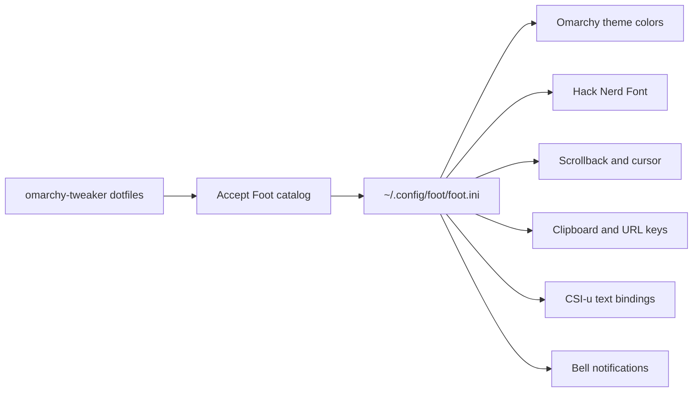

# Foot Dotfiles

This page is the practical usage guide for the Foot terminal configuration bundled with
Omarchy Tweaker. It explains what the linked config changes, how to use Foot day to day, and
how to verify or customize it safely.

For an explanation of the dotfile catalog system itself, see **[Dotfiles](dotfiles.md)**.

!!! note "Catalog scope"
    The `Foot` catalog only links the bundled configuration to `~/.config/foot/foot.ini`. It does
    not install Foot, fonts, `notify-send`, `xdg-open`, or an Omarchy theme. The catalog
    directory is named `Foot`, so that is the name shown in the dotfiles confirmation prompt.

---

## What this custom setup gives you

The bundled config keeps Foot consistent with the rest of an Omarchy desktop:

- Colors are imported from the current Omarchy theme instead of being frozen in the dotfile.
- `xterm-256color` keeps `TERM` broadly compatible with SSH and terminal applications.
- Hack Nerd Font supplies icons, with Noto Color Emoji as a fallback.
- Centered inner padding gives windows a more balanced text area.
- Extended scrollback, a relative scrollback indicator, and a blinking beam cursor.
- Mouse-driven selection and right-click primary paste.
- Keyboard clipboard copy/paste, live font resizing, and URL picking with `Ctrl+Shift+o`.
- CSI-u bindings that let `Shift+Return` and `Alt+Shift+Return` reach TUIs and tmux.
- Desktop notifications and urgency hints for bells without running a program on every bell.



---

## Requirements

| Tool | Used for |
|---|---|
| `foot` | The linked configuration itself. |
| Omarchy theme state | Provides `~/.local/state/omarchy/current/theme/foot.ini` through the `include`. |
| Hack Nerd Font | Primary font and Nerd Font icons. |
| Noto Color Emoji | Emoji fallback font. |
| `notify-send` | Desktop notifications for bells. |
| `xdg-open` | Opening URLs from URL mode. |

The configuration was validated with Foot `1.28.0`. Older releases may not support every
option, binding, or section used here.

---

## Install and verify

Run the dotfiles command and accept the `Foot` catalog:

```bash
omarchy-tweaker dotfiles
```

Check the link and Foot setup:

```bash
ls -l ~/.config/foot/foot.ini
foot --version
foot --check-config
```

You can also validate the bundled file before linking it:

```bash
foot --check-config -c src/omarchy_tweaker/dotfiles/Foot/config
```

If the command exits without an error, the config is syntactically valid. Open a new Foot
window to pick up the linked configuration, or restart terminals with:

```bash
omarchy restart terminal
```

---

## Linked files

| Bundled source | Destination | Purpose |
|---|---|---|
| `src/omarchy_tweaker/dotfiles/Foot/config` | `~/.config/foot/foot.ini` | Main Foot configuration. |
| `src/omarchy_tweaker/dotfiles/Foot/config.toml` | Not linked | Catalog manifest read by Omarchy Tweaker. |

Foot reads `~/.config/foot/foot.ini` by default. Use `-c PATH` or `FOOT_CONFIG=PATH` only when
you intentionally want to test another configuration file.

---

## What each section does

### `[main]`

| Option | Value | Effect |
|---|---|---|
| `include` | `~/.local/state/omarchy/current/theme/foot.ini` | Imports colors from the active Omarchy theme. |
| `term` | `xterm-256color` | Keeps `TERM` compatible across local and remote hosts. |
| `font` | `Hack Nerd Font:size=11.5, Noto Color Emoji:size=9` | Sets the primary font and emoji fallback. |
| `font-bold` | Hack Nerd Font bold | Uses a real bold face. |
| `font-italic` | Hack Nerd Font italic | Uses a real italic face. |
| `font-bold-italic` | Hack Nerd Font bold italic | Uses a real bold italic face. |
| `bold-text-in-bright` | `no` | Preserves theme accent colors for bold text. |
| `pad` | `14x14 center` | Adds padding and centers the text block. |
| `initial-window-mode` | `windowed` | Starts windows normally instead of maximized or fullscreen. |

To use Foot's full local feature set, change `term` to `foot`. Keep `xterm-256color` if you
regularly connect over SSH or rely on software that does not know Foot's terminfo entry.

### `[scrollback]`

| Option | Value | Effect |
|---|---|---|
| `lines` | `20000` | Keeps a long history for non-tmux windows. |
| `multiplier` | `5.0` | Allows deeper scrollback for a single long output line. |
| `indicator-position` | `relative` | Shows the scroll position where it applies. |
| `indicator-format` | `percentage` | Displays scrollback position as a percentage. |

### `[cursor]`, `[mouse]`, and `[mouse-bindings]`

| Option | Value | Effect |
|---|---|---|
| `style` | `beam` | Uses a thin vertical cursor. |
| `beam-thickness` | `1.5` | Slightly widens the beam for visibility. |
| `blink` | `yes` | Enables cursor blinking. |
| `blink-rate` | `600` | Blinks every 600 milliseconds. |
| `unfocused-style` | `hollow` | Makes an unfocused cursor an outline. |
| `hide-when-typing` | `yes` | Hides the pointer while typing. |
| `alternate-scroll-mode` | `yes` | Lets the wheel scroll alternate-screen applications such as `less` and `nvim`. |
| `select-begin` | `BTN_LEFT` | Starts selection with left drag. |
| `primary-paste` | `BTN_RIGHT` | Pastes the primary selection with right click. |

### `[url]` and `[key-bindings]`

| Shortcut | Action |
|---|---|
| `Ctrl+Shift+o` | Enters URL mode and labels visible links. |
| `Control+Insert` | Copies the selection to the clipboard. |
| `Control+Shift+c` | Copies the selection to the clipboard. |
| `XF86Copy` | Copies the selection using the keyboard copy key. |
| `Control+v` | Pastes from the clipboard. |
| `Control+Shift+v` | Pastes from the clipboard. |
| `XF86Paste` | Pastes using the keyboard paste key. |
| `Control+plus`, `Control+equal`, `Control+KP_Add` | Increases the font size. |
| `Control+minus`, `Control+KP_Subtract` | Decreases the font size. |
| `Control+0`, `Control+KP_0` | Resets the font size. |

URL mode uses `xdg-open ${url}` and the label letters `sadfjklewcmpgh`. Change
`label-letters` if you also bind `t` in `[url-bindings]`.

### `[text-bindings]`

| Sequence | Shortcut | Purpose |
|---|---|---|
| `\x1b[13;2u` | `Shift+Return` | Sends a distinct CSI-u sequence to TUIs. |
| `\x1b[13;4u` | `Alt+Shift+Return` | Sends a distinct CSI-u sequence that tmux can match as `M-S-Enter`. |

These bindings help applications tell modified Return presses apart from a plain Return. If a
TUI does not understand CSI-u, remove the corresponding binding from the catalog config.

### `[desktop-notifications]` and `[bell]`

| Option | Value | Effect |
|---|---|---|
| `inhibit-when-focused` | `yes` | Suppresses bell notifications while Foot has focus. |
| `command` | `notify-send ...` | Uses `notify-send` for OSC-99 and bell notifications. |
| `urgent` | `yes` | Marks the window urgent on bells when unfocused. |
| `notify` | `yes` | Emits a desktop notification on bells. |
| `command-focused` | `no` | Does not run the bell command while focused. |

The bell `command` is intentionally unset because it expects a program, not a Boolean. Do not
set it to `yes`; that would run the `yes` utility on every bell.

### `[tweak]`

`overflowing-glyphs=yes` lets wide Nerd Font icons render into one neighboring cell instead of
being clipped. Disable it if you notice spacing artifacts in applications that draw wide
characters manually.

---

## Customize safely

Edit the bundled catalog file when you want the change to be managed by Omarchy Tweaker:

```bash
src/omarchy_tweaker/dotfiles/Foot/config
```

Validate it before relinking:

```bash
foot --check-config -c src/omarchy_tweaker/dotfiles/Foot/config
```

If you edit the linked destination directly, remember that rerunning the `dotfiles` command
will replace it with the bundled version after creating a backup.

---

## Safety notes

- The catalog links configuration only; it installs no packages and edits no shell startup files.
- Existing destinations are backed up before replacement.
- Theme colors come from Omarchy state, so changing the Omarchy theme changes Foot too.
- `clipboard-paste=Control+v` can conflict with applications that expect `Ctrl+v` themselves; use a TUI's own paste binding when needed.
- URL mode runs `xdg-open` on links you choose; only activate links you trust.
- Bell `command` is a program, not a yes/no switch; leave it unset unless you provide a real command.

---

## Troubleshooting

| Symptom | Fix |
|---|---|
| Colors do not match the Omarchy theme | Check `~/.local/state/omarchy/current/theme/foot.ini` and reapply or refresh the theme. |
| Foot reports an invalid config | Run `foot --check-config` and check the most recently changed section. |
| Nerd Font icons appear as boxes | Install Hack Nerd Font or change the `font` entries to an installed Nerd Font. |
| Emoji render poorly | Confirm Noto Color Emoji is installed or adjust the fallback font. |
| `Ctrl+v` pastes instead of reaching an app | Use the application's own paste binding or remove `Control+v` from `clipboard-paste`. |
| Right click does not paste | Check the mouse selection and ensure a primary selection exists. |
| `Shift+Return` behaves like `Return` | Confirm the TUI supports CSI-u, or remove the `[text-bindings]` entries. |
| Bell runs an unexpected command | Check the `[bell] command` option; it must be empty or a valid program. |
| Config changes are ignored | Open a new Foot window or run `omarchy restart terminal`. |
| Config file is not a symlink | Rerun `omarchy-tweaker dotfiles`; check the backup created before replacement. |

---

## Related pages

- [Dotfiles](dotfiles.md)
- [Bat Dotfiles](bat.md)
- [Git Dotfiles](git.md)
- [Lazygit Dotfiles](lazygit.md)
- [Tig Dotfiles](tig.md)
- [Tmux Dotfiles](tmux.md)
- [Starship Dotfiles](starship.md)
- [Superfile Dotfiles](superfile.md)
- [Zellij Dotfiles](zellij.md)
- [Commands](commands.md)
- [Security](security.md)
- [Troubleshooting](troubleshooting.md)
