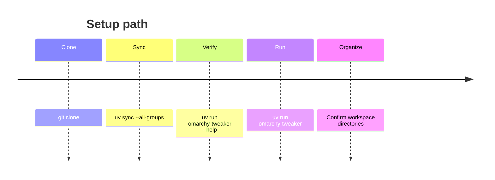
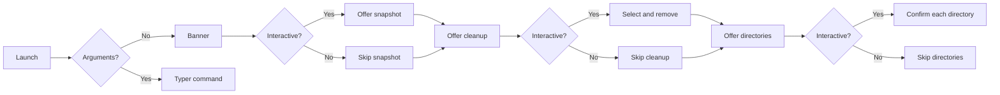

# Getting Started

This page covers requirements, installation, the first run, and where to find logs. The
**[Commands](commands.md)** page is the canonical reference for options, exit codes, and
non-interactive behavior.

Omarchy Tweaker is a terminal application for **Omarchy Linux** only. It is not a
general-purpose Linux administration tool and is not tested on other distributions.

---

## Requirements

| Requirement | Why it matters |
|:--|:--|
| **Omarchy Linux** | The application relies on Omarchy commands, paths, and conventions. |
| **Python 3.13+** | The project targets Python 3.13 and uses modern typing syntax. |
| **uv** | The supported way to install dependencies, run tasks, and build the project. |
| **`omarchy` on `PATH`** | Snapshot and cleanup delegate work to Omarchy commands. |
| **`pacman`** | Package installation uses Pacman directly; cleanup checks installed packages. |
| **`yay`** | Package installation uses `yay` for the AUR group. |
| **Writable home directory** | Directory setup creates fixed workspace folders beneath `$HOME`. |
| **Interactive terminal** | Snapshot confirmation, cleanup selection, package selection, and directory creation use TTY prompts. |
| **Nerd Font** *(recommended)* | The UI uses Nerd Font glyphs for icons. |

!!! warning "Omarchy only"
    Do not install or run Omarchy Tweaker on standard Arch Linux, Ubuntu, Debian, Fedora,
    macOS, or Windows. Some Python code may run, but the application's system operations
    are designed around Omarchy.

### Optional system tools

- `lspci` — used by the welcome screen to identify a GPU. Missing `lspci` only produces an
  `Unknown` GPU value.
- `snapper` and Omarchy's snapshot configuration — required for `omarchy snapshot create`
  to succeed.
- `sudo` — package installation and removal may prompt for elevated privileges.

---

## Install

The project is currently installed from a checkout. This is the recommended path while the
application is in early development.

| Method | Command | Use it when |
|:--|:--|:--|
| Checkout | `uv sync --all-groups` | You are developing or testing the repository. |
| Global tool | `uv tool install .` | You want `omarchy-tweaker` outside the checkout. |
| Editable tool | `uv tool install --editable .` | You want global commands while editing source. |

```bash
git clone https://github.com/Armoghans-Organization/Omarchy-Tweaker.git
cd Omarchy-Tweaker
uv sync --all-groups
uv run omarchy-tweaker --help
```

The console entry point is `omarchy-tweaker`, backed by
`omarchy_tweaker_bootstrap:main`.

---

### Setup at a glance



## First run

Run the application without arguments:

```bash
uv run omarchy-tweaker
```



The default sequence is:

1. **Banner** — clears the screen and shows the application banner.
2. **Snapshot** — asks whether to create a system snapshot with
   `omarchy snapshot create`.
3. **Cleanup** — discovers installed Omarchy cleanup targets and asks what to remove.
4. **Directories** — asks whether to create each missing workspace folder.

Every step can be skipped. If the terminal is not interactive, the snapshot, cleanup, and
directory steps skip safely instead of guessing. See **[Commands](commands.md)** for
per-command rules.

Package installation is standalone: run `omarchy-tweaker packages` when you want to install
from the fixed Pacman and AUR catalog. It is not part of the default sequence.

### Explore commands

```bash
uv run omarchy-tweaker --help
uv run omarchy-tweaker welcome
uv run omarchy-tweaker snapshot --help
uv run omarchy-tweaker cleanup --help
uv run omarchy-tweaker directories --help
uv run omarchy-tweaker packages --help
```

The `welcome` command shows the banner plus a system overview containing OS, kernel,
desktop, CPU, GPU, memory, disk, uptime, and hostname details.

!!! note "Before removing anything"
    Cleanup is permanent. Review **[Cleanup](cleanup.md)** and the
    **[Security Policy](security.md)** before confirming removal.

---

## Logs

Each invocation writes a structured log file. The default location is:

```text
$XDG_STATE_HOME/omarchy_tweaker/logs/omarchy_tweaker_<timestamp>.log
```

If `XDG_STATE_HOME` is unset, the fallback is:

```text
~/.local/state/omarchy_tweaker/logs/omarchy_tweaker_<timestamp>.log
```

Override the directory when needed:

```bash
OMARCHY_TWEAKER_LOG_DIR=/tmp/omarchy-tweaker-logs uv run omarchy-tweaker welcome
```

Each log contains application metadata, system details, timestamped records, and a
shutdown report. Logs are written to a file, not the terminal, so normal output stays
clean. See **[Architecture](architecture.md)** for logging internals.

---

## Next steps

- [Commands](commands.md) — full CLI reference.
- [Cleanup](cleanup.md) — discovery and removal details.
- [Directories](directories.md) — workspace folder targets and safety rules.
- [Packages](packages.md) — package catalog and installation workflow.
- [Architecture](architecture.md) — how the application works internally.
- [Troubleshooting](troubleshooting.md) — common problems and fixes.
