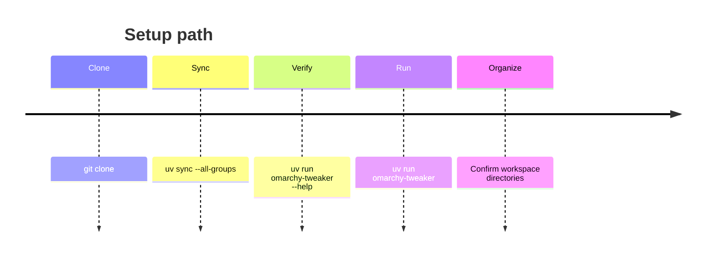
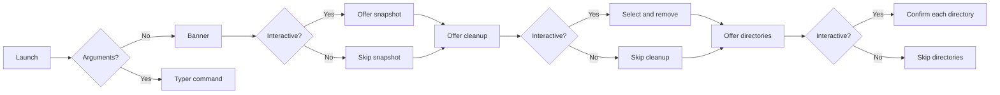

# Getting Started

This page covers requirements, installation, the first run, and where to find logs. The
**[Commands](commands.md)** page is the canonical reference for options, exit codes, and
non-interactive behavior.

Omarchy Tweaker is a terminal application for **Omarchy Linux** only. It is not a
general-purpose Linux administration tool and is not tested on other distributions.

---

## Requirements

| Requirement | Why it matters |
|:--|:--|
| **Omarchy Linux** | The application relies on Omarchy commands, paths, and conventions. |
| **Python 3.13+** | The project targets Python 3.13 and uses modern typing syntax. |
| **uv** | The supported way to install dependencies, run tasks, and build the project. |
| **`omarchy` on `PATH`** | Snapshot and cleanup delegate work to Omarchy commands. |
| **`pacman`** | Package installation uses Pacman directly; cleanup checks installed packages. |
| **`yay`** | Package installation uses `yay` for the AUR group. |
| **`git`** | Plugin installation clones repositories through `omarchy plugin add`. |
| **`ssh-keygen`** | Dotfile setup creates SSH keys when configured. |
| **`gpg`** | Dotfile setup creates GPG signing keys and exports the public key. |
| **`bash` and `gum`** | Bundled plugin patch scripts use Bash and Gum; the global Git hook optionally uses Gum. |
| **`sudo`** | Package installation/removal and shell config installation use elevated privileges. |
| **Writable home directory** | Directory setup creates fixed workspace folders beneath `$HOME`. |
| **Interactive terminal** | Snapshot confirmation, cleanup selection, package and plugin selection, and directory creation use TTY prompts. |
| **Nerd Font** *(recommended)* | The UI uses Nerd Font glyphs for icons. |

!!! warning "Omarchy only"
    Do not install or run Omarchy Tweaker on standard Arch Linux, Ubuntu, Debian, Fedora,
    macOS, or Windows. Some Python code may run, but the application's system operations
    are designed around Omarchy.

### Optional system tools

- `lspci` — used by the welcome screen to identify a GPU. Missing `lspci` only produces an
  `Unknown` GPU value.
- `snapper` and Omarchy's snapshot configuration — required for `omarchy snapshot create`
  to succeed.

---

## Install

The project is currently installed from a checkout. This is the recommended path while the
application is in early development.

| Method | Command | Use it when |
|:--|:--|:--|
| Checkout | `uv sync --all-groups` | You are developing or testing the repository. |
| Global tool | `uv tool install .` | You want `omarchy-tweaker` outside the checkout. |
| Editable tool | `uv tool install --editable .` | You want global commands while editing source. |

```bash
git clone https://github.com/Armoghans-Organization/Omarchy-Tweaker.git
cd Omarchy-Tweaker
uv sync --all-groups
uv run omarchy-tweaker --help
```

The console entry point is `omarchy-tweaker`, backed by
`omarchy_tweaker_bootstrap:main`.

---

### Setup at a glance



## First run

Run the application without arguments:

```bash
uv run omarchy-tweaker
```



The default sequence is:

1. **Banner** — clears the screen and shows the application banner.
2. **Snapshot** — asks whether to create a system snapshot with
   `omarchy snapshot create`.
3. **Cleanup** — discovers installed Omarchy cleanup targets and asks what to remove.
4. **Directories** — asks whether to create each missing workspace folder.
5. **Dotfiles** — links bundled dotfiles, prepares SSH and GPG keys, and renders Git identity.
6. **Packages** — offers the fixed Pacman and AUR package groups.
7. **Containers** — offers the fixed Docker Compose catalog and prepares selected projects.
8. **Plugins** — offers the fixed Omarchy shell plugin catalog and installs the bundled
   shell configuration after successful installation.
9. **Hyprland** — links the bundled Lua configuration and loads the workspaces module.
10. **Bundled Scripts** — makes the bundled helper scripts executable and links them into
   `~/.local/bin/`.

Every step can be skipped. If the terminal is not interactive, interactive steps skip
safely instead of guessing. See **[Commands](commands.md)** for per-command rules.

Dotfile, package, container, plugin, Hyprland, and script setup also run in the default
sequence. Run `omarchy-tweaker dotfiles`, `omarchy-tweaker packages`,
`omarchy-tweaker containers`, `omarchy-tweaker plugins`, `omarchy-tweaker hypr`, or
`omarchy-tweaker scripts` directly when you want one feature without the earlier steps.

### Explore commands

```bash
uv run omarchy-tweaker --help
uv run omarchy-tweaker welcome
uv run omarchy-tweaker snapshot --help
uv run omarchy-tweaker cleanup --help
uv run omarchy-tweaker directories --help
uv run omarchy-tweaker dotfiles --help
uv run omarchy-tweaker packages --help
uv run omarchy-tweaker containers --help
uv run omarchy-tweaker plugins --help
uv run omarchy-tweaker hypr --help
uv run omarchy-tweaker scripts --help
```

The `welcome` command shows the banner plus a system overview containing OS, kernel,
desktop, CPU, GPU, memory, disk, uptime, and hostname details.

!!! note "Before removing or replacing anything"
    Cleanup is permanent, and the Hyprland and Bundled Scripts steps replace matching files
    with symlinks without creating backups. Dotfile setup backs up existing files before
    replacement. Review **[Cleanup](cleanup.md)**, **[Dotfiles](dotfiles.md)**,
    **[Hyprland](hypr.md)**, **[Bundled Scripts](scripts.md)**, and the
    **[Security Policy](security.md)** before confirming.

---

## Logs

Each invocation writes a structured log file. The default location is:

```text
$XDG_STATE_HOME/omarchy_tweaker/logs/omarchy_tweaker_<timestamp>.log
```

If `XDG_STATE_HOME` is unset, the fallback is:

```text
~/.local/state/omarchy_tweaker/logs/omarchy_tweaker_<timestamp>.log
```

Override the directory when needed:

```bash
OMARCHY_TWEAKER_LOG_DIR=/tmp/omarchy-tweaker-logs uv run omarchy-tweaker welcome
```

Each log contains application metadata, system details, timestamped records, and a
shutdown report. Logs are written to a file, not the terminal, so normal output stays
clean. See **[Architecture](architecture.md)** for logging internals.

---

## Next steps

- [Commands](commands.md) — full CLI reference.
- [Cleanup](cleanup.md) — discovery and removal details.
- [Directories](directories.md) — workspace folder targets and safety rules.
- [Dotfiles](dotfiles.md) — catalog format, keys, and backups.
- [Bat Dotfiles](bat.md) — syntax highlighting, pager behavior, and customization.
- [Git Dotfiles](git.md) — Git usage examples, GitHub setup, and cheat sheets.
- [Lazygit Dotfiles](lazygit.md) — TUI config, keybindings, and custom commands.
- [Tig Dotfiles](tig.md) — text-mode Git interface, Delta/Meld actions, and keybindings.
- [Tmux Dotfiles](tmux.md) — multiplexer config, mode keybindings, helper scripts, and TPM plugins.
- [Starship Dotfiles](starship.md) — prompt usage, module cheat sheets, and customization.
- [Superfile Dotfiles](superfile.md) — file manager config, hotkeys, theme, and integrations.
- [Zellij Dotfiles](zellij.md) — multiplexer config, keybindings, layouts, plugins, and zextract.
- [Packages](packages.md) — package catalog and installation workflow.
- [Plugins](plugins.md) — shell plugin catalog, placement, and patch workflow.
- [Hyprland](hypr.md) — bundled Lua files, symlinks, and workspaces loading.
- [Bundled Scripts](scripts.md) — script catalog, permissions, and PATH links.
- [Architecture](architecture.md) — how the application works internally.
- [Troubleshooting](troubleshooting.md) — common problems and fixes.
