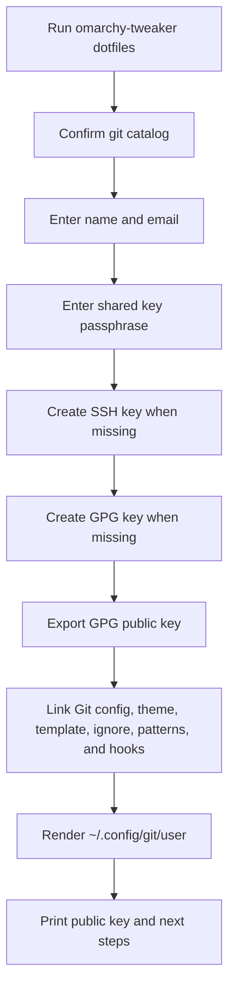

# Git Dotfiles

This page is the practical usage guide for the custom Git configuration bundled with
Omarchy Tweaker. It explains what the custom setup does, how to use it day to day, and how
to inspect or change each part.

For an explanation of the dotfile catalog system itself, see **[Dotfiles](dotfiles.md)**.

---

## What this custom setup gives you

The `git` catalog installs a complete Git environment that is:

- Signed by default with your GPG key.
- Based on Conventional Commits.
- Integrated with Neovim, Delta, and Meld.
- Complemented by the bundled lazygit and Tig catalogs for terminal UI workflows.
- Configured for clean rebases, remote-tracking branches, and conflict reuse.
- Protected by a global pre-commit safety hook.
- Ready for GitHub over SSH with URL shortcuts.
- Ready for Git LFS repositories.

```bash
omarchy-tweaker dotfiles
```

---

## Quick start

Run the dotfile command and accept the Git catalog:

```bash
omarchy-tweaker dotfiles
```

You will be asked to:

1. Confirm applying the `git` catalog.
2. Enter your name.
3. Enter your email address.
4. Enter and confirm one passphrase for SSH and GPG keys.

Then verify the result:

```bash
git config --show-origin --list
git config --get user.name
git config --get user.email
git config --get user.signingkey
git config --get core.hooksPath
```

---

## First-run flow



Existing private keys are never regenerated. If a private key exists but its public key is
missing, the public key is derived from the private key using the passphrase you provide.

---

## What gets installed

| Bundled source | Destination | What it does |
|:--|:--|:--|
| `config` | `~/.config/git/config` | Main Git configuration: identity includes, signing, editor, Delta, diff, merge, fetch, LFS, and GitHub URL shortcuts. |
| `catppuccin` | `~/.config/git/catppuccin.gitconfig` | Catppuccin Delta themes for Latte, Frappé, Macchiato, and Mocha. |
| `gitmessage` | `~/.config/git/gitmessage` | Conventional Commit template used by `commit.template`. |
| `ignore` | `~/.config/git/ignore` | Global ignore rules used by `core.excludesFile`. |
| `secret-patterns` | `~/.config/git/secret-patterns` | Extra extended-regex patterns used by the global pre-commit hook. |
| `hooks/` | `~/.config/git/hooks` | Global hooks directory used by `core.hooksPath`. |
| `user` | `~/.config/git/user` | Rendered identity: name, email, and GPG signing key. |

Key outputs:

| Item | Default destination |
|:--|:--|
| SSH private key | `~/.ssh/id_ed25519` |
| SSH public key | `~/.ssh/id_ed25519.pub` |
| GPG home | `~/.gnupg` |
| GPG public export | `~/.config/git/gpg-public-key.asc` |

All destinations come from:

```text
src/omarchy_tweaker/dotfiles/git/config.toml
```

---

## What the custom configuration does

### Identity and signing

| Setting | Value | Effect |
|:--|:--|:--|
| `[include] path` | `~/.config/git/user` | Loads your rendered name, email, and signing key. |
| `[include] path` | `~/.config/git/catppuccin.gitconfig` | Loads Catppuccin Delta palettes. |
| `[gpg] program` | `/usr/bin/gpg` | Tells Git which GPG binary to use. |
| `[commit] gpgSign` | `true` | Every commit is signed by default. |
| `[commit] template` | `~/.config/git/gitmessage` | Opens commits with the Conventional Commit template. |
| `[commit] verbose` | `true` | Shows the full diff in the commit message editor. |
| `[tag] gpgSign` | `true` | Annotated tags are signed by default. |
| `[tag] sort` | `version:refname` | Tag listings sort naturally by version. |

### Editor and display

| Setting | Value | Effect |
|:--|:--|:--|
| `[core] editor` | `nvim` | Uses Neovim for commit messages. |
| `[sequence] editor` | `nvim` | Uses Neovim for interactive rebase todo lists. |
| `[core] pager` | `delta` | Uses Delta for styled diffs and logs. |
| `[interactive] diffFilter` | `delta --color-only` | Adds Delta colors to interactive add. |
| `[interactive] singleKey` | `true` | Allows single-key commands in interactive add. |
| `[delta] features` | `Catppuccin Macchiato` | Selects the Catppuccin Macchiato Delta theme. |
| `[delta] syntax-theme` | `Catppuccin Mocha` | Uses Catppuccin Mocha syntax highlighting. |
| `[delta] navigate` | `true` | Enables keyboard navigation in Delta. |
| `[delta] side-by-side` | `true` | Shows diffs in two columns. |
| `[delta] line-numbers` | `true` | Shows line numbers in Delta output. |
| `[delta] dark` | `true` | Uses dark-mode colors. |
| `[delta] hyperlinks` | `true` | Renders clickable file links where supported. |
| `[format] pretty` | Custom format | Provides a detailed commit format with author, dates, committer, tree, parent, GPG status, key, and refs. |

### Diff, merge, and conflict handling

| Setting | Value | Effect |
|:--|:--|:--|
| `[diff] algorithm` | `histogram` | Produces more readable diffs than the default algorithm. |
| `[diff] colorMoved` | `default` | Highlights moved lines. |
| `[diff] mnemonicPrefix` | `true` | Uses meaningful `c/`, `i/`, `w/`, and `o/` diff prefixes. |
| `[diff] renames` | `true` | Detects renamed files. |
| `[diff] context` | `5` | Shows more surrounding lines in diffs. |
| `[diff] wordDiff` | `color` | Highlights changed words inside changed lines. |
| `[difftool] prompt` | `false` | Opens difftools without an extra confirmation prompt. |
| `[merge] conflictStyle` | `zdiff3` | Shows common conflict context to make manual merges easier. |
| `[merge] tool` | `meld` | Uses Meld as the default merge tool. |
| `[mergetool] prompt` | `false` | Starts Meld without an extra confirmation prompt. |
| `[mergetool] keepBackup` | `false` | Avoids leaving `*.orig` conflict backup files. |
| `[mergetool "meld"] cmd` | Custom Meld command | Opens local, base, and remote versions and writes the merged result. |
| `[mergetool "meld"] trustExitCode` | `true` | Trusts Meld's exit status to decide whether the merge succeeded. |
| `[rerere] enabled` | `true` | Remembers how conflicts were resolved. |
| `[rerere] autoupdate` | `true` | Stages recorded conflict resolutions automatically. |

### Branch, rebase, fetch, and push workflow

| Setting | Value | Effect |
|:--|:--|:--|
| `[init] defaultBranch` | `main` | New repositories start on `main`. |
| `[core] autocrlf` | `input` | Normalizes line endings on commit without converting checkouts. |
| `[core] whitespace` | `trailing-space,space-before-tab` | Flags common whitespace problems. |
| `[pull] rebase` | `true` | Rebases local commits when pulling instead of creating merge commits. |
| `[push] default` | `simple` | Pushes only the current branch to its matching upstream. |
| `[push] autoSetupRemote` | `true` | Automatically sets upstream on first push. |
| `[branch] sort` | `-committerdate` | Sorts branches by most recent commit. |
| `[checkout] guess` | `true` | Guesses remote branches when checking out local names. |
| `[checkout] defaultRemote` | `origin` | Uses `origin` as the default remote. |
| `[rebase] autoStash` | `true` | Stashes and restores changes before rebasing. |
| `[rebase] autoSquash` | `true` | Automatically enables `fixup`/`squash` behavior. |
| `[rebase] updateRefs` | `true` | Moves branch refs during rebase in modern Git versions. |
| `[fetch] prune` | `true` | Removes stale remote-tracking branches when fetching. |
| `[fetch] writeCommitGraph` | `true` | Improves log and branch performance in large repositories. |

### Status, log, grep, and security

| Setting | Value | Effect |
|:--|:--|:--|
| `[status] branch` | `true` | Shows branch information in `git status`. |
| `[status] showUntrackedFiles` | `all` | Shows every untracked file instead of collapsing untracked directories. |
| `[log] date` | `iso` | Uses ISO-style dates in logs. |
| `[log] decorate` | `short` | Shows short branch and tag decorations. |
| `[log] follow` | `true` | Follows file history through renames. |
| `[grep] lineNumber` | `true` | Shows line numbers in `git grep` output. |
| `[grep] patternType` | `extended` | Uses extended regular expressions for grep patterns. |
| `[http] sslVerify` | `true` | Keeps TLS certificate verification enabled. |
| `[core] excludesFile` | `~/.config/git/ignore` | Uses the bundled global ignore file. |
| `[core] hooksPath` | `~/.config/git/hooks` | Uses the bundled global hooks directory. |

### Git LFS and GitHub shortcuts

| Setting | Value | Effect |
|:--|:--|:--|
| `[filter "lfs"] clean` | `git-lfs clean -- %f` | Cleans LFS-tracked files before commit. |
| `[filter "lfs"] smudge` | `git-lfs smudge -- %f` | Restores LFS file contents in the working tree. |
| `[filter "lfs"] process` | `git-lfs filter-process` | Uses the efficient LFS filter process. |
| `[filter "lfs"] required` | `true` | Fails clearly when Git LFS is required but unavailable. |
| `[url "https://github.com/"] insteadOf` | `github:`, `gh:` | Expands short HTTPS GitHub URLs. |
| `[url "git@github.com:"] insteadOf` | `ghssh:` | Expands short SSH GitHub URLs. |

---

## Custom configuration cheat sheet

### Inspect the active setup

| Task | Command |
|:--|:--|
| Show all config with file origins | `git config --show-origin --list` |
| Show the main config file | `git config --show-origin --get user.name` |
| Show the commit template | `git config --get commit.template` |
| Show the global ignore file | `git config --get core.excludesFile` |
| Show the hooks path | `git config --get core.hooksPath` |
| Show the default branch | `git config --get init.defaultBranch` |
| Show the pager | `git config --get core.pager` |
| Show the merge tool | `git config --get merge.tool` |
| Show the pull strategy | `git config --get pull.rebase` |
| Show the push strategy | `git config --get push.default` |
| Show LFS filter status | `git config --get-regexp '^filter\.lfs\.'` |
| Show GitHub rewrites | `git config --get-regexp '^url\.'` |

### Signing and key commands

| Task | Command |
|:--|:--|
| Show SSH public key | `cat ~/.ssh/id_ed25519.pub` |
| Show SSH key fingerprint | `ssh-keygen -lf ~/.ssh/id_ed25519.pub` |
| Test GitHub SSH auth | `ssh -T git@github.com` |
| List GPG secret keys | `gpg --homedir ~/.gnupg --list-secret-keys --keyid-format LONG` |
| Show GPG public export | `cat ~/.config/git/gpg-public-key.asc` |
| Show effective signing key | `git config --get user.signingkey` |
| Sign one commit manually | `git commit -S -m "message"` |
| Verify latest signature | `git log --show-signature -1` |
| Sign a tag | `git tag -s v1.0.0 -m "release"` |

!!! note "Signing is already the default"
    `commit.gpgSign = true` and `tag.gpgSign = true`, so normal commits and annotated tags
    are signed without `-S`.

### Commit template cheat sheet

The bundled template follows Conventional Commits:

```text
<type>(<scope>): <short summary>
```

| Type | Use for |
|:--|:--|
| `feat` | New features |
| `fix` | Bug fixes |
| `docs` | Documentation-only changes |
| `style` | Formatting or whitespace only |
| `refactor` | Code changes that are neither features nor fixes |
| `perf` | Performance improvements |
| `test` | Adding or correcting tests |
| `build` | Build system or dependency changes |
| `ci` | CI configuration and scripts |
| `chore` | Maintenance tasks |
| `revert` | Reverting previous changes |

Examples:

```text
feat(dotfiles): add Git usage guide
fix(hooks): handle missing custom patterns
docs(readme): update installation steps
```

Rules:

- Use imperative mood: `add`, not `added` or `adds`.
- Keep the summary around 50 characters or fewer.
- Do not end the summary with a period.
- Wrap the body at 72 characters.
- Use footers for breaking changes or issue references.

### GitHub URL shortcut cheat sheet

| Short form | Expands to |
|:--|:--|
| `github:owner/repo` | `https://github.com/owner/repo` |
| `gh:owner/repo` | `https://github.com/owner/repo` |
| `ghssh:owner/repo` | `git@github.com:owner/repo` |

Examples:

```bash
git clone gh:Armoghans-Organization/Omarchy-Tweaker
git clone github:Armoghans-Organization/Omarchy-Tweaker
git clone ghssh:Armoghans-Organization/Omarchy-Tweaker
```

### Global ignore cheat sheet

| Task | Command |
|:--|:--|
| Show ignore file path | `git config --get core.excludesFile` |
| Check why a file is ignored | `git check-ignore -v .env` |
| Edit global ignore rules | `nvim ~/.config/git/ignore` |

The bundled ignore file covers common OS files, editor state, caches, environment files,
credentials, build output, container state, and AI-tool state.

### Delta cheat sheet

| Task | Command |
|:--|:--|
| Preview a styled diff | `git diff` |
| Pipe a diff through Delta | `git diff | delta` |
| Use interactive add with Delta colors | `git add -p` |
| Show Delta version | `delta --version` |
| Temporarily disable side-by-side diff | `git -c delta.side-by-side=false diff` |

Theme settings live in `~/.config/git/config` and `~/.config/git/catppuccin.gitconfig`.

### Merge and rebase cheat sheet

| Task | Command |
|:--|:--|
| Rebase onto the current branch | `git fetch && git rebase` |
| Continue after resolving conflicts | `git add . && git rebase --continue` |
| Start Meld manually | `git mergetool` |
| Inspect remembered conflict resolutions | `git rerere status` |
| Forget a remembered resolution | `git rerere forget <file>` |
| Rebase with local changes safely | `git rebase ...` — `rebase.autoStash = true` handles the stash |
| Create a fixup commit for autosquash | `git commit --fixup <commit>` |

### Fetch, branch, and cleanup cheat sheet

| Task | Command |
|:--|:--|
| Fetch and prune stale branches | `git fetch --prune` |
| List branches by recent commit | `git branch --sort=-committerdate` |
| Show decorated log | `git log --oneline --decorate` |
| Follow file history | `git log --follow -- path/to/file` |
| Search with extended regex | `git grep -E 'pattern|other'` |
| Rewrite a Git URL for one command | `git -c url."git@github.com:".insteadOf=gh: clone gh:owner/repo` |

---

## GitHub setup

### Add the SSH key

1. Copy the SSH public key:

   ```bash
   cat ~/.ssh/id_ed25519.pub
   ```

2. Open GitHub → **Settings** → **SSH and GPG keys**.
3. Select **New SSH key**.
4. Paste the public key and save it.

Test the connection:

```bash
ssh -T git@github.com
```

### Add the GPG key

1. Copy the ASCII-armored public key:

   ```bash
   cat ~/.config/git/gpg-public-key.asc
   ```

2. Open GitHub → **Settings** → **SSH and GPG keys**.
3. Select **New GPG key**.
4. Paste the full exported block and save it.

Verify signed commits locally:

```bash
git commit -S -m "test: verify signed commit"
git log --show-signature -1
```

Because `commit.gpgSign = true`, the explicit `-S` is optional for normal commits.

---

## Verify the setup

### Show active configuration and origins

```bash
git config --show-origin --list
```

This confirms that Git is reading `~/.config/git/config` and its included files.

### Check identity and signing

```bash
git config --get user.name
git config --get user.email
git config --get user.signingkey
git config --get commit.gpgSign
git config --get tag.gpgSign
```

Expected values:

- `user.name` — the name you entered.
- `user.email` — the email you entered.
- `user.signingkey` — the generated or existing GPG fingerprint.
- `commit.gpgSign` — `true`.
- `tag.gpgSign` — `true`.

### Check tools and hooks

```bash
command -v nvim
command -v delta
command -v meld
command -v git-lfs

git config --get core.hooksPath
ls -l ~/.config/git/hooks/pre-commit
```

The pre-commit hook must be executable. The bundled file ships with mode `755`.

---

## Global pre-commit hook

The hook checks staged files for:

- Files larger than `MAX_FILE_SIZE_MB`, default `5`.
- Sensitive filenames such as `.env`, private keys, and credential files.
- Conflict markers.
- Private key headers, provider tokens, passwords, API keys, and custom patterns.
- Repository-local `.git/hooks/pre-commit` hooks, when present.

Run it directly for inspection:

```bash
~/.config/git/hooks/pre-commit
```

Review staged content with:

```bash
git diff --cached
```

### Hook variables

| Variable | Default | Purpose |
|:--|:--|:--|
| `CHAIN_MODE` | `global-then-local` | Set to `local-first` to run the repository hook first. |
| `MAX_FILE_SIZE_MB` | `5` | Maximum staged file size before blocking or warning. |
| `BLOCK_LARGE_FILES` | `1` | `1` blocks large files; `0` warns only. |
| `CUSTOM_PATTERNS` | Derived from `core.hooksPath` | Extra extended-regex pattern file. Defaults to `~/.config/git/secret-patterns`. |

Examples:

```bash
BLOCK_LARGE_FILES=0 git commit
MAX_FILE_SIZE_MB=2 git commit
CUSTOM_PATTERNS=~/.config/git/secret-patterns git commit
```

Custom pattern rules:

- One extended regular expression per line.
- Lines beginning with `#` are comments.
- Blank lines are ignored.

Add a pattern:

```bash
printf 'my_company_token_[A-Za-z0-9]{24,}\n' >> ~/.config/git/secret-patterns
```

---

## Backups and restore

Existing destinations are renamed before replacement:

```text
<name>.bak.<YYYYMMDD-HHMMSS>
```

A PID and counter are added if the same timestamp already exists.

List backups:

```bash
ls -la ~/.config/git
```

Restore the newest backup manually:

```bash
backup="$(ls -t ~/.config/git/config.bak.* | head -n 1)"
cp "$backup" ~/.config/git/config
```

If symlink or template creation fails, the command tries to restore the backup automatically.

---

## Customize the Git catalog

The catalog is controlled by:

```text
src/omarchy_tweaker/dotfiles/git/config.toml
```

```toml
[symlink]
config = "~/.config/git/config"
catppuccin = "~/.config/git/catppuccin.gitconfig"
gitmessage = "~/.config/git/gitmessage"
ignore = "~/.config/git/ignore"
secret-patterns = "~/.config/git/secret-patterns"
hooks = "~/.config/git/hooks"

[ask]
Name = "What is your name?"
Email = "What is your email?"

[create]
user = "~/.config/git/user"

[keys]
ssh_private = "~/.ssh/id_ed25519"
ssh_public = "~/.ssh/id_ed25519.pub"
gpg_home = "~/.gnupg"
gpg_public = "~/.config/git/gpg-public-key.asc"
ssh_type = "ed25519"
ssh_rounds = 100
gpg_algorithm = "ed25519"
gpg_usage = "sign"
gpg_expiration = "never"
```

Rules:

- `[symlink]` maps bundled source names to destinations under `~/`.
- `[ask]` keys are normalized to lowercase and become template values.
- `[create]` maps bundled templates to rendered destinations under `~/`.
- `[keys]` requires `name` and `email` answers.
- Every path must start with `~/` and stay inside the home directory.

### Template placeholders

| Placeholder | Source |
|:--|:--|
| `{name}` | Answer from `[ask].Name`. |
| `{email}` | Answer from `[ask].Email`. |
| `{signing_key}` | GPG fingerprint discovered or generated by key setup. |

The bundled template is:

```ini
[user]
    name = {name}
    email = {email}
    signingkey = {signing_key}
```

!!! note "Prefer re-running the command"
    Editing `~/.config/git/user` works immediately, but rerunning `omarchy-tweaker dotfiles`
    regenerates it from your answers. Change the bundled template or `config.toml` for a
    permanent structural change.

---

## Troubleshooting

| Symptom | Check |
|:--|:--|
| Git still reads `~/.gitconfig` | Run `git config --show-origin --list`; remove or merge conflicting user-level settings. |
| `user.signingkey` is empty | Check `gpg --homedir ~/.gnupg --list-secret-keys` and rerun the command. |
| Commit signing fails | Confirm the GPG key was added to GitHub and the email matches the key identity. |
| SSH clone asks for a password | Confirm the public key is on GitHub and run `ssh -T git@github.com`. |
| `gh:` shortcut does not work | Run `git config --get-regexp '^url\.'`. |
| `delta` is not found | Install Delta or change `core.pager`. |
| `meld` is not found | Install Meld or change `merge.tool`. |
| `git-lfs` is not found | Install Git LFS; `filter.lfs.required = true` makes this fail clearly. |
| Hook does not run | Check `git config --get core.hooksPath` and that `pre-commit` is executable. |
| Hook cannot find custom patterns | Check `git config --path --get core.hooksPath` and `~/.config/git/secret-patterns`. |
| Template placeholders are literal | Ensure the bundled template uses `{name}`, `{email}`, and `{signing_key}`. |
| Command skipped immediately | The dotfiles command requires an interactive terminal. |

If the hook blocks a commit, fix the reported file or pattern. Avoid bypassing it unless you
understand exactly what is being committed.

---

## Safety notes

- Private keys are never printed or uploaded.
- Public keys and the fingerprint are printed for GitHub setup.
- Existing private keys are reused, never regenerated.
- Existing destination files are backed up before replacement.
- TLS verification remains enabled through `http.sslVerify = true`.
- The hook is a guardrail, not a guarantee; still review staged content with `git diff --cached`.

---

## Related pages

- [Dotfiles](dotfiles.md)
- [Lazygit Dotfiles](lazygit.md)
- [Tig Dotfiles](tig.md)
- [Starship Dotfiles](starship.md)
- [Superfile Dotfiles](superfile.md)
- [Zellij Dotfiles](zellij.md)
- [Commands](commands.md)
- [Security](security.md)
- [Troubleshooting](troubleshooting.md)
