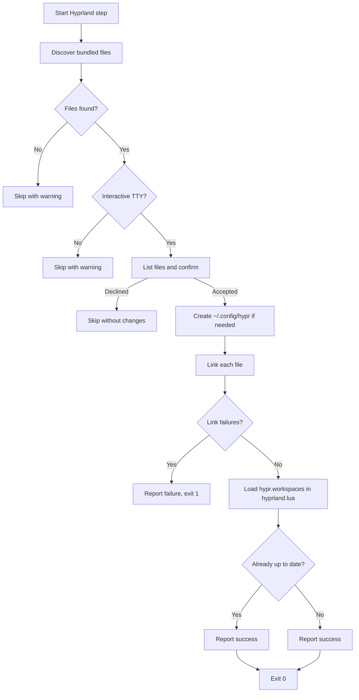

# Hyprland

The Hyprland step applies the bundled Lua configuration from
`src/omarchy_tweaker/hypr/` to `~/.config/hypr/`. It links each bundled file into place and
makes sure `hyprland.lua` loads the workspaces module.

```bash
omarchy-tweaker hypr
```

The default workflow runs this step last:

```bash
omarchy-tweaker
```

---

## Bundled files

| File | Purpose |
|:--|:--|
| `bindings.lua` | Keybindings, launchers, window management, and web app handlers. |
| `input.lua` | Keyboard, pointer, touchpad, and gesture settings. |
| `looknfeel.lua` | General, decoration, animation, and layer rules. |
| `workspaces.lua` | Workspace assignments and window rules. |

The catalog is the set of regular files present in `src/omarchy_tweaker/hypr/` at run time,
sorted by name. No other paths are considered.

---

## Workflow



1. Bundled files are discovered and listed.
2. A single confirmation is requested before anything is changed.
3. `~/.config/hypr/` is created if it does not exist.
4. Each bundled file is linked to the matching name in `~/.config/hypr/`.
5. `require("hypr.workspaces")` is appended to `hyprland.lua` when it is missing.

A symlink that already points at the correct bundled file is left untouched. A symlink that
points somewhere else, or a regular file, is replaced.

!!! warning "Existing files are replaced without backup"
    This step intentionally does not create `.bak` files. Any file in `~/.config/hypr/`
    whose name matches a bundled file is replaced by a symlink to the bundled version.
    Save any changes you want to keep before running the command.

---

## Loading workspaces

The step reads `~/.config/hypr/hyprland.lua` and appends this line only when it is not already
present:

```lua
require("hypr.workspaces")
```

Matching ignores surrounding whitespace, so running the step repeatedly never duplicates the
line. If `hyprland.lua` cannot be read or written, the step reports a failure and exits with
code `1`.

---

## Non-interactive use

Applying the configuration requires an interactive terminal.

| Invocation | Result |
|:--|:--|
| `omarchy-tweaker hypr` without a TTY | Skips with a warning. |
| `omarchy-tweaker hypr` with a TTY | Lists the files, then asks for confirmation. |

A skip is not a failure and exits with code `0`.

---

## Safety model

- **Fixed source** — only files bundled with the application are linked.
- **One confirmation** — nothing is changed until you accept the summary.
- **Idempotent** — correct links and an existing require line are left alone.
- **No privilege escalation** — the step never invokes `sudo` and does not change ownership.
- **No backup** — matching files in `~/.config/hypr/` are replaced by symlinks.
- **Fail fast** — a link or entrypoint failure stops the step with exit code `1` before the
  require line is added.

---

## Environment variables

| Variable | Purpose |
|:--|:--|
| `OMARCHY_TWEAKER_HYPR_DIR` | Override the directory containing bundled Hyprland files. |

The override is intended for development and testing. It does not change the destination in
`~/.config/hypr/`.

---

## Examples

### Apply the bundled configuration

```bash
omarchy-tweaker hypr
```

### Run the full guided workflow

```bash
omarchy-tweaker
```

### Inspect the result

```bash
ls -l ~/.config/hypr
tail -n 5 ~/.config/hypr/hyprland.lua
```

### Use a development catalog

```bash
OMARCHY_TWEAKER_HYPR_DIR=~/Documents/Github/My-Hypr-Config omarchy-tweaker hypr
```

---

## Related pages

- [Commands](commands.md)
- [Getting Started](getting-started.md)
- [Architecture](architecture.md)
- [Troubleshooting](troubleshooting.md)
