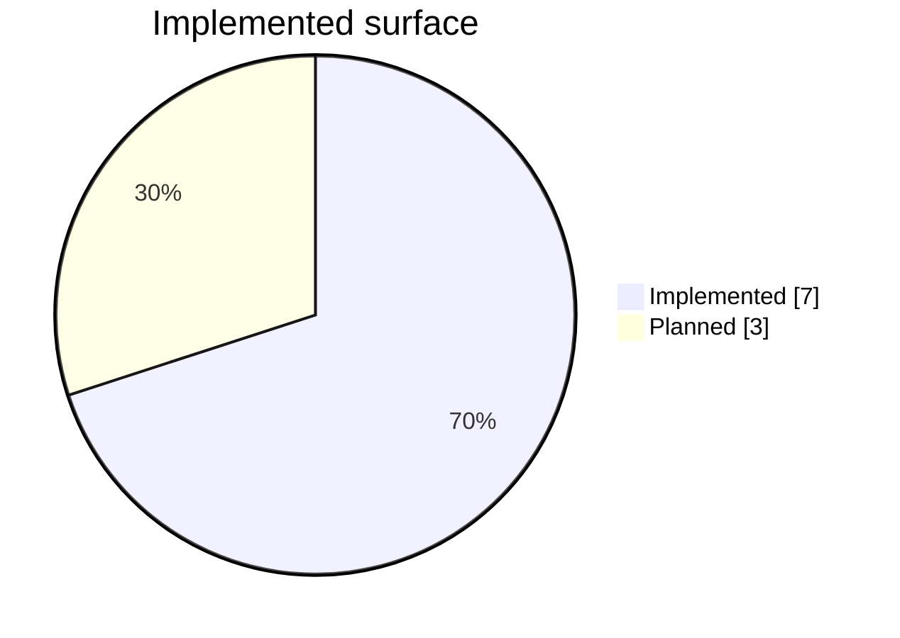
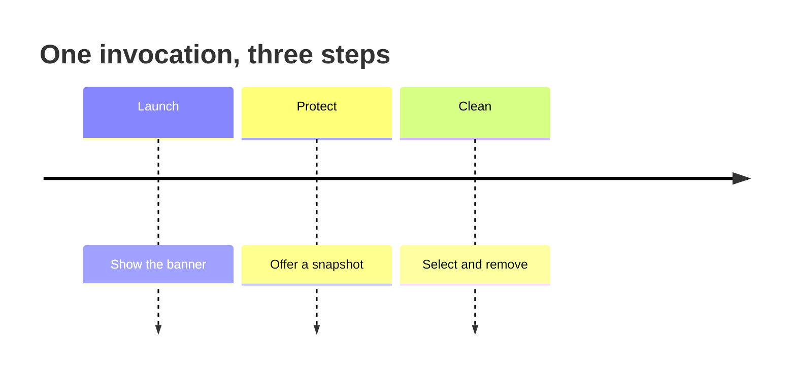
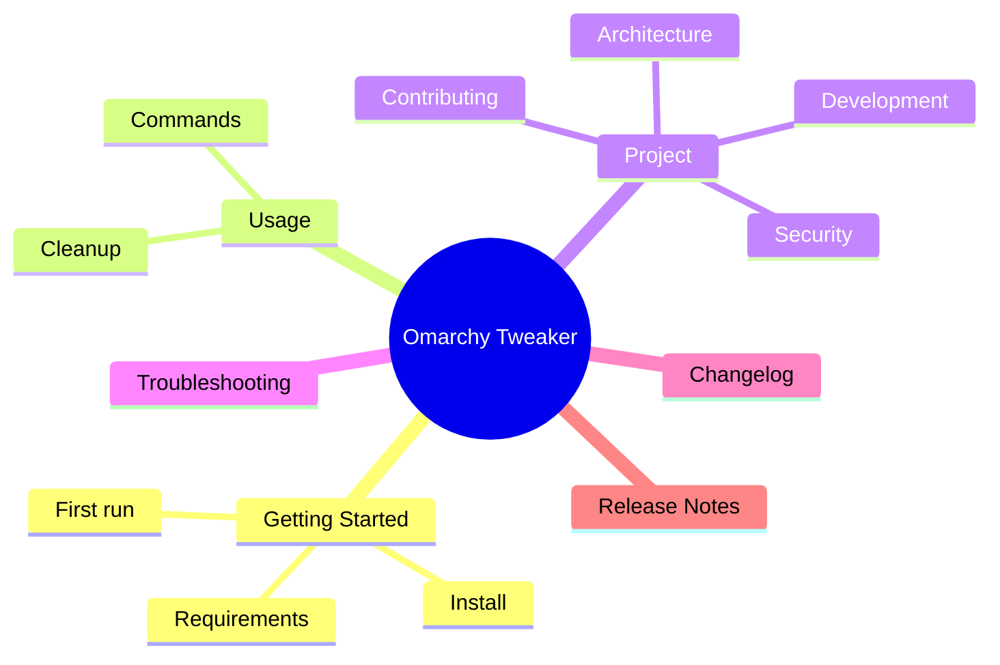

<h1 class='ot-h1'> Omarchy Tweaker </h1>

### Customize. Automate. Make Omarchy yours.

**A personal Omarchy customization, automation, and bootstrap toolkit.**

[Get started](getting-started.md){ .md-button .md-button--primary }
[Browse commands](commands.md){ .md-button }
[View on GitHub](https://github.com/Armoghans-Organization/Omarchy-Tweaker){ .md-button }

---

---

!!! info "A personal project, built around a real setup"
    Omarchy Tweaker is an evolving toolkit for customizing, automating, and maintaining a personal Omarchy installation. It is intentionally opinionated and terminal-first.

    It is not a universal Linux customization tool, a replacement for Omarchy, or a one-size-fits-all installer.

## What is Omarchy Tweaker?

Omarchy Tweaker is a Python command-line application that brings useful Omarchy tweaks, configuration workflows, maintenance tasks, and automation into one consistent interface.

The project is currently in **early implementation**. The implemented surface is deliberately small and safe: it helps you inspect your system, create a restore point, and remove selected preinstalled Omarchy applications.

-   :material-console: **Terminal-first**

    ---

    A focused Rich and InquirerPy interface designed for an interactive terminal, with clear prompts and visible command output.

-   :material-shield-check-outline: **Safety-oriented**

    ---

    Destructive actions require explicit selection and confirmation. Non-interactive runs skip steps instead of guessing.

-   :material-package-variant-closed: **Omarchy-aware**

    ---

    Discovers installed Omarchy packages, web apps, TUIs, and Mise wrappers using Omarchy's own conventions.

-   :material-file-document-multiple-outline: **Observable**

    ---

    Every session writes a structured log with application metadata, system details, and a shutdown report.

## What works today

| Area | Status | What it does |
|:--|:--:|:--|
| Default startup sequence | Implemented | Shows the banner, offers a snapshot, then offers cleanup. |
| `welcome` command | Implemented | Displays the welcome screen and a system overview. |
| `snapshot` command | Implemented | Runs `omarchy snapshot create` with confirmation and live output. |
| `cleanup` command | Implemented | Removes only selected installed packages, web apps, TUIs, and Mise wrappers. |
| Session logging | Implemented | Writes structured logs to the XDG state directory. |
| Rich error handling | Implemented | Renders uncaught exceptions, thread errors, and syntax errors cleanly. |
| Reusable UI toolkit | Implemented | Provides banners, panels, tables, prompts, progress, and virtual terminals. |
| Package installation | Not implemented | Planned for a future iteration. |
| Dotfile management | Not implemented | Planned for a future iteration. |
| Theme and desktop automation | Not implemented | Planned for a future iteration. |

### Current surface

!!! warning "Do not assume planned features exist"
    The table above is the source of truth for the current documentation. If a workflow is not listed as implemented, treat it as unavailable.

## Default workflow

Each step can be skipped. See **[Getting Started](getting-started.md)** for the full first-run flow.

## Safety first

!!! warning "System-changing workflow"
    Snapshot and cleanup act on the host. Read **[Cleanup](cleanup.md)** and the **[Security Policy](security.md)** before removing anything.

    The default sequence offers a snapshot before cleanup. Running `omarchy-tweaker cleanup` directly does **not** create a snapshot automatically.

## Documentation map

-   :material-rocket-launch-outline: **Getting Started**

    ---

    Requirements, installation, first run, and logs.

    [Open Getting Started](getting-started.md)

-   :material-console-line: **Commands**

    ---

    Command reference, options, exit codes, and examples.

    [Open Commands](commands.md)

-   :material-delete-sweep-outline: **Cleanup**

    ---

    What cleanup discovers, how removal works, and how to stay safe.

    [Open Cleanup](cleanup.md)

-   :material-sitemap-outline: **Architecture**

    ---

    Runtime flow, module responsibilities, logging, and extension points.

    [Open Architecture](architecture.md)

-   :material-tools: **Development**

    ---

    Local setup, tooling, tests, Git hooks, and release workflow.

    [Open Development](development.md)

-   :material-source-pull: **Contributing**

    ---

    Workflow, standards, and review expectations for changes.

    [Open Contributing](contributing.md)

-   :material-shield-lock-outline: **Security**

    ---

    Safety model, supported versions, and private vulnerability reporting.

    [Open Security](security.md)

-   :material-help-circle-outline: **Troubleshooting**

    ---

    Common issues with terminals, Omarchy commands, snapshots, and cleanup.

    [Open Troubleshooting](troubleshooting.md)

### Docs at a glance

## Project resources

[GitHub Repository](https://github.com/Armoghans-Organization/Omarchy-Tweaker) · [Changelog](changelog.md) · [Release Notes](release-notes.md)

---

**Built for a personal Omarchy setup.**

Omarchy Tweaker · Customization, automation, and maintenance

