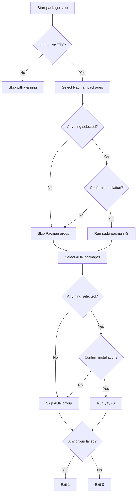

# Packages

The package step presents a fixed catalog of Pacman and AUR packages, lets you select what
you want, and installs each selected group with a single package-manager command.

```bash
omarchy-tweaker packages
```

Package installation is a standalone command. It is **not** part of the default startup
sequence.

!!! warning "System-changing command"
    Installing packages can invoke `sudo`, modify the package database, and pull software
    from Arch repositories and the AUR. Review each selection and confirmation carefully.
    Running `packages` directly does not create a snapshot automatically.

---

## Workflow



The Pacman group is always shown first. The AUR group is shown second. A failure in one
group does not prevent the other group from being offered.

---

## Package groups

| Group | Install command | Packages |
|:--|:--|:--:|
| **Pacman** | `sudo pacman -S --noconfirm --needed --noprogressbar <packages...>` | 32 |
| **AUR** | `yay -S --noconfirm --needed --noprogressbar <packages...>` | 3 |

### Pacman packages

| Package | Package | Package |
|:--|:--|:--|
| `atuin` | `brave-origin-bin` | `fnm` |
| `git-delta` | `gitleaks` | `go` |
| `hugo` | `kdeconnect` | `omarchy-zsh` |
| `onefetch` | `onionshare` | `openvpn` |
| `python-pip` | `python-pipx` | `python-pytest` |
| `qemu-full` | `qemu-user-static-binfmt` | `qrencode` |
| `ripgrep` | `sqlitebrowser` | `superfile` |
| `tig` | `tldr` | `ttf-hack-nerd` |
| `uv` | `virt-manager` | `virt-viewer` |
| `visual-studio-code-bin` | `zellij` | `zen-browser-bin` |
| `zram-generator` | `rclone` |  |

### AUR packages

| Package | Package | Package |
|:--|:--|:--|
| `powershell-bin` | `cyberchef-web` | `anydesk-bin` |

The catalog is fixed in the application. The command does not scan the filesystem or accept
arbitrary package names from the terminal.

---

## Selection and confirmation

1. A checkbox prompt lets you select Pacman packages.
2. Selected packages are confirmed.
3. `sudo -v` prompts for and caches sudo credentials before the live display starts. The
   cached timestamp is verified with `sudo -n -v`; if sudo would prompt again, installation
   stops instead of hiding the prompt inside the live display.
4. `sudo pacman -S --noconfirm --needed --noprogressbar` installs all selected Pacman packages in one
   command.
5. A checkbox prompt lets you select AUR packages.
6. Selected packages are confirmed.
7. `yay -S --noconfirm --needed --noprogressbar` installs all selected AUR packages in one command.

Nothing is selected by default. Leaving a group empty skips it. Declining a group's
confirmation skips that group without failing the command.

Pacman and `yay` skip packages that are already installed because both commands use
`--needed`. The full selected list is passed in one command per group.

---

## Output

Each group runs inside a virtual terminal, so command output stays visible without flooding
the scrollback. Sudo credentials are requested before the live display starts, so the
password prompt is not hidden by the terminal panel. The progress display is rendered in the
same live view as the terminal, which avoids nested terminal panels. The package manager's
own progress bar is disabled with `--noprogressbar`, so download and install lines remain
visible in the terminal panel.

A failure in either group is reported, but the remaining group is still offered. The command
exits with code `1` if any selected group fails.

---

## Non-interactive use

Package installation requires an interactive terminal.

| Invocation | Result |
|:--|:--|
| `omarchy-tweaker packages` without a TTY | Skips with a warning. |
| `omarchy-tweaker packages` with a TTY | Shows both package groups. |

A skip is not a failure. The command exits with code `0` when no group is installed.

---

## Timeout

Each package group has a **900 second** timeout. A timeout is reported as a failure for that
group.

---

## Requirements

- `pacman` must be on `PATH`.
- `yay` must be on `PATH` for the AUR group.
- `sudo` may be required for the Pacman group.
- Package repositories and the AUR must be reachable.
- The terminal must be interactive.

If installation fails, run the underlying command directly to inspect the error:

```bash
sudo pacman -S --noconfirm --needed --noprogressbar <package>
yay -S --noconfirm --needed --noprogressbar <package>
```

---

## Safety model

- **Fixed catalog** — only the documented Pacman and AUR packages can be selected.
- **Separate groups** — Pacman and AUR packages are never mixed into one ambiguous prompt.
- **Explicit selection** — nothing is selected by default.
- **Per-group confirmation** — each group is confirmed separately.
- **Visible sudo prompt** — `sudo -v` runs before the live display, and `sudo -n -v` verifies the cached timestamp so password prompts are not hidden.
- **Single command per group** — selected packages are installed together.
- **Visible output** — package-manager output is streamed in a bounded terminal panel.
- **Partial failure reporting** — failed groups produce exit code `1`.
- **No automatic snapshot** — running `packages` directly does not create a restore point.

---

## Examples

### Install selected packages

```bash
omarchy-tweaker packages
```

### Check the command help

```bash
omarchy-tweaker packages --help
```

### Inspect the package-manager commands

```bash
pacman --help
yay --help
```

---

## Related pages

- [Commands](commands.md)
- [Cleanup](cleanup.md)
- [Getting Started](getting-started.md)
- [Architecture](architecture.md)
- [Security Policy](security.md)
- [Troubleshooting](troubleshooting.md)
