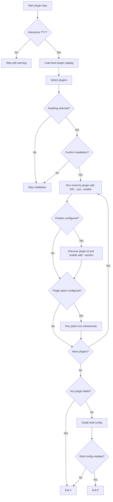

# Plugins

The plugin step presents a fixed catalog of Omarchy shell plugins, lets you select what you
want, and installs each selected plugin with Omarchy's own plugin manager.

```bash
omarchy-tweaker plugins
```

Plugin installation runs in the default startup sequence and is also available as the
standalone `plugins` command.

!!! warning "Unsandboxed plugin code"
    Omarchy shell plugins run as arbitrary, unsandboxed code inside your long-lived
    `omarchy-shell` process. Only install repositories you trust. Installing a plugin does
    not create a snapshot automatically.

---

## Workflow



A failure for one plugin does not prevent the remaining selected plugins from being processed.

---

## Plugin catalog

The catalog is bundled with the application in
`src/omarchy_tweaker/config/plugins.ini`. Repository URLs, descriptions, positions, and
patch settings are read from that file.

| Plugin | Description | Position | Patch |
|:--|:--|:--:|:--:|
| App Grid | GNOME-style full-screen app grid | — | — |
| Clipboard History | Raycast-style clipboard history | — | — |
| Control Center | Quick-settings hub | center | — |
| Fathom | A depth-based Alt-Tab | — | — |
| Keybindings hint | Shows the keyboard shortcut whenever you reach for the menu instead. | — | `keybindings-helper-plugin.patch` |
| Kronos | Desktop clock with smooth minute/second orbital rings | left | `kronsh-plugin.patch` |
| Lock Screen Explorer | Lock screen designs for Omarchy | — | — |
| OmaSettings | One window for every Omarchy settings | — | — |
| Omarchy Switcher | Fast Super+Tab window switching | — | `switcher-plugin.patch` |
| Radial menu | A theme-aware radial (pie) version of the Omarchy menu | — | — |
| Spotlight | A Raycast-style launcher for Omarchy | — | — |
| Tray | A better system tray for Omarchy | right | — |
| Notification Pulse | A notification inbox for the Omarchy bar. | — | — |
| Omarchy Key Prompter | Shows the keyboard shortcut whenever you reach for the menu instead. | — | — |
| Screen Time | Daily screen time per app in your Omarchy bar. | — | — |
| Close Guard | Asks: Are you sure you want to close? before Super+W closes a window. | — | — |
| Github | A keyboard-friendly GitHub inbox | — | — |
| Agent Activity | Live view of the processes your AI agents have started. | — | — |
| Agent Activity Visualization | Visualization of the processes your AI agents have started. | — | — |
| OmaWall+ | Wallpaper manager for Omarchy | — | — |

The command does not accept arbitrary plugin URLs from the terminal. To add a new plugin to
the selectable catalog, update `plugins.ini` and the matching patch file if needed.

---

## Selection and confirmation

1. A checkbox prompt lets you select plugins from the fixed catalog.
2. The selected plugins are confirmed together.
3. Each plugin is installed with:

   ```bash
   omarchy plugin add <url> --yes --enable
   ```

   `--yes` makes the add command non-interactive, and `--enable` enables the plugin after
   installation. Omarchy uses the plugin manifest's default placement when no position is
   supplied.

Nothing is selected by default. Leaving the list empty skips the step. Declining the
confirmation skips the step without failing the command.

If a selected plugin is already installed, Omarchy Tweaker detects it by repository URL,
skips the add command, still applies any configured placement or patch, and reports it as
already installed.

---

## Placement

Some plugins expose a bar position in `plugins.ini`:

```ini
[Control Center]
position=center
```

When a position is configured, Omarchy Tweaker discovers the newly installed plugin ID and
runs:

```bash
omarchy plugin enable <id> --section <left|center|right>
```

If the ID cannot be determined, the plugin stays enabled with its manifest default and the
command reports a warning. Invalid positions are ignored, and the manifest default is used.

Only `left`, `center`, and `right` are accepted.

---

## Patches

Some catalog entries include a patch script. After the plugin is installed and enabled,
Omarchy Tweaker runs the matching script from the repository-level `patches/` directory:

```bash
bash patches/<patch-file>
```

Patch scripts are applied non-interactively. Their confirmation prompts are answered with
`yes`, and their output is written into the plugin terminal. The bundled patches create a
`.bak` backup beside the modified plugin file and restore it if verification fails.

| Patch | Purpose |
|:--|:--|
| `keybindings-helper-plugin.patch` | Changes the Keybindings hint timeout from 6000 ms to 2500 ms. |
| `switcher-plugin.patch` | Limits the Omarchy Switcher to windows on the focused workspace. |
| `kronsh-plugin.patch` | Hides the Kronos clock widget from the Omarchy bar (interactive gum menu). |

Patch scripts are optional. A plugin with `patch=false` is installed without a patch.
Plugin updates may overwrite patched files; rerun the plugin command or apply the patch
manually after an update.

Override the patch directory with:

```bash
OMARCHY_TWEAKER_PATCHES_DIR=/path/to/patches omarchy-tweaker plugins
```

---

## Output

Each plugin runs inside a virtual terminal with a progress display in the same live view.
Plugin clone, validation, enable, and patch output stays visible without flooding the
scrollback or nesting terminal panels.

A failure in any selected plugin is reported, but the remaining plugins are still processed.
The command exits with code `1` if any selected plugin fails.

---

## Shell configuration

After all selected plugins are installed or updated successfully, Omarchy Tweaker replaces
`~/.config/omarchy/shell.json` with the bundled configuration from
`src/omarchy_tweaker/config/shell.json`.

If an existing regular `~/.config/omarchy/shell.json` is present, it is backed up to
`~/.config/omarchy/shell.json.bak.<timestamp>` before replacement. An existing symlink is
replaced without creating a backup.

The new `shell.json` is made read-only by changing ownership to `root:root` and setting
permissions to `444` (read-only for all). This requires `sudo` and prevents accidental
edits without elevated privileges.

The bundled `shell.json` is the source of truth. Update it in the repository and rerun
the `plugins` command to propagate changes.

If shell config installation fails (for example, if `sudo` is unavailable or the user
declines the password prompt), the plugin installation itself is still considered
successful, but the command exits with code `1`.

---

## shell.json explained

`src/omarchy_tweaker/config/shell.json` is the Omarchy shell configuration that gets copied
to `~/.config/omarchy/shell.json` after plugin installation. It controls the bar layout,
plugin list, idle behavior, and disabled built-in plugins.

### Top-level keys

| Key | Type | Description |
|:--|:--|:--|
| `version` | integer | Shell config format version (currently `1`). |
| `idle` | object | Screen idle timeout settings. |
| `bar` | object | Bar position, transparency, and layout. |
| `plugins` | array | List of installed plugin entries with their per-plugin settings. |
| `disabledPlugins` | array | Built-in Omarchy plugins that are disabled. |
| `cloneSourceRestores` | array | Plugin IDs that restore from their original clone source. |

### `idle`

Controls when the screen locks and screensaver activates.

| Key | Type | Description |
|:--|:--|:--|
| `screensaver` | integer | Seconds before screensaver activates (150 = 2.5 min). |
| `lock` | integer | Seconds before the screen locks (300 = 5 min). |

### `bar`

Controls the Omarchy bar position and layout.

| Key | Type | Description |
|:--|:--|:--|
| `position` | string | Bar position on screen: `top`, `bottom`, etc. |
| `transparent` | boolean | Whether the bar background is transparent. |

### `bar.layout`

Defines which widgets appear in each section of the bar. Each section is an array of widget
objects with an `id` field and optional per-widget settings.

| Section | Description |
|:--|:--|
| `left` | Left-aligned bar widgets (menu, workspaces, Kronos clock, active window). |
| `center` | Center bar widgets (clock). |
| `right` | Right-aligned bar widgets (tray, system indicators, etc.). |
| `centerBegin` | Widgets that appear at the start of the center section (control center, indicators). |
| `centerEnd` | Widgets that appear at the end of the center section (weather, screen time, system update). |
| `tray` | System tray panel widgets (e.g., `superwhisper.panel`). |

#### Widget types

- **Built-in Omarchy widgets** — identified by `omarchy.*` prefix (e.g., `omarchy.menu`,
  `omarchy.workspaces`, `omarchy.clock`, `omarchy.active-window`, `omarchy.spacer`,
  `omarchy.keyboard-layout`, `omarchy.agents`, `omarchy.monitor`, `omarchy.microphone`,
  `omarchy.audio`, `omarchy.bluetooth`, `omarchy.network`, `omarchy.power`,
  `omarchy.weather`, `omarchy.system-update`, `omarchy.indicators`).
- **Plugin widgets** — identified by their reverse-DNS plugin ID (e.g.,
  `io.github.tyrichards.tray`, `mash2rafi.kronos`, `aryal.control-center`,
  `io.github.twiking.omasettings`, `io.github.iammhador.notification-pulse`,
  `rimuru.screentime`).

#### Kronos widget settings

The Kronos plugin (`mash2rafi.kronos`) in the `left` section has extensive per-plugin
configuration for its orbital clock rings:

| Key | Type | Description |
|:--|:--|:--|
| `scale` | float | Overall scale factor (0.8 = 80%). |
| `hourScale`, `dateScale`, `subtimeScale` | float | Individual ring scale factors. |
| `ringLabelScale` | float | Scale of ring labels. |
| `minuteCapsuleScale`, `secondCapsuleScale` | float | Scale of time capsule elements. |
| `hourColor`, `dateColor`, `minuteCapsuleColor`, `secondCapsuleColor`, `minuteRingColor`, `secondRingColor`, `ringLabelColor` | string | Color overrides (empty = use theme accent). |
| `hourFont`, `dateFont`, `minuteCapsuleFont`, `secondCapsuleFont` | string | Font family for each element. |
| `showHour`, `showMinuteCapsule`, `showSecondCapsule`, `showRingLabels`, `showRings` | boolean | Toggle visibility of each element. |
| `hourOffsetX/Y`, `dateOffsetX/Y` | integer | Position offsets in pixels. |
| `minuteCapsuleAngleOffset`, `secondCapsuleAngleOffset` | integer | Angular position offsets. |
| `minuteCapsuleRadiusOffset`, `secondCapsuleRadiusOffset` | integer | Radial distance offsets. |
| `ringRotationOffset` | integer | Rotation of the entire ring assembly. |
| `position` | string | Widget position within the bar (`top-right`). |
| `centerLayout` | string | Layout mode (`orbit`). |
| `use24h` | boolean | Use 24-hour format. |
| `showSeconds` | boolean | Show seconds on the clock. |
| `lowPower` | boolean | Reduce rendering for power saving. |
| `renderer` | string | Rendering backend (`shader`). |
| `compactSurface` | boolean | Use compact drawing surface. |
| `showDate` | boolean | Show date. |
| `clockEnabled` | boolean | Enable the clock. |
| `accentMode` | string | Color accent mode (`accent`). |
| `margin` | integer | Margin in pixels. |
| `barPadding` | integer | Padding inside the bar. |
| `clockFont` | string | Font for the clock text. |
| `labelFont` | string | Font for ring labels (supports fallback list). |
| `ringDiameter` | float | Diameter of the rings (0.31 = 31% of available space). |
| `ringGap` | integer | Gap between rings in pixels. |
| `ringArcDegrees` | integer | Arc length of each ring in degrees (120 = one-third of circle). |
| `ringTransparency` | float | Ring transparency (1.0 = fully opaque). |
| `minuteRingOpacity`, `secondRingOpacity` | float | Individual ring opacity. |
| `screenMode` | string | Which screen to display on (`all`). |
| `selectedMonitors` | array | Specific monitors when `screenMode` is not `all`. |
| `perMonitorScale` | boolean | Scale per monitor. |
| `scaleReferenceHeight` | integer | Reference height for scaling (1080). |
| `savedLayouts` | array | Saved layout presets. |

#### Clock widget settings

The built-in `omarchy.clock` widget in the `center` section has these settings:

| Key | Type | Description |
|:--|:--|:--|
| `format` | string | Primary time format (e.g., `dddd HH:mm`). |
| `formatAlt` | string | Alternative time format (e.g., `d MMMM 'W'ww yyyy`). |
| `verticalFormat` | string | Vertical layout format (uses `\n` for line breaks). |

#### Tray widget settings

The `io.github.tyrichards.tray` widget in the `right` section has:

| Key | Type | Description |
|:--|:--|:--|
| `widgets` | array | List of tray entries with `entry.id` and `listed` boolean. |
| `order` | array | Display order of tray entry IDs. |

#### Other widget settings

- **Screen Time** (`rimuru.screentime`): Supports `iconOnly` boolean to show only the icon.
- **Spacer** (`omarchy.spacer`): No settings, just a flexible space.

### `plugins`

Plugin entries and their optional per-plugin settings. Bar widgets are referenced directly
by ID in `bar.layout`, so not every plugin needs an entry here; this array is used for
plugins that require explicit registration or configuration.

Most entries only specify their `id`:

```json
{
    "id": "io.github.mtolhuys.fathom"
}
```

Some plugins have additional configuration:

**Lock Screen Explorer** (`io.github.sirjul1337.lock-explorer`):

| Key | Type | Description |
|:--|:--|:--|
| `avatar` | string | Path to avatar image. |
| `blankMs` | integer | Screen blank delay in milliseconds (30000 = 30 s). |
| `boot` | string | Boot animation mode (`follow`). |
| `clock12` | boolean | Use 12-hour clock. |
| `design` | string | Lock screen design theme (`editorial`). |
| `powerActions` | boolean | Show power action buttons. |
| `reduceMotion` | string | Motion reduction mode (`battery`). |
| `unlock` | string | Unlock animation (`fade`). |
| `wallpaperBlur` | string | Wallpaper blur effect (`sharp`). |
| `openAs` | string | How the lock screen opens (`full`). |

### `disabledPlugins`

An array of built-in Omarchy plugin IDs that are explicitly disabled:

```json
[
    "omarchy.clipboard",
    "omarchy.elsewhen",
    "omarchy.lock",
    "omarchy.background",
    "omarchy.tray"
]
```

### `cloneSourceRestores`

An array of plugin IDs that restore from their original clone source when the plugin is
updated or reinstalled:

```json
[
    "alanfortlink.clipboard",
    "io.github.sirjul1337.lock-explorer",
    "poipoi.omawall"
]
```

---

## Non-interactive use

Plugin installation requires an interactive terminal because plugin selection and
confirmation use TTY prompts.

| Invocation | Result |
|:--|:--|
| `omarchy-tweaker plugins` without a TTY | Skips with a warning. |
| `omarchy-tweaker plugins` with a TTY | Shows the plugin catalog. |

A skip is not a failure. The command exits with code `0` when no plugin is installed.

The underlying `omarchy plugin add` call itself is non-interactive and does not ask for
input.

---

## Timeouts

| Operation | Timeout |
|:--|:--:|
| Plugin add and validation | 300 seconds |
| Plugin enable or placement | 60 seconds |
| Plugin discovery | 30 seconds |
| Patch script | 120 seconds |
| Shell config install | 30 seconds |

A timeout is reported as a failure for that plugin.

---

## Requirements

- `omarchy` must be on `PATH`.
- `git` must be available for `omarchy plugin add`.
- `bash` is required for patch scripts.
- `gum` is required by the bundled patch scripts.
- `sudo` is required for shell config installation (chown + chmod).
- Plugin repositories and their dependencies must be reachable.
- The terminal must be interactive.

If installation fails, run the underlying command directly to inspect the error:

```bash
omarchy plugin add <url> --yes --enable
omarchy plugin enable <id> --section <position>
```

---

## Safety model

- **Fixed catalog** — only the documented plugins can be selected.
- **Explicit selection** — nothing is selected by default.
- **Confirmation** — the selected plugin set is confirmed before any clone starts.
- **No arbitrary URLs** — plugin URLs come from the bundled catalog, not terminal input.
- **Non-interactive add** — `omarchy plugin add` runs with `--yes` and does not prompt.
- **Idempotent installs** — already-installed plugins are detected by repository URL and
  skipped instead of failing.
- **Controlled placement** — only `left`, `center`, and `right` are accepted.
- **Fixed patches** — patch scripts come from the configured patch directory.
- **Automatic backups** — bundled patches create `.bak` files before editing; shell config
  is backed up before replacement.
- **Timeouts** — clone, enable, discovery, and patch operations are bounded.
- **Partial failure reporting** — failed plugins produce exit code `1`.
- **Shell config protection** — shell config is made read-only (root-owned, 444) after
  installation.
- **No automatic snapshot** — running `plugins` directly does not create a restore point.

---

## Examples

### Install selected plugins

```bash
omarchy-tweaker plugins
```

### Check the command help

```bash
omarchy-tweaker plugins --help
```

### Inspect the plugin catalog

```bash
sed -n '1,240p' src/omarchy_tweaker/config/plugins.ini
```

### Inspect the shell config

```bash
cat src/omarchy_tweaker/config/shell.json
```

### Inspect available plugins

```bash
omarchy plugin list
```

### Edit the shell config (requires sudo)

```bash
sudo nano ~/.config/omarchy/shell.json
```

---

## Related pages

- [Commands](commands.md)
- [Packages](packages.md)
- [Cleanup](cleanup.md)
- [Getting Started](getting-started.md)
- [Architecture](architecture.md)
- [Security Policy](security.md)
- [Troubleshooting](troubleshooting.md)
