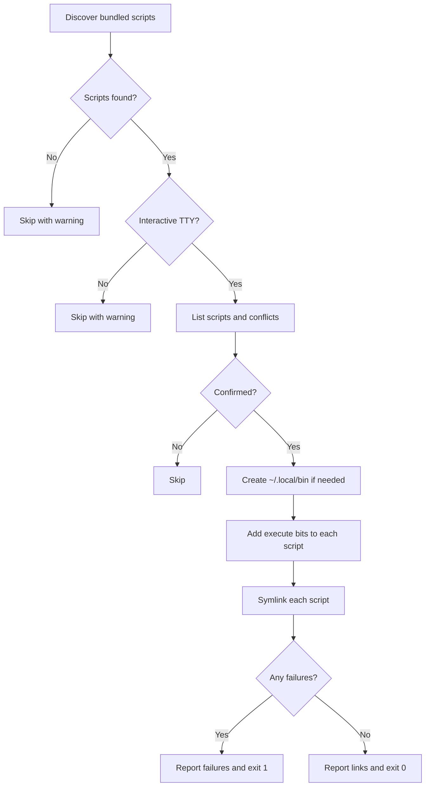

# Bundled Scripts

The `scripts` command links the helper scripts shipped with Omarchy Tweaker into
`~/.local/bin/`. It also makes each bundled script executable so the links are
ready to run from your shell.

```bash
omarchy-tweaker scripts
```

!!! note "Links, not copies"
    Each entry in `~/.local/bin/` is a symlink back to the bundled file. Updating
    Omarchy Tweaker updates the commands available on your PATH automatically.

## Bundled catalog

The catalog is every regular, non-hidden file in `src/omarchy_tweaker/script/` at
run time. The current catalog contains:

| Script | Purpose |
|:--|:--|
| `create-vm` | Create and manage QEMU/KVM virtual machines and instant sandboxes. |
| `macos-vm` | macOS virtual machine helper. |
| `setup-security-fingerprint` | Configure fingerprint authentication with an interactive gum workflow. |
| `snapshot` | Create or restore system snapshots with snapper. |
| `windows-vm` | Windows virtual machine helper. |

## Workflow



The exact sequence is:

1. Discover the bundled scripts.
2. Require an interactive terminal.
3. List the scripts and warn about any names that already exist in `~/.local/bin/`.
4. Ask for one confirmation before changing anything.
5. Create `~/.local/bin/` when it is missing.
6. Add user, group, and other execute bits to each bundled script when missing.
7. Replace each destination with a symlink to the bundled script.

!!! warning "Existing entries are replaced without a backup"
    A symlink that already points at the correct bundled script is left alone.
    Any other file, directory link, or broken symlink at the same name is removed
    and replaced. Review the conflict warning before confirming.

## Behavior details

### Permissions

Execute bits are added to the bundled source files, not to the symlinks. A file
that is already executable is left unchanged. Permission changes are reported as
links because they are part of the same idempotent setup step.

### Idempotency

Running the command repeatedly produces the same result. Scripts with a correct
symlink and execute permissions are reported as already linked, and the command
still exits successfully.

### Non-interactive use

`omarchy-tweaker scripts` requires an interactive terminal. Without one, it prints
a warning and skips without changing files or permissions. The default startup
sequence applies the same rule.

### Failure handling

A failed permission change, destination removal, symlink creation, or bin
directory creation is reported by name. The command exits with code `1` when any
script fails; a skipped step is not a failure.

## Configuration

| Variable | Purpose |
|:--|:--|
| `OMARCHY_TWEAKER_SCRIPTS_DIR` | Override the directory containing the bundled scripts. |

For example, to link scripts from a checkout instead of the installed package:

```bash
OMARCHY_TWEAKER_SCRIPTS_DIR=~/Documents/Github/My-Scripts omarchy-tweaker scripts
```

Override the home directory used for `~/.local/bin/` only in tests through the
`home` argument of `run_scripts_step()`; the CLI always uses `Path.home()`.

## Verify the result

```bash
omarchy-tweaker scripts
ls -l ~/.local/bin
command -v create-vm
```

## Related pages

- [Commands](commands.md)
- [Getting Started](getting-started.md)
- [Security](security.md)
- [Troubleshooting](troubleshooting.md)
