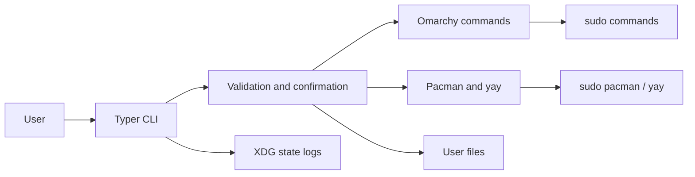
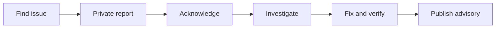
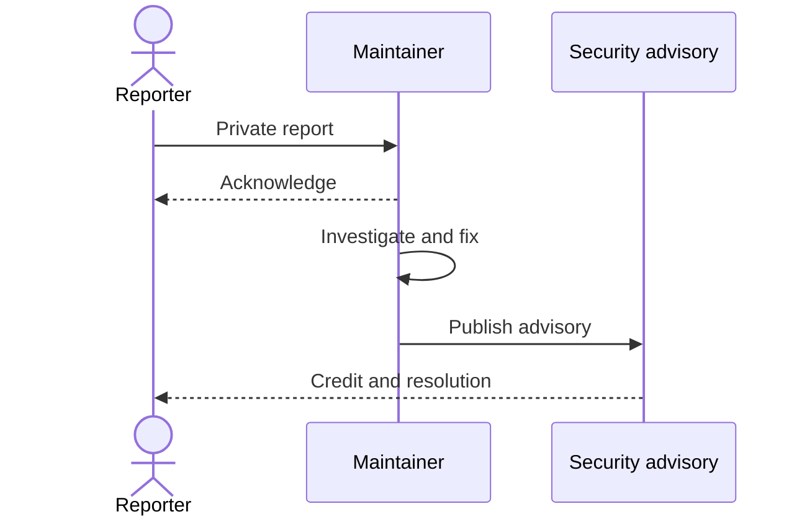

# Security Policy

The security of **Omarchy Tweaker** and its users is important. Responsible security
research is appreciated, and vulnerabilities should be reported privately and responsibly.

---

## System Safety Model

Omarchy Tweaker performs system-level operations, including package installation, package
removal, snapshot creation, and workspace directory creation.



| Risk | Control |
|:--|:--|
| Accidental installation | Fixed package catalog, separate Pacman and AUR lists, per-group confirmation. |
| Accidental removal | Explicit selection, separate category lists, final confirmation. |
| Non-interactive guessing | Interactive steps skip when no TTY is available. |
| Shell injection | External commands use argument lists, never `shell=True`. |
| Hung commands | Snapshot, package installation, and removal operations have explicit timeouts. |
| Broad package removal | Candidates are limited to Omarchy preinstalls and installed packages. |
| Unsafe wrapper deletion | Mise paths must be absolute, name a file, and resolve inside the home directory. |
| Unintended directory creation | Fixed home-relative targets, per-path confirmation, and no overwrite of existing paths. |
| Silent partial failure | Package installation, cleanup, and directory setup report failures and exit non-zero. |
| Noisy notifications | `OMARCHY_REMOVE_NOTIFY=false` suppresses per-item notifications. |

Omarchy Tweaker does not log passwords, authentication tokens, private keys, or secret
configuration values. Review logs before sharing them publicly, since they include command
arguments and system details.

See [Packages](packages.md) for package installation details, [Cleanup](cleanup.md) for the
full destructive-operation workflow, and [Directories](directories.md) for workspace path
rules.

---

## Supported Versions

Omarchy Tweaker is currently maintained as a personal project. Security updates and fixes
are provided for the latest available version whenever reasonably possible.

| Version | Supported |
|:---|:---:|
| Latest | ✅ |
| Older versions | ❌ |
| Unmaintained versions | ❌ |

!!! note "No separate release branches"
    This project does not currently maintain separate release branches or guarantee
    security updates for older versions.

---

## Reporting a Vulnerability

**Please do not disclose security vulnerabilities through public GitHub Issues or
discussions.**

Use one of the following methods instead:

- **GitHub Security Advisories:**
  [Privately report a vulnerability](https://github.com/Armoghans-Organization/Omarchy-Tweaker/security/advisories/new)
- **Private Contact:** Contact the repository owner through GitHub if private
  vulnerability reporting is unavailable.



### What to Include

To help investigate and resolve the issue, please provide:

- A clear description of the vulnerability.
- Steps to reproduce the issue, if applicable.
- The potential impact and affected components.
- Relevant logs, screenshots, or proof-of-concept details.
- Any suggested mitigation or remediation, if available.

### Response and Resolution

Reasonable efforts will be made to:

1. Acknowledge the report as soon as reasonably possible.
2. Investigate and assess the reported vulnerability.
3. Request additional information if necessary.
4. Develop and verify an appropriate fix where applicable.
5. Communicate the outcome and publish relevant security updates.

Response and resolution times may vary depending on the complexity and severity of the
issue, as well as maintainer availability.

### Responsible Disclosure

Please allow reasonable time for investigation and remediation before publicly disclosing
a vulnerability.

---

### Coordinated disclosure



## Security Tooling in This Repository

The project uses **Bandit** for static Python security analysis. It is configured in
`pyproject.toml`:

| Setting | Value |
|---|---|
| Target | `src` |
| Excluded directories | `tests`, `.venv`, `build`, `dist` |
| Severity threshold | `LOW` |
| Confidence threshold | `MEDIUM` |
| Skipped checks | none |

Bandit runs in two places:

- As a `[SECURITY]` hook in the local `pre-commit` stage.
- As manual Poe tasks:

```bash
uv run poe security
uv run poe security-report
```

`security-report` writes `bandit-report.json`, which is a generated artifact and must not be
committed.

The pre-commit configuration also includes a `[SECURITY]` private-key detection hook to
prevent accidental commits of sensitive material.

!!! info "Scope of automated checks"
    The CI workflow runs linting, formatting, type checking, tests with coverage, the
    documentation build, and the package build. Bandit is enforced locally through
    pre-commit and the Poe security tasks.

---

## Scope and Limitations

This security policy covers security vulnerabilities directly related to the code,
scripts, configurations, and other resources maintained in this repository.

It does not guarantee security support for:

- Third-party applications, packages, or dependencies.
- The underlying Omarchy or Arch Linux installations.
- User-modified configurations or externally sourced scripts.
- Issues unrelated to this repository.

---

<p align="center">
  <sub>SECURITY IS A SHARED RESPONSIBILITY.</sub>
</p>
