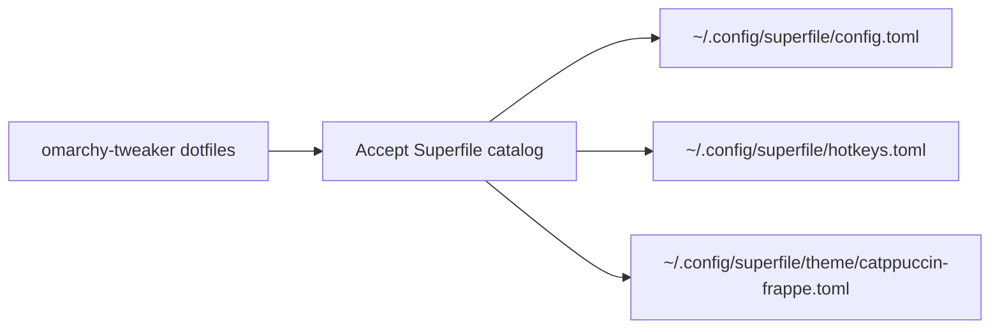

# Superfile Dotfiles

This page is the practical usage guide for the custom Superfile configuration bundled with
Omarchy Tweaker. It explains what the custom setup does, how to use it day to day, and how
to inspect or change each part.

For an explanation of the dotfile catalog system itself, see **[Dotfiles](dotfiles.md)**.

!!! note "Catalog scope"
    The `Superfile` catalog only links the bundled configuration, hotkeys, and theme files.
    It does not install Superfile, `bat`, `nvim`, `exiftool`, `md5sum`, `zoxide`, or a Nerd
    Font. The catalog directory is named `Superfile`, so that is the name shown in the
    dotfiles confirmation prompt.

---

## What this custom setup gives you

The `Superfile` catalog links a keyboard-first Superfile setup with:

- A Catppuccin Frappe theme with custom panel, footer, sidebar, modal, and help-menu colors.
- Vim-style navigation with `h`/`j`/`k`/`l`, `H`/`L` panel movement, `/` search, and `?` help.
- Multiple file panels with `n`, split panels with `N`, and close with `w`.
- File and image previews enabled by default, plus a file information footer.
- Natural ascending case-insensitive sorting and SI file-size units.
- A sidebar with home, pinned, and disks sections.
- `bat` syntax highlighting for code previews.
- Nerd Font icons, select-mode icons, Unicode borders, and transparent background support.
- Optional metadata, MD5 checksum, and zoxide integrations.
- An empty `[open_with]` table ready for local extension-to-command rules.



---

## Quick start

```bash
omarchy-tweaker dotfiles
```

Accept the `Superfile` catalog when prompted, then verify the links and tools:

```bash
ls -l ~/.config/superfile/config.toml
ls -l ~/.config/superfile/hotkeys.toml
ls -l ~/.config/superfile/theme/catppuccin-frappe.toml
command -v spf
command -v bat
command -v nvim
command -v exiftool
command -v md5sum
command -v zoxide
spf
```

If the theme, icons, previews, or integrations do not work, check the tool requirements
below.

---

## What gets installed

| Bundled source | Destination | What it does |
|:--|:--|:--|
| `config` | `~/.config/superfile/config.toml` | Main Superfile settings, styling, plugins, and extension rules. |
| `hotkeys` | `~/.config/superfile/hotkeys.toml` | Global, typing, and mode-specific keybindings. |
| `catppuccin` | `~/.config/superfile/theme/catppuccin-frappe.toml` | Catppuccin Frappe theme with custom Superfile colors. |

The catalog configuration is:

```text
src/omarchy_tweaker/dotfiles/Superfile/config.toml
```

It contains three `[symlink]` entries:

```toml
[symlink]
config = "~/.config/superfile/config.toml"
hotkeys = "~/.config/superfile/hotkeys.toml"
catppuccin = "~/.config/superfile/theme/catppuccin-frappe.toml"
```

No prompts, templates, key setup, shell startup edits, or package installation are involved.

!!! warning "The destinations are symlinks"
    Editing files under `~/.config/superfile/` in place writes through to the bundled source
    files. For temporary experiments this is fine. For permanent personal changes, keep a
    separate copy or edit the catalog in a checkout and rerun `omarchy-tweaker dotfiles`.

---

## Requirements

| Tool | Used for |
|:--|:--|
| `superfile` / `spf` | The terminal file manager itself. |
| `bat` | Syntax highlighting in file previews. |
| `nvim` | Default file editor configured by the main config. |
| Nerd Font | Icons used by `nerdfont = true` and select-mode icons. |
| `exiftool` | Detailed metadata in the metadata plugin. |
| `md5sum` | MD5 checksum generation. |
| `zoxide` | Smart directory navigation with `z`. |
| Terminal with image support | Image previews enabled by `show_image_preview = true`. |
| Terminal with transparency support | Transparent background enabled by `transparent_background = true`. |

Superfile itself is not installed by this catalog. The linked settings only take effect when
`spf` is available and Superfile reads its configuration from `~/.config/superfile/`.
`XDG_CONFIG_HOME` can change that location.

---

## Main configuration tour

### Behavior defaults

| Setting | Value | Effect |
|:--|:--|:--|
| `editor` | `nvim` | Opens files in Neovim with `e`. |
| `dir_editor` | empty | Falls back to the configured file editor for directories. |
| `auto_check_update` | `true` | Checks for Superfile updates. |
| `cd_on_quit` | `true` | Asks Superfile to return the shell to the last open directory. |
| `default_open_file_preview` | `true` | Previews hovered files by default. |
| `show_image_preview` | `true` | Previews hovered images when the terminal supports it. |
| `show_panel_footer_info` | `true` | Shows extra file information in the file panel footer. |
| `default_directory` | `.` | Starts in the current directory. |
| `file_size_use_si` | `true` | Uses kB, MB, and GB instead of KiB, MiB, and GiB. |
| `default_sort_type` | `4` | Natural sort, so `file2` appears before `file10`. |
| `sort_order_reversed` | `false` | Sorts ascending. |
| `case_sensitive_sort` | `false` | Sorts without case sensitivity. |
| `debug` | `false` | Keeps debug output disabled. |
| `ignore_missing_fields` | `false` | Warns about missing configuration fields. |

### Styling

| Setting | Value | Effect |
|:--|:--|:--|
| Theme | Catppuccin Frappe | Linked theme file selected by the main config. |
| `code_previewer` | `bat` | Uses `bat` for syntax-highlighted previews. |
| `nerdfont` | `true` | Enables Nerd Font symbols. |
| `show_select_icons` | `true` | Shows checkbox icons in select mode. |
| `transparent_background` | `true` | Enables terminal background transparency. |
| `file_preview_width` | `0` | Uses the same width as the file panel. |
| `enable_file_preview_border` | `true` | Draws a border around the preview panel. |
| `sidebar_width` | `16` | Sets a compact sidebar. |
| `sidebar_sections` | `home`, `pinned`, `disks` | Controls sidebar section order. |
| Borders | Unicode box drawing | Uses double-line `═`, `║`, and corner characters. |

### Plugins

| Plugin setting | Requirement | Effect |
|:--|:--|:--|
| `metadata = true` | `exiftool` | Adds detailed metadata display. |
| `enable_md5_checksum = true` | `md5sum` | Adds MD5 checksum generation. |
| `zoxide_support = true` | `zoxide` | Enables smart `z` directory navigation. |
| `[open_with]` | Per extension | Maps extensions to commands; the bundled table is empty. |

!!! tip "Add local file-opening rules"
    `[open_with]` is at the end of the file because TOML cannot close tables. Add rules
    below that header, for example `pdf = "zathura"` or `png = "feh"`. The file path is
    appended as the last argument.

---

## Hotkey cheat sheet

### Global and navigation

| Keys | Action |
|:--|:--|
| `Enter`, `Right`, `l` | Confirm the current selection or enter a directory. |
| `q` | Quit Superfile. |
| `Q` | Quit and change the shell directory, when shell integration is active. |
| `Down`, `j` | Move down. |
| `Up`, `k` | Move up. |
| `PgDown` | Page down. |
| `PgUp` | Page up. |
| `h`, `Left`, `Backspace` | Move to the parent directory. |
| `/` | Open the search bar. |

### Panels and views

| Keys | Action |
|:--|:--|
| `n` | Create a new file panel. |
| `N` | Split the file panel. |
| `w` | Close the current file panel. |
| `Tab`, `L` | Move to the next file panel. |
| `Shift+Left`, `H` | Move to the previous file panel. |
| `f` | Toggle the file preview panel. |
| `o` | Open sort options. |
| `R` | Toggle reverse sort. |
| `P` | Open pinned directories. |
| `s` | Focus the sidebar. |
| `m` | Focus metadata. |
| `p` | Focus the process bar. |
| `.` | Toggle hidden files. |
| `F` | Toggle the footer. |

### File operations

| Keys | Action |
|:--|:--|
| `Ctrl+n` | Create a new file or directory. |
| `Ctrl+r`, `F2` | Rename. |
| `Ctrl+c` | Copy selected items. |
| `Ctrl+x` | Cut selected items. |
| `Ctrl+v`, `Ctrl+w` | Paste items. |
| `Ctrl+d`, `Delete` | Delete items. |
| `D`, `Shift+Delete` | Permanently delete items. |
| `Ctrl+a` | Compress files. |
| `Ctrl+e` | Extract archives. |
| `e` | Open the selected file with the editor. |
| `E` | Open the current directory with the editor. |
| `Ctrl+p` | Copy the selected path. |
| `c` | Copy the present working directory. |
| `v` | Change panel mode. |

### Commands and typing

| Keys | Action |
|:--|:--|
| `:` | Open the command line. |
| `>` | Open the Superfile prompt. |
| `?` | Open the help menu. |
| `z` | Open zoxide navigation. |
| `Enter` | Confirm typing input. |
| `Ctrl+c`, `Esc` | Cancel typing input. |
| `Shift+Down`, `J` | Extend selection downward. |
| `Shift+Up`, `K` | Extend selection upward. |
| `A` | Select all items. |

---

## Catppuccin Frappe theme

The linked theme uses the muted Catppuccin Frappe palette rather than Mocha:

| Element | Color |
|:--|:--|
| Full-screen background | `#303446` |
| Full-screen foreground | `#a5adce` |
| Gradient | `#8caaee` → `#ca9ee6` |
| Selected item | `#99d1db` foreground on `#303446` |
| Active panel border | `#babbf1` |
| Sidebar title | `#85c1dc` |
| Active sidebar border | `#e78284` |
| Confirm button | `#99d1db` |
| Cancel/error | `#ea999c` / `#e78284` |
| Correct | `#a6d189` |
| Cursor | `#f2d5cf` |

Syntax highlighting in previews uses the `catppuccin-frappe` Chroma style. The theme follows
the Frappe palette closely, so it is intentionally softer than the Mocha-oriented
[Starship](starship.md), [Lazygit](lazygit.md), [Tig](tig.md), and [Zellij](zellij.md)
configurations.

---

## Integration with the other dotfiles

- Superfile is a terminal file manager and does not replace Git, Lazygit, Tig, Starship, or Zellij.
- The shared Nerd Font requirement also improves icons in Starship, lazygit, and Zellij.
- `zoxide_support` complements shell zoxide setup; the dotfile catalog links the Superfile side only.
- `cd_on_quit` depends on Superfile's shell integration being active.
- `bat`, `nvim`, `delta`, and other external commands are referenced by configuration only.

See **[Git Dotfiles](git.md)**, **[Lazygit Dotfiles](lazygit.md)**,
**[Tig Dotfiles](tig.md)**, **[Starship Dotfiles](starship.md)**, and
**[Zellij Dotfiles](zellij.md)** for the related setups.

---

## Troubleshooting

| Symptom | Check |
|:--|:--|
| `spf: command not found` | Install Superfile; the dotfile catalog only links configuration. |
| Theme does not load | Confirm all three symlinks, check `XDG_CONFIG_HOME`, and check for extra spaces around the `theme` value. |
| Icons appear as boxes | Install and enable a Nerd Font in the terminal. |
| Code previews are plain text | Install `bat` or switch `code_previewer` to the built-in previewer. |
| Image previews do not appear | Confirm terminal image protocol support and the preview setting. |
| Transparent background looks wrong | Confirm terminal transparency support. |
| Metadata or MD5 actions fail | Install `exiftool` or `md5sum` as needed. |
| `z` does not work | Install `zoxide` and enable its shell integration. |
| `cd_on_quit` has no effect | Confirm the Superfile shell integration or wrapper is active. |
| Config edits disappear after rerunning dotfiles | The destination is a symlink into the bundled catalog; keep a separate copy for permanent changes. |

---

## Customization

For temporary changes, edit the linked files under `~/.config/superfile/` and restart
Superfile. Because they are symlinks, those edits change the bundled source files too.

For durable personal changes, copy the files elsewhere, edit them there, and either point
the catalog at new sources or maintain a separate Superfile config directory. Keep
`[open_with]` as the last section when adding file-opening rules.

---

## Related pages

- [Dotfiles](dotfiles.md)
- [Git Dotfiles](git.md)
- [Lazygit Dotfiles](lazygit.md)
- [Tig Dotfiles](tig.md)
- [Starship Dotfiles](starship.md)
- [Zellij Dotfiles](zellij.md)
- [Commands](commands.md)
- [Getting Started](getting-started.md)
- [Security](security.md)
- [Troubleshooting](troubleshooting.md)
