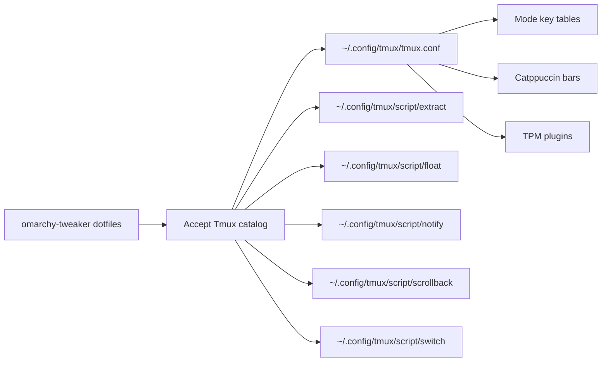

# Tmux Dotfiles

This page is the practical usage guide for the custom Tmux configuration bundled with
Omarchy Tweaker. It explains what the custom setup does, how to use its mode-based
keybindings, how the helper scripts fit together, and how to inspect or change each part.

For an explanation of the dotfile catalog system itself, see **[Dotfiles](dotfiles.md)**.

!!! note "Catalog scope"
    The `Tmux` catalog only links the bundled `tmux.conf` and five helper scripts. It does
    not install Tmux, `fzf`, Python 3, `nvim`, `wl-copy`, a Nerd Font, or any TPM plugin.
    The catalog directory is named `Tmux`, so that is the name shown in the dotfiles
    confirmation prompt.

---

## What this custom setup gives you

The `Tmux` catalog links a Catppuccin Macchiato terminal workspace with:

- A Catppuccin Macchiato palette applied to tabs, borders, popups, hints, and notifications.
- A top bar with tabs on the left, a temporary notification pill in the center, and the
  session name on the right.
- A bottom bar with a mode chip and live key hints on the left and an Alt-key strip on the
  right, drawn through the bottom pane border.
- Zellij-style modes for panes, tabs, resizing, moving, sessions, native tmux commands,
  scrollback, and locked pass-through.
- Mouse support, vi copy mode, Wayland clipboard copying through `wl-copy`, 50,000 lines of
  history, and windows/panes numbered from 1.
- Automatic tab names based on the current directory, with manual renames pinned per tab.
- Five helper scripts for extraction, floating panes, notifications, scrollback editing,
  and fuzzy pane switching.
- TPM-managed `tmux-resurrect` and `tmux-continuum` for manual and automatic session
  persistence.



---

## Requirements

The dotfile command only needs an interactive terminal and a writable home directory. To
use every linked feature, install these separately:

| Tool | Used for |
|---|---|
| `tmux` 3.4 or newer | The linked configuration itself. |
| A Nerd Font | Mode icons, separators, and bar glyphs. |
| `fzf` | `script/extract` and `script/switch`. |
| Python 3 | `script/extract`. |
| `nvim` | Scrollback editing and config editing from session mode. |
| `wl-copy` | Copying through the Wayland clipboard. |
| `xdg-open` | Opening URLs from the extraction picker. |
| `git` and network access | First-time TPM and plugin installation. |

!!! warning "Terminal key conflicts"
    `Ctrl h`, `Ctrl n`, `Ctrl p`, `Ctrl s`, and `Ctrl o` are mode keys, so they do not reach
    applications. Configure Backspace to send DEL instead of `Ctrl h`, and use
    **[Locked mode](#locked-mode)** when an application needs those keys.

---

## Install and verify

Run the dotfiles command and accept the `Tmux` catalog:

```bash
omarchy-tweaker dotfiles
```

Then check the linked files:

```bash
ls -l ~/.config/tmux/tmux.conf
ls -l ~/.config/tmux/script/*
tmux -V
tmux list-keys | less -S
```

Reload the configuration from an existing session with `Ctrl b`, then `r`, or manually:

```bash
tmux source-file ~/.config/tmux/tmux.conf
```

If the configuration was changed outside the catalog, restore it by rerunning
`omarchy-tweaker dotfiles`. Existing destinations are backed up before replacement.

---

## Linked files

| Bundled source | Destination | Purpose |
|---|---|---|
| `src/omarchy_tweaker/dotfiles/Tmux/config` | `~/.config/tmux/tmux.conf` | Main Tmux configuration. |
| `src/omarchy_tweaker/dotfiles/Tmux/script/extract` | `~/.config/tmux/script/extract` | Scrollback extraction picker. |
| `src/omarchy_tweaker/dotfiles/Tmux/script/float` | `~/.config/tmux/script/float` | Persistent floating pane session. |
| `src/omarchy_tweaker/dotfiles/Tmux/script/notify` | `~/.config/tmux/script/notify` | Notification pill in the top bar. |
| `src/omarchy_tweaker/dotfiles/Tmux/script/scrollback` | `~/.config/tmux/script/scrollback` | Scrollback editing in `nvim`. |
| `src/omarchy_tweaker/dotfiles/Tmux/script/switch` | `~/.config/tmux/script/switch` | Fuzzy pane switcher. |

The helper directory is singular: `~/.config/tmux/script/`. Do not rename it to `scripts/`
without also updating `config.toml` and every command in `tmux.conf`.

---

## Directory-based session names

Tmux does not automatically attach to a session named after the current directory. Add a
small wrapper to `~/.zshrc` if you want one session per project directory:

```bash
function tmux() {
    if [[ -z "$TMUX" ]] && [[ $# -eq 0 ]]; then
        local session
        session="$(basename "$PWD")"
        command tmux attach-session -t "$session" 2>/dev/null ||
        command tmux new-session -s "$session"
    else
        command tmux "$@"
    fi
}
```

The wrapper only changes the bare `tmux` invocation. Commands such as `tmux ls`,
`tmux attach -t name`, and `tmux new -s name` pass through unchanged. `command tmux`
prevents recursion.

---

## Modes

The configuration replaces the default prefix-first workflow with modes that stay active
until you change them. Press `Esc`, `Enter`, or `Ctrl c` in most modes to return to normal.

| Key | Mode | Purpose |
|---|---|---|
| `Ctrl p` | Pane | Split, focus, rename, zoom, float, and close panes. |
| `Ctrl t` | Tab | Switch, create, rename, break, and synchronize windows. |
| `Ctrl n` | Resize | Grow and shrink the active pane. |
| `Ctrl h` | Move | Swap panes in directions. |
| `Ctrl s` | Scroll | Enter copy mode with vi-style navigation. |
| `Ctrl o` | Session | Choose sessions, layouts, config, keys, and detach. |
| `Ctrl b` | Tmux | Use familiar native tmux prefix-style commands. |
| `Ctrl g` | Locked | Pass all keys to the application until `Ctrl g` again. |

### Global keys

These work in normal mode and are repeated in the other modes so they remain available:

| Key | Action |
|---|---|
| `Alt n` | New pane, split horizontally for wide panes or vertically otherwise. |
| `Alt f` | Toggle the persistent floating pane session. |
| `Alt h` / `Alt j` / `Alt k` / `Alt l` | Focus pane left, down, up, or right. |
| `Alt Left` / `Alt Right` | Focus pane, or move to the previous/next tab at an edge. |
| `Alt Up` / `Alt Down` | Focus pane vertically. |
| `Alt i` / `Alt o` | Move the current tab left or right. |
| `Alt [` / `Alt ]` | Previous or next layout. |
| `Alt +` / `Alt =` / `Alt -` | Grow or shrink the active pane. |
| `Alt P` | Join the marked pane. |
| `Alt z` | Zoom the active pane. |
| `Alt p` | Mark or unmark the active pane and show a notification. |
| `Alt Shift p` | Join the marked pane. |
| `Ctrl Space` | Open the fuzzy pane switcher. |
| `Alt x` | Extract all supported text from the pane. |
| `Alt y` | Extract URLs from the tab. |
| `Alt v` | Extract files and diagnostics from the tab. |
| `Alt 1`–`Alt 9`, `Alt 0` | Select tab 1–9 or 10. |
| `Alt u` | Kill the active pane. |

### Pane mode

Enter with `Ctrl p`:

| Key | Action |
|---|---|
| `h` / `j` / `k` / `l` or arrows | Focus a pane. |
| `;` | Last pane. |
| `p` | Next pane. |
| `n` | New pane with automatic orientation. |
| `d` / `r` | Split down or right. |
| `s` | Stacked split with zoom. |
| `f` | Zoom the pane. |
| `F` | Fullscreen mode that hides both bars. |
| `w` | Toggle the floating pane. |
| `z` | Toggle the bars. |
| `c` | Rename the pane. |
| `x` | Close the pane. |
| `Esc`, `Enter`, `Ctrl c` | Return to normal mode. |

### Tab mode

Enter with `Ctrl t`. Tmux windows are presented as tabs:

| Key | Action |
|---|---|
| `h` / `j` / `k` / `l` or arrows | Previous or next tab. |
| `Tab` | Last tab. |
| `1`–`9` | Select tab 1–9. |
| `n` / `x` | New or close tab. |
| `r` | Rename the tab. |
| `b` | Break the pane into its own tab. |
| `[` / `]` | Break the pane to the left or right. |
| `s` | Toggle pane synchronization and show a notification. |
| `Esc`, `Enter`, `Ctrl c` | Return to normal mode. |

### Resize mode

Enter with `Ctrl n`:

| Key | Action |
|---|---|
| `h` / `j` / `k` / `l` | Grow the pane left, down, up, or right. |
| `H` / `J` / `K` / `L` | Shrink the opposite border. |
| `+` / `=` | Grow right and down together. |
| `-` | Shrink left and up together. |
| `Esc`, `Enter`, `Ctrl c` | Return to normal mode. |

### Move mode

Enter with `Ctrl h`:

| Key | Action |
|---|---|
| `h` / `j` / `k` / `l` or arrows | Swap the pane with its neighbor. |
| `n` / `Tab` | Swap down. |
| `p` | Swap up. |
| `Esc`, `Enter`, `Ctrl c` | Return to normal mode. |

### Session mode

Enter with `Ctrl o`:

| Key | Action |
|---|---|
| `w` | Open the session, window, and pane tree. |
| `l` | Open the layout menu. |
| `c` | Edit `tmux.conf` in `nvim` and source it on exit. |
| `p` | Page through `tmux list-keys`. |
| `s` | Create a named session. |
| `a` | Show the configuration banner. |
| `[` / `]` | Previous or next session. |
| `d` | Detach. |
| `Esc`, `Enter`, `Ctrl c` | Return to normal mode. |

### Tmux mode

Enter with `Ctrl b`. This mode restores familiar native tmux commands while keeping the
Zellij-style global keys:

| Key | Action |
|---|---|
| `h` / `j` / `k` / `l` or arrows | Focus a pane. |
| `"` / `%` | Split down or right. |
| `c` | New tab. |
| `,` | Rename the tab. |
| `n` / `p` | Next or previous tab. |
| `o` | Next pane. |
| `z` | Zoom the pane. |
| `Space` | Next layout. |
| `[` | Copy mode. |
| `x` / `d` | Close the pane or detach. |
| `r` | Reload the configuration. |
| `?` | Page through `tmux list-keys`. |
| `Ctrl b` | Send the prefix through to a nested session. |
| `Esc`, `Enter`, `Ctrl c` | Return to normal mode. |

`tmux-resurrect` adds its own save and restore bindings when plugins load: `Ctrl b`, then
`Ctrl s` to save and `Ctrl b`, then `Ctrl r` to restore.

### Scroll mode

Enter with `Ctrl s`:

| Key | Action |
|---|---|
| `j` / `k` or `Down` / `Up` | Scroll one line. |
| `h` / `l` or `Left` / `Right` | Page up or down. |
| `u` / `d` | Half page up or down. |
| `PageUp` / `PageDown` | Page up or down. |
| `Ctrl b` / `Ctrl f` | Page up or down. |
| `[` / `]` | Previous or next prompt. |
| `s` | Incremental search upward. |
| `n` / `p` | Next or previous match. |
| `v` | Begin a visual selection. |
| `y` | Copy the selection and cancel copy mode. |
| `e` | Open the whole pane history in `nvim`. |
| `Esc`, `Enter`, `Ctrl c`, `q`, `Ctrl s` | Cancel copy mode. |

Dragging with the mouse selects text, and double-clicking selects a word and copies it.

### Locked mode

Press `Ctrl g` from any mode to pass keys directly to the active application. The bottom
bar shows a red `LOCKED` chip. Press `Ctrl g` again to restore the normal key table and
prefix.

---

## Helper scripts

| Script | Trigger | What it does |
|---|---|---|
| `script/extract` | `Alt x`, `Alt y`, `Alt v` | Finds URLs, paths, diagnostics, hashes, IPs, UUIDs, quotes, commands, and secret-like strings, then lets you copy, open, edit, or insert them. |
| `script/float` | `Alt f`, pane mode `w` | Attaches to a hidden `float_<parent>` session so the shell keeps running when the popup is hidden. |
| `script/notify` | Bell hook and manual calls | Shows a temporary message in the center of the top bar. |
| `script/scrollback` | Scroll mode `e` | Captures the entire pane history to a temporary file and opens it read-only in `nvim`. |
| `script/switch` | `Ctrl Space` | Uses `fzf` to jump to any pane; `ctrl-x` closes the selected pane. Falls back to `tmux choose-tree` without `fzf`. |

Extraction picker keys:

| Key | Action |
|---|---|
| `Enter` | Default action for the match type. |
| `Ctrl y` | Copy. |
| `Ctrl o` | Open with `xdg-open`. |
| `Ctrl e` | Edit in the editor. |
| `Alt Enter` | Insert at the prompt without running. |
| `Tab` | Multi-select. |
| `Alt 1`–`Alt 5` | Switch between quick, deep, viewport, tab, and full profiles. |
| `Ctrl /` | Toggle the preview. |

Secret-like matches are masked in the picker and only allow copying. Commands are inserted
rather than executed automatically.

Manual notifications:

```bash
~/.config/tmux/script/notify -l ok "build finished"
~/.config/tmux/script/notify -l warn -t 5 "check failed"
~/.config/tmux/script/notify --clear
```

Optional zsh hook for long commands:

```bash
preexec() { _t0=$EPOCHSECONDS }
precmd()  {
  [[ -n $_t0 && $((EPOCHSECONDS - _t0)) -ge 30 && -n $TMUX ]] &&
    ~/.config/tmux/script/notify -l ok "done in $((EPOCHSECONDS - _t0))s"
  unset _t0
}
```

---

## Plugins and persistence

The configuration uses TPM and stores plugins in `~/.config/tmux/plugins/`:

| Plugin | Purpose |
|---|---|
| `tmux-plugins/tpm` | Installs, updates, and removes plugins. |
| `tmux-plugins/tmux-resurrect` | Manually saves and restores sessions, windows, panes, and folders. |
| `tmux-plugins/tmux-continuum` | Autosaves every 10 minutes and restores on startup. |

On first load, the configuration clones TPM when `~/.config/tmux/plugins/tpm` is missing,
then runs `install_plugins`. This needs `git` and network access. Use `Ctrl b`, `I` to
install after adding plugins, `Ctrl b`, `U` to update, and `Ctrl b`, `M-u` to remove after
deleting a plugin line.

The top bar deliberately uses `status-format[0]` instead of `status-right`, so the
continuum autosave tick is called at the end of that format. The path
`~/.config/tmux/plugins/tmux-continuum/scripts/continuum_save.sh` is plugin-internal and
is not one of the five catalog helpers.

---

## Customization

Edit the linked files rather than the bundled sources if you only want a local change.
Rerunning `omarchy-tweaker dotfiles` backs up and replaces those linked files, so permanent
changes belong in the catalog under `src/omarchy_tweaker/dotfiles/Tmux/`.

Useful starting points in `tmux.conf`:

- `C_*` variables in the palette section control every bar color.
- `@bar_*` options define each mode chip and hint strip.
- The `KEYBINDS` section holds the mode tables and global bindings.
- The `PLUGINS · TPM` section holds plugin declarations and optional extras.

Keep the `run "~/.config/tmux/plugins/tpm/tpm"` line at the bottom. After editing, verify
with `tmux source-file ~/.config/tmux/tmux.conf` and `tmux list-keys`.

---

## Safety notes

- The catalog links configuration and scripts only; it does not install packages or edit
  shell startup files.
- Existing destinations are backed up before replacement, and the wrapper and zsh hooks on
  this page are applied manually by the user.
- `Ctrl g` locked mode is the safest way to hand keys back to an application.
- Mode keys intentionally override normal tmux and application shortcuts; review the
  [global keys](#global-keys) before using the config with keyboard-heavy tools.
- TPM auto-install needs network access and runs plugin code from third-party repositories.
- `script/extract` reads pane scrollback and can copy or insert matched text; review results
  before acting on secrets.
- `script/switch` can close panes with `ctrl-x`; `script/scrollback` writes a temporary file
  under `/tmp` and removes it when `nvim` exits.

---

## Related pages

- [Dotfiles](dotfiles.md)
- [Bat Dotfiles](bat.md)
- [Foot Dotfiles](foot.md)
- [Zellij Dotfiles](zellij.md)
- [Git Dotfiles](git.md)
- [Lazygit Dotfiles](lazygit.md)
- [Tig Dotfiles](tig.md)
- [Starship Dotfiles](starship.md)
- [Superfile Dotfiles](superfile.md)
- [Commands](commands.md)
- [Security](security.md)
- [Troubleshooting](troubleshooting.md)
