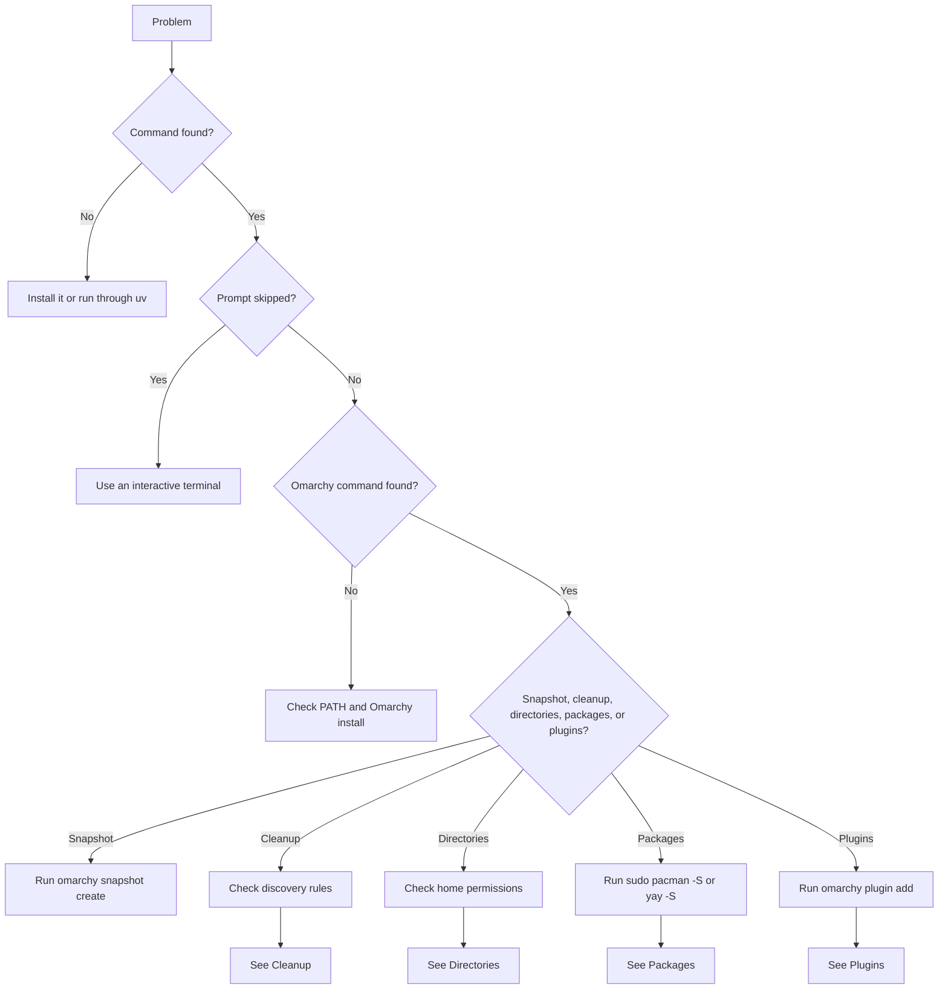
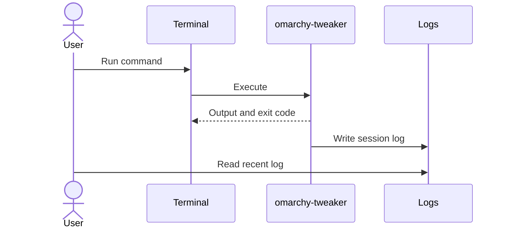

# Troubleshooting

Common problems and how to diagnose them.



| Symptom | Likely cause | Next step |
|:--|:--|:--|
| `omarchy-tweaker` not found | Checkout not on `PATH`, or tool bin directory missing | Run through `uv` or install globally. |
| Snapshot, cleanup, directory setup, package installation, or plugin installation skipped | No interactive TTY | Run directly in a terminal. |
| `omarchy` not found | Omarchy CLI not on `PATH` | Verify the Omarchy installation. |
| `pacman` or `yay` not found | Package manager or AUR helper missing from `PATH` | Install the missing command or fix `PATH`. |
| Snapshot fails | Snapshot tooling, permissions, or disk space | Run `omarchy snapshot create` directly. |
| Cleanup list is empty | Items do not match discovery rules | Check the category-specific commands below. |
| Removal fails | `sudo`, package state, or package-manager lock | Run the underlying Omarchy command directly. |
| Directory creation fails | Parent is missing, a file occupies the path, or home is not writable | Check the fixed targets and permissions below. |
| Package installation fails | `sudo`, `yay`, network, package state, or package-manager lock | Run the underlying `pacman` or `yay` command directly. |
| Plugin installation fails | `omarchy`, `git`, network, validation, or an existing plugin ID | Run `omarchy plugin add` directly and inspect its output. |
| Plugin patch fails | Missing patch file, `bash`, `gum`, or an unexpected plugin version | Run the patch script directly or inspect the plugin file. |
| Icons are missing | Terminal lacks a Nerd Font | Install and configure a Nerd Font. |
| Docs build fails | Generated files or broken links | See [Development](development.md#troubleshooting). |

---

## The `omarchy-tweaker` command is not found

From a source checkout, run it through `uv`:

```bash
uv run omarchy-tweaker --help
```

To install the command globally:

```bash
uv tool install .
```

If you already installed it, make sure uv's tool directory is on `PATH`:

```bash
uv tool dir --bin
```

---

## Interactive steps are skipped

Snapshot confirmation, cleanup selection, package selection, and directory creation require
an interactive terminal. They check that both standard input and standard output are TTYs.

```text
Snapshot skipped: confirmation requires an interactive terminal.
Cleanup skipped: selecting items requires an interactive terminal.
Package installation skipped: selecting packages requires an interactive terminal.
Plugin installation skipped: selecting plugins requires an interactive terminal.
Directory setup skipped: creating directories requires an interactive terminal.
```

Run the command directly in a terminal instead of through a pipe, IDE runner, CI job, or
non-interactive shell. For snapshot automation, use `--yes`:

```bash
omarchy-tweaker snapshot --yes
```

Cleanup intentionally has no non-interactive removal mode. Package and plugin installation
intentionally have no non-interactive mode. Directory setup intentionally has no
non-interactive creation mode.

---

## The `omarchy` command is not found

Omarchy Tweaker delegates snapshot and removal work to Omarchy commands.

```bash
command -v omarchy
```

If nothing is printed, `omarchy` is not on `PATH`. Confirm that you are running Omarchy
Linux and that the Omarchy CLI is installed and available in your shell.

---

## Snapshot creation fails

Run the underlying command directly:

```bash
omarchy snapshot create
```

Check that Omarchy's snapshot tooling is configured, `snapper` is available if your setup
uses it, there is enough disk space, and permissions are not blocking the operation.
Omarchy Tweaker uses a **600 second** timeout; a timeout is reported as a failure.

---

## Cleanup shows no items

Cleanup discovers items at runtime. Check the category that is empty:

| Category | Check | Rule |
|:--|:--|:--|
| Packages | `pacman -Qq` | Must be installed and in Omarchy's preinstall removal list. |
| Web apps | `ls ~/.local/share/applications/*.desktop` | `Exec` must use `omarchy-launch-webapp` or `omarchy-webapp-handler`. |
| TUIs | Same directory | `Exec` must use `$TERMINAL` or `xdg-terminal-exec` with `-e`. |
| Mise wrappers | `rg '^\s*mise use -g\b' ~/.local/bin` | Regular, non-symlink file up to **128,000 bytes**. |

See **[Cleanup](cleanup.md#discovery)** for the full discovery rules.

---

## Package removal fails

Run the underlying command directly:

```bash
omarchy pkg drop <package>
```

Common causes include a `sudo` password prompt or expired authentication, a package that is
no longer installed, another package-manager process holding a lock, or a package required
by another installed package. Cleanup reports failed items and exits with code `1`.

---

## Package installation fails

Run the underlying command directly:

```bash
sudo pacman -S --noconfirm --needed --noprogressbar <package>
yay -S --noconfirm --needed --noprogressbar <package>
```

Common causes include a `sudo` password prompt or expired authentication, a missing `yay`
AUR helper, network problems, another package-manager process holding a lock, or a package
conflict. Each package group has a **900 second** timeout. Package installation reports
failures and exits with code `1`.

---

## Plugin installation fails

Run the underlying plugin command directly:

```bash
omarchy plugin add <url> --yes --enable
```

Common causes include `omarchy` not being on `PATH`, `git` being unavailable, network
problems, plugin validation failure, an already-installed plugin ID, or a repository that is
not reachable. Omarchy Tweaker uses a **300 second** timeout for plugin add operations and a
**60 second** timeout for placement.

If a configured position was not applied, verify the plugin ID and placement manually:

```bash
omarchy plugin list
omarchy plugin enable <id> --section left
```

See **[Plugins](plugins.md)** for the catalog and placement rules.

---

## Plugin patch fails

Run the patch script directly to inspect the error:

```bash
bash patches/<patch-file>
```

The bundled patches require `gum` and `bash`. They also expect the plugin's original file to
contain the exact code they patch. If the plugin was updated, the expected code may have
changed; review the patch and the plugin file before applying it manually. Patch scripts
create a `.bak` backup and restore it when verification fails.

If the repository-level `patches/` directory is not available, set:

```bash
OMARCHY_TWEAKER_PATCHES_DIR=/path/to/patches omarchy-tweaker plugins
```

---

## A Mise wrapper cannot be removed

Cleanup only unlinks paths that are absolute, name a file, and resolve inside your home
directory. If the wrapper is a symlink or lives outside the home directory, cleanup refuses
to remove it. Remove it manually after verifying the path.

---

## Directory setup fails

Directory setup uses fixed paths beneath your home directory. Check the target directly:

```bash
ls -ld ~/Github ~/Github/Clone ~/Projects ~/Projects/Containers ~/.ISO ~/.VM ~/.Cloud
```

Common causes:

- The parent directory was declined, so its child is skipped.
- A regular file or broken symlink already occupies the target path.
- Your home directory is not writable.
- The target path exists but is not a directory.

Existing directories are left untouched. To resolve a file conflict, inspect and move the
existing path manually before running `omarchy-tweaker directories` again. Directory setup
does not use `sudo` and does not change ownership.

See **[Directories](directories.md)** for the complete target list and safety model.

---

## Icons look wrong or are missing

The UI uses Nerd Font glyphs. Install a Nerd Font and configure your terminal to use it.
Missing glyphs do not affect functionality.

---

## Where are the logs?

Logs default to `$XDG_STATE_HOME/omarchy_tweaker/logs/` or
`~/.local/state/omarchy_tweaker/logs/`. List recent logs with:

```bash
ls -lt "${XDG_STATE_HOME:-$HOME/.local/state}/omarchy_tweaker/logs" | head
```

Override the directory for one run with `OMARCHY_TWEAKER_LOG_DIR`. See
**[Getting Started](getting-started.md#logs)** for locations and log contents. Review logs
before sharing them publicly.

---

### Collect diagnostics



## Still stuck?

Collect the following before opening an issue:

- The exact command you ran.
- The terminal output.
- The relevant log file.
- Your Omarchy version and Python version.
- Whether the command was run in an interactive terminal.

Report bugs at [GitHub Issues](https://github.com/Armoghans-Organization/Omarchy-Tweaker/issues).

---

## Related pages

- [Getting Started](getting-started.md)
- [Commands](commands.md)
- [Cleanup](cleanup.md)
- [Directories](directories.md)
- [Packages](packages.md)
- [Plugins](plugins.md)
- [Development](development.md)
