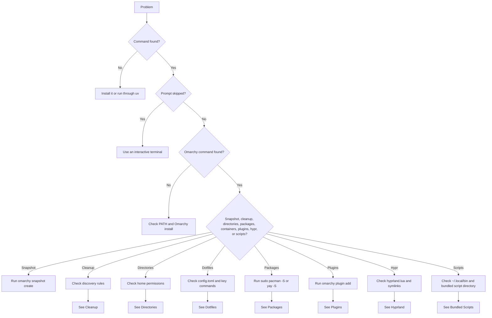
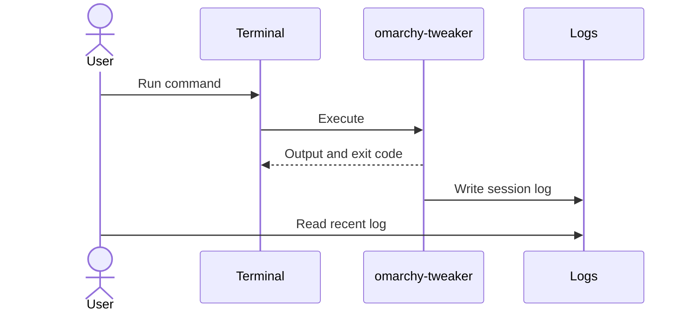

# Troubleshooting

Common problems and how to diagnose them.



| Symptom | Likely cause | Next step |
|:--|:--|:--|
| `omarchy-tweaker` not found | Checkout not on `PATH`, or tool bin directory missing | Run through `uv` or install globally. |
| Snapshot, cleanup, directory setup, dotfile setup, package installation, container setup, plugin installation, Hyprland configuration, or script linking skipped | No interactive TTY | Run directly in a terminal. |
| `omarchy` not found | Omarchy CLI not on `PATH` | Verify the Omarchy installation. |
| `pacman` or `yay` not found | Package manager or AUR helper missing from `PATH` | Install the missing command or fix `PATH`. |
| Snapshot fails | Snapshot tooling, permissions, or disk space | Run `omarchy snapshot create` directly. |
| Cleanup list is empty | Items do not match discovery rules | Check the category-specific commands below. |
| Removal fails | `sudo`, package state, or package-manager lock | Run the underlying Omarchy command directly. |
| Directory creation fails | Parent is missing, a file occupies the path, or home is not writable | Check the fixed targets and permissions below. |
| Package installation fails | `sudo`, `yay`, network, package state, or package-manager lock | Run the underlying `pacman` or `yay` command directly. |
| Plugin installation fails | `omarchy`, `git`, network, validation, or an existing plugin ID | Run `omarchy plugin add` directly and inspect its output. |
| Plugin patch fails | Missing patch file, `bash`, `gum`, or an unexpected plugin version | Run the patch script directly or inspect the plugin file. |
| Zsh aliases or helpers are missing | `~/.config/zsh/`, `~/.local/bin/`, or `~/.zshrc` links are missing, or `~/.zshrc` is not sourced | Check the linked paths and open a new interactive shell. |
| Icons are missing | Terminal lacks a Nerd Font | Install and configure a Nerd Font. |
| Docs build fails | Generated files or broken links | See [Development](development.md#troubleshooting). |

---

## The `omarchy-tweaker` command is not found

From a source checkout, run it through `uv`:

```bash
uv run omarchy-tweaker --help
```

To install the command globally:

```bash
uv tool install .
```

If you already installed it, make sure uv's tool directory is on `PATH`:

```bash
uv tool dir --bin
```

---

## Interactive steps are skipped

Snapshot confirmation, cleanup selection, package selection, and directory creation require
an interactive terminal. They check that both standard input and standard output are TTYs.

```text
Snapshot skipped: confirmation requires an interactive terminal.
Cleanup skipped: selecting items requires an interactive terminal.
Package installation skipped: selecting packages requires an interactive terminal.
Plugin installation skipped: selecting plugins requires an interactive terminal.
Directory setup skipped: creating directories requires an interactive terminal.
```

Run the command directly in a terminal instead of through a pipe, IDE runner, CI job, or
non-interactive shell. For snapshot automation, use `--yes`:

```bash
omarchy-tweaker snapshot --yes
```

Cleanup intentionally has no non-interactive removal mode. Package and plugin installation
intentionally have no non-interactive mode. Directory setup intentionally has no
non-interactive creation mode.

---

## The `omarchy` command is not found

Omarchy Tweaker delegates snapshot and removal work to Omarchy commands.

```bash
command -v omarchy
```

If nothing is printed, `omarchy` is not on `PATH`. Confirm that you are running Omarchy
Linux and that the Omarchy CLI is installed and available in your shell.

---

## Snapshot creation fails

Run the underlying command directly:

```bash
omarchy snapshot create
```

Check that Omarchy's snapshot tooling is configured, `snapper` is available if your setup
uses it, there is enough disk space, and permissions are not blocking the operation.
Omarchy Tweaker uses a **600 second** timeout; a timeout is reported as a failure.

---

## Cleanup shows no items

Cleanup discovers items at runtime. Check the category that is empty:

| Category | Check | Rule |
|:--|:--|:--|
| Packages | `pacman -Qq` | Must be installed and in Omarchy's preinstall removal list. |
| Web apps | `ls ~/.local/share/applications/*.desktop` | `Exec` must use `omarchy-launch-webapp` or `omarchy-webapp-handler`. |
| TUIs | Same directory | `Exec` must use `$TERMINAL` or `xdg-terminal-exec` with `-e`. |
| Mise wrappers | `rg '^\s*mise use -g\b' ~/.local/bin` | Regular, non-symlink file up to **128,000 bytes**. |

See **[Cleanup](cleanup.md#discovery)** for the full discovery rules.

---

## Package removal fails

Run the underlying command directly:

```bash
omarchy pkg drop <package>
```

Common causes include a `sudo` password prompt or expired authentication, a package that is
no longer installed, another package-manager process holding a lock, or a package required
by another installed package. Cleanup reports failed items and exits with code `1`.

---

## Package installation fails

Run the underlying command directly:

```bash
sudo pacman -S --noconfirm --needed --noprogressbar <package>
yay -S --noconfirm --needed --noprogressbar <package>
```

Common causes include a `sudo` password prompt or expired authentication, a missing `yay`
AUR helper, network problems, another package-manager process holding a lock, or a package
conflict. Each package group has a **900 second** timeout. Package installation reports
failures and exits with code `1`.

---

## Plugin installation fails

Run the underlying plugin command directly:

```bash
omarchy plugin add <url> --yes --enable
```

Common causes include `omarchy` not being on `PATH`, `git` being unavailable, network
problems, plugin validation failure, an already-installed plugin ID, or a repository that is
not reachable. Omarchy Tweaker uses a **300 second** timeout for plugin add operations and a
**60 second** timeout for placement.

If a configured position was not applied, verify the plugin ID and placement manually:

```bash
omarchy plugin list
omarchy plugin enable <id> --section left
```

See **[Plugins](plugins.md)** for the catalog and placement rules.

---

## Plugin patch fails

Run the patch script directly to inspect the error:

```bash
bash patches/<patch-file>
```

The bundled patches require `gum` and `bash`. They also expect the plugin's original file to
contain the exact code they patch. If the plugin was updated, the expected code may have
changed; review the patch and the plugin file before applying it manually. Patch scripts
create a `.bak` backup and restore it when verification fails.

If the repository-level `patches/` directory is not available, set:

```bash
OMARCHY_TWEAKER_PATCHES_DIR=/path/to/patches omarchy-tweaker plugins
```

---

## A Mise wrapper cannot be removed

Cleanup only unlinks paths that are absolute, name a file, and resolve inside your home
directory. If the wrapper is a symlink or lives outside the home directory, cleanup refuses
to remove it. Remove it manually after verifying the path.

---

## Directory setup fails

Directory setup uses fixed paths beneath your home directory. Check the target directly:

```bash
ls -ld ~/Github ~/Github/Clone ~/Projects ~/Projects/Containers ~/.ISO ~/.VM ~/.Cloud
```

Common causes:

- The parent directory was declined, so its child is skipped.
- A regular file or broken symlink already occupies the target path.
- Your home directory is not writable.
- The target path exists but is not a directory.

Existing directories are left untouched. To resolve a file conflict, inspect and move the
existing path manually before running `omarchy-tweaker directories` again. Directory setup
does not use `sudo` and does not change ownership.

See **[Directories](directories.md)** for the complete target list and safety model.

---

## Dotfile setup fails

Inspect the Git destinations and key files:

```bash
ls -l ~/.config/git
ls -l ~/.ssh/id_ed25519 ~/.ssh/id_ed25519.pub
gpg --homedir ~/.gnupg --list-secret-keys
```

Common causes:

- A catalog `config.toml` is missing or contains a path outside the home directory.
- `ssh-keygen` or `gpg` is missing from `PATH`.
- The home directory or `~/.config/git` is not writable.
- A bundled source named in `config.toml` is missing.
- The command was run without an interactive terminal.

Existing destinations are backed up before replacement, and a failed symlink or template
write restores the backup. Existing SSH and GPG private keys are reused rather than
overwritten. If GPG fingerprint discovery fails after generation, run
`gpg --homedir ~/.gnupg --list-secret-keys` to inspect the keyring.

See **[Dotfiles](dotfiles.md)** for the catalog format and safety model, and
**[Git Dotfiles](git.md)** for Git-specific checks and setup steps.

### Starship prompt issues

Check the linked prompt config:

```bash
ls -l ~/.config/starship.toml
starship --version
starship explain
```

Common causes:

- Starship is installed but not initialized in `~/.zshrc`.
- The terminal is not using a Nerd Font, so prompt icons render as boxes.
- The config file was removed or replaced with a regular file instead of the managed symlink.
- A custom module depends on a missing tool such as `hugo`, `pgrep`, or `docker`.
- `command_timeout` or `scan_timeout` is too low for slower machines or large repositories.

See **[Starship Dotfiles](starship.md)** for module requirements, cheat sheets, and
customization notes.

### Lazygit config issues

Check the linked config and the tools it calls:

```bash
ls -l ~/.config/lazygit/config.yml
lazygit --version
command -v delta
command -v nvim
command -v tig
command -v xdg-open
```

Common causes:

- Icons render as boxes when no Nerd Font is configured.
- Delta diffs are plain or missing when `delta` is absent or lacks the `mantis-shrimp` feature.
- Editor and open actions fail when `nvim` or `xdg-open` is missing from `PATH`.
- The `t` file-history command needs `tig`.
- The `c` Conventional Commit command only runs from the Files panel.
- `XDG_CONFIG_HOME` may point lazygit to a different config location.
- The config file may have been replaced with a regular file instead of the managed symlink.

See **[Lazygit Dotfiles](lazygit.md)** for keybindings, external command requirements, and
customization notes.

### Tig config issues

Check the linked config and the tools it calls:

```bash
ls -l ~/.config/tig/config
tig --version
command -v delta
command -v meld
command -v wl-copy
git config --get diff.tool
```

Common causes:

- Colors do not look Catppuccin-like when the terminal palette is not configured.
- The commit graph renders poorly without UTF-8 locale and terminal support.
- The `D` diff binding needs `delta`.
- The `M` diff binding needs `meld` and `git config --get diff.tool` set to `meld`.
- The `y` binding needs `wl-copy` and a Wayland session.
- `XDG_CONFIG_HOME` may point Tig to a different config location.
- The config file may have been replaced with a regular file instead of the managed symlink.

See **[Tig Dotfiles](tig.md)** for keybindings, external command requirements, and
customization notes.

### Bat config issues

Check the linked config, installed version, theme, and pager:

```bash
ls -l ~/.config/bat/config
bat --config-file
bat --version
bat --list-themes
command -v less
BAT_CONFIG_PATH=~/.config/bat/config bat --paging=never --color=never pyproject.toml > /dev/null
```

Common causes:

- `BAT_CONFIG_PATH` overrides the linked `~/.config/bat/config`.
- The Catppuccin Macchiato theme is missing on older Bat versions; install it and run `bat cache --build`.
- Config-option changes do not require a cache rebuild, but theme or syntax asset changes do.
- Colors are automatic by default, so pipes and redirects normally contain no ANSI codes; use `--color=always` only when that is intentional.
- Colors disappear in a terminal when the terminal, pipe, or downstream tool strips ANSI codes.
- `--decorations=always` keeps headers and line numbers in piped output; use `bat -p` for plain output.
- The configured `less` command uses `-R`, `-F`, `-K`, `-X`, `-i`, `-j.5`, `--mouse`, and `--wheel-lines`; override with `--pager="less -R"` or `--paging=never`.
- Syntax mappings must use exact names from `bat --list-languages`; otherwise use `-l` to force one.
- The config file may have been replaced with a regular file instead of the managed symlink.

See **[Bat Dotfiles](bat.md)** for config options, pager details, and customization notes.

### Foot config issues

Check the linked config and validate it with Foot:

```bash
ls -l ~/.config/foot/foot.ini
foot --version
foot --check-config
ls -l ~/.local/state/omarchy/current/theme/foot.ini
```

Common causes:

- The Omarchy current theme state is missing or stale, so the theme include has no colors.
- Hack Nerd Font or Noto Color Emoji is not installed.
- `clipboard-paste=Control+v` can conflict with applications that expect `Ctrl+v` themselves.
- `Shift+Return` needs a TUI that understands CSI-u sequences.
- The `[bell] command` option must be empty or a real program, never `yes` or `no`.
- Foot reads its config at startup; open a new window or run `omarchy restart terminal`.
- The config file may have been replaced with a regular file instead of the managed symlink.

See **[Foot Dotfiles](foot.md)** for terminal options, key bindings, and customization notes.

### Superfile config issues

Check the linked files and the tools the config calls:

```bash
ls -l ~/.config/superfile/config.toml
ls -l ~/.config/superfile/hotkeys.toml
ls -l ~/.config/superfile/theme/catppuccin-frappe.toml
command -v spf
command -v bat
command -v nvim
command -v exiftool
command -v md5sum
command -v zoxide
```

Common causes:

- The theme does not load when a theme symlink is missing or `XDG_CONFIG_HOME` redirects Superfile.
- Extra spaces around a theme name can prevent the theme from being found.
- Icons appear as boxes without a Nerd Font.
- Code previews stay plain without `bat` or when `code_previewer` is misconfigured.
- Image previews need terminal image-protocol support.
- Transparency needs terminal transparency support.
- Metadata and MD5 actions need `exiftool` and `md5sum`.
- `z` needs `zoxide` and its shell integration.
- `cd_on_quit` needs Superfile's shell integration or wrapper.
- The config files may have been replaced with regular files instead of managed symlinks.

See **[Superfile Dotfiles](superfile.md)** for settings, keybindings, theme details, and
customization notes.

### Zellij config issues

Check the linked files, config status, and external tools:

```bash
ls -l ~/.config/zellij/config.kdl
ls -l ~/.config/zellij/zextract.kdl
ls -l ~/.config/zellij/layouts/*.kdl
zellij setup --check
zellij list-aliases
zellij --version
```

Common causes:

- `The layout was not found, File: custom` means the layout file is missing or was not linked into `~/.config/zellij/layouts/`.
- A `layout_dir "~/..."` setting does not expand `~`; leave it unset and rely on the default `~/.config/zellij/layouts` directory.
- The in-app configuration UI rewrites `config.kdl`, drops comments, and creates `config.kdl.bak.N` backups.
- Because `clear-defaults=true`, unlisted keys appear to do nothing until they are added to the bundled config.
- Plugins need network access on first download and a Nerd Font for glyphs.
- Raw `#[...]` text in key hints can be fixed by switching the layout's `pipe_zjstatus_hints_rendermode` to `"raw"`.
- zextract shows a parse-error banner when `zextract.kdl` is invalid; it rereads the file on every open.
- Copying needs `wl-copy` and a Wayland session; scrollback editing needs `/usr/bin/nvim`.
- The config files may have been replaced with regular files instead of managed symlinks.

See **[Zellij Dotfiles](zellij.md)** for keybindings, layout details, plugin scope, and
customization notes.

### Tmux config issues

Check the linked files, installed tools, and active key table:

```bash
ls -l ~/.config/tmux/tmux.conf
ls -l ~/.config/tmux/script/*
tmux -V
command -v fzf python3 nvim wl-copy
tmux list-keys
tmux display-message -p '#{client_key_table}'
```

Common causes:

- `Ctrl h`, `Ctrl n`, `Ctrl p`, `Ctrl s`, and `Ctrl o` are mode keys and do not reach the active application; press `Ctrl g` to lock tmux and pass keys through, then `Ctrl g` again to unlock.
- Some terminals send Backspace as `Ctrl h`, which enters MOVE mode; configuring the terminal to send DEL avoids this.
- `Alt [`, `Alt ]`, and other Alt bindings can feel delayed because they share bytes with terminal escape sequences.
- `fzf` is required by `script/extract` and `script/switch`; without it, `script/switch` falls back to `tmux choose-tree`.
- Helper scripts must be executable. Rerun `omarchy-tweaker dotfiles` or use `chmod +x ~/.config/tmux/script/*`.
- `tmux.conf` and `config.toml` must use the same `script/` directory name; the catalog links helpers to `~/.config/tmux/script/`.
- TPM auto-install needs `git` and network access on first load. Without TPM, the status-line continuum tick and plugin keys are unavailable.
- The top bar covers built-in `status-right`/`status-left`; notifications use `@notify` and session saving uses the continuum hook at the end of `status-format[0]`.
- The bottom bar is drawn through `pane-border-status`, so it is not shown when pane borders are disabled.
- `script/extract` needs Python 3 and `fzf`; opening URLs needs `xdg-open`, editing needs `nvim`, and copying prefers `wl-copy`.

See **[Tmux Dotfiles](tmux.md)** for keybindings, helper scripts, plugin scope, and
customization notes.

### Zsh config issues

Check the entrypoint, linked directories, helper links, and secrets file:

```bash
ls -l ~/.zshrc ~/.secrets.zsh
ls -l ~/.config/zsh/lib ~/.config/zsh/functions
ls -l ~/.local/bin/_hastebin ~/.local/bin/_ltx ~/.local/bin/_lzj ~/.local/bin/_pal ~/.local/bin/_server ~/.local/bin/startup.py
zsh -n ~/.zshrc ~/.config/zsh/lib/*.zsh ~/.config/zsh/functions/*.zsh
```

Common causes:

- The shell is not interactive; `~/.zshrc` intentionally returns immediately in scripts.
- `XDG_CONFIG_HOME` points Zsh at a different config directory than the catalog used.
- `~/.local/bin` is not on `PATH`; the bundled `~/.zshrc` prepends it, but only when sourced.
- A library or function file was edited in place and no longer passes `zsh -n`.
- `~/.secrets.zsh` is missing, unreadable, or contains unquoted values; it must be mode `0600`.
- A helper script's dependency is missing; see the requirements in **[Zsh Dotfiles](zsh.md)**.
- `hastebin` config must be plain `KEY=VALUE`; it is no longer sourced as shell code.

See **[Zsh Dotfiles](zsh.md)** for layout, aliases, helper scripts, and the function audit.

---

## Hyprland configuration fails

Check the destination and the entrypoint directly:

```bash
ls -l ~/.config/hypr
tail -n 5 ~/.config/hypr/hyprland.lua
```

Common causes:

- `hyprland.lua` is missing, unreadable, or not writable.
- A bundled filename is occupied by a directory in `~/.config/hypr/`.
- `OMARCHY_TWEAKER_HYPR_DIR` points at an empty or missing directory.
- The command was run without an interactive terminal.

Correct links and an existing `require("hypr.workspaces")` line are left alone. Remember that
the step replaces matching files with symlinks without creating backups. Restore any file you
need from your own backup before rerunning the command.

See **[Hyprland](hypr.md)** for the bundled file catalog and safety model.

---

## Bundled script linking fails

Inspect the links and the bundled source directory:

```bash
ls -l ~/.local/bin
ls -l /usr/share/omarchy-tweaker/script 2>/dev/null || true
```

Common causes:

- `~/.local/bin` cannot be created or written to.
- A bundled name is occupied by a directory in `~/.local/bin/`.
- `OMARCHY_TWEAKER_SCRIPTS_DIR` points at an empty or missing directory.
- The command was run without an interactive terminal.

Correct links and executable scripts are left alone. Remember that the step replaces matching
`~/.local/bin/` entries with symlinks without creating backups. Restore any file you need from
your own backup before rerunning the command.

See **[Bundled Scripts](scripts.md)** for the catalog and safety model.

---

## Icons look wrong or are missing

The UI uses Nerd Font glyphs. Install a Nerd Font and configure your terminal to use it.
Missing glyphs do not affect functionality.

---

## Where are the logs?

Logs default to `$XDG_STATE_HOME/omarchy_tweaker/logs/` or
`~/.local/state/omarchy_tweaker/logs/`. List recent logs with:

```bash
ls -lt "${XDG_STATE_HOME:-$HOME/.local/state}/omarchy_tweaker/logs" | head
```

Override the directory for one run with `OMARCHY_TWEAKER_LOG_DIR`. See
**[Getting Started](getting-started.md#logs)** for locations and log contents. Review logs
before sharing them publicly.

---

### Collect diagnostics



## Still stuck?

Collect the following before opening an issue:

- The exact command you ran.
- The terminal output.
- The relevant log file.
- Your Omarchy version and Python version.
- Whether the command was run in an interactive terminal.

Report bugs at [GitHub Issues](https://github.com/Armoghans-Organization/Omarchy-Tweaker/issues).

---

## Related pages

- [Getting Started](getting-started.md)
- [Commands](commands.md)
- [Cleanup](cleanup.md)
- [Directories](directories.md)
- [Packages](packages.md)
- [Plugins](plugins.md)
- [Zsh Dotfiles](zsh.md)
- [Hyprland](hypr.md)
- [Development](development.md)
