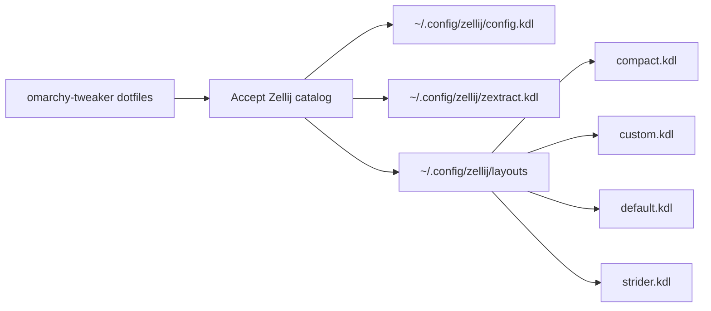

# Zellij Dotfiles

This page is the practical usage guide for the custom Zellij configuration bundled with
Omarchy Tweaker. It explains what the custom setup does, how to use its keybindings, how the
layouts and plugins fit together, and how to inspect or change each part.

For an explanation of the dotfile catalog system itself, see **[Dotfiles](dotfiles.md)**.

!!! note "Catalog scope"
    The `Zellij` catalog only links the bundled configuration, zextract configuration, and
    four layout files. It does not install Zellij, plugins, `zsh`, `nvim`, `wl-copy`, or a
    Nerd Font. The catalog directory is named `Zellij`, so that is the name shown in the
    dotfiles confirmation prompt.

---

## What this custom setup gives you

The `Zellij` catalog links a Catppuccin Macchiato terminal workspace with:

- A `clear-defaults=true` key map, so only the documented bindings are active.
- Mode-based pane, tab, resize, move, scroll, session, tmux, and locked workflows.
- Named plugin aliases for built-in Zellij plugins and third-party WASM plugins.
- Background plugins for status text, live key hints, session tooling, smart tabs, and buffers.
- Four layouts, with `custom.kdl` selected as the startup layout.
- A Catppuccin Macchiato theme override plus pane frames and automatic layout handling.
- A zextract configuration for finding URLs, paths, identifiers, diagnostics, secrets, and commands in scrollback.
- Wayland clipboard integration through `wl-copy` and scrollback editing through `nvim`.



---

## Quick start

```bash
omarchy-tweaker dotfiles
```

Accept the `Zellij` catalog when prompted, then verify the links:

```bash
ls -l ~/.config/zellij/config.kdl
ls -l ~/.config/zellij/zextract.kdl
ls -l ~/.config/zellij/layouts/*.kdl
zellij setup --check
zellij --version
zellij list-aliases
```

The catalog was validated with Zellij `0.45.1`. Start a fresh session to load the new
configuration:

```bash
zellij
```

If `zellij setup --check` reports that the `custom` layout was not found, confirm that
`~/.config/zellij/layouts/custom.kdl` exists. The bundled config intentionally relies on
Zellij's default layout directory instead of setting `layout_dir "~/..."`, because Zellij
does not expand `~` in that setting.

---

## What gets linked

| Bundled source | Destination | What it does |
|:--|:--|:--|
| `config` | `~/.config/zellij/config.kdl` | Main Zellij keybindings, plugins, appearance, sessions, mouse, and clipboard settings. |
| `zextract` | `~/.config/zellij/zextract.kdl` | zextract picker configuration for scanning scrollback and opening matches. |
| `layouts/custom.kdl` | `~/.config/zellij/layouts/custom.kdl` | Startup layout with zjstatus bars and live key hints. |
| `layouts/default.kdl` | `~/.config/zellij/layouts/default.kdl` | Built-in tab-bar and status-bar layout. |
| `layouts/strider.kdl` | `~/.config/zellij/layouts/strider.kdl` | Startup-style bars plus the built-in strider file picker. |
| `layouts/compact.kdl` | `~/.config/zellij/layouts/compact.kdl` | Compact single-bar zjstatus layout. |

The catalog configuration is:

```text
src/omarchy_tweaker/dotfiles/Zellij/config.toml
```

It contains six `[symlink]` entries:

```toml
[symlink]
config = "~/.config/zellij/config.kdl"
zextract = "~/.config/zellij/zextract.kdl"
"layouts/custom.kdl" = "~/.config/zellij/layouts/custom.kdl"
"layouts/default.kdl" = "~/.config/zellij/layouts/default.kdl"
"layouts/strider.kdl" = "~/.config/zellij/layouts/strider.kdl"
"layouts/compact.kdl" = "~/.config/zellij/layouts/compact.kdl"
```

Quoted keys let the catalog keep its layout sources in a subdirectory while linking each
layout file individually. This avoids replacing an existing `~/.config/zellij/layouts`
directory and lets each layout be backed up independently.

The catalog itself involves no prompts, templates, key setup, shell startup edits, or package
installation. An optional shell wrapper for directory-named sessions is documented below.

!!! warning "The destinations are symlinks"
    Editing files under `~/.config/zellij/` in place writes through to the bundled source
    files. For temporary experiments this is fine. For permanent personal changes, copy the
    files elsewhere or edit the catalog in a checkout and rerun `omarchy-tweaker dotfiles`.

---

## Requirements

| Tool | Used for |
|:--|:--|
| `zellij` | The terminal multiplexer itself. Validated with `0.45.1`. |
| Nerd Font | Icons and arrow glyphs used by the status bars and key hints. |
| `zsh` | Default shell configured for new panes. |
| `nvim` | Scrollback editor and zextract `edit` action. |
| `wl-copy` | Wayland clipboard copy from `copy_command`. |
| Network access | Downloads WASM plugins from their release URLs on first use. |
| `strider` | Built-in Zellij file picker used by the `strider.kdl` layout. |

Zellij itself is not installed by this catalog. The linked settings only take effect when
Zellij reads its configuration from `~/.config/zellij/config.kdl`. `ZELLIJ_CONFIG_FILE` and
`ZELLIJ_CONFIG_DIR` can override that location for testing.

---

## Keybinding cheat sheet

This config uses `clear-defaults=true`: only the bindings included in the bundled file are
active. `Esc` or `Enter` returns to normal mode from most temporary modes. Pressing a mode's
own key also exits it. Locked mode ignores everything except `Ctrl g`.

### Mode switchers

| Keys | Mode |
|:--|:--|
| `Ctrl p` | Pane |
| `Ctrl t` | Tab |
| `Ctrl n` | Resize |
| `Ctrl h` | Move |
| `Ctrl s` | Scroll |
| `Ctrl o` | Session |
| `Ctrl b` | tmux-compatible |
| `Ctrl g` | Locked |

### Always available except in locked mode

| Keys | Action |
|:--|:--|
| `Alt n` | New pane. |
| `Alt f` | Toggle floating panes. |
| `Alt h` / `Alt l` | Move focus, or hop to the neighbouring tab at the edge. |
| `Alt j` / `Alt k` | Move focus down or up. |
| `Alt left` / `Alt right` | Move focus, or hop to the neighbouring tab at the edge. |
| `Alt down` / `Alt up` | Move focus down or up. |
| `Alt i` / `Alt o` | Move the current tab left or right. |
| `Alt [` / `Alt ]` | Previous or next layout. |
| `Alt +` / `Alt =` / `Alt -` | Resize panes on all sides. |
| `Alt p` | Toggle pane group membership. |
| `Alt Shift p` | Toggle group marking. |
| `Ctrl Space` | Launch or focus zbuffers. |
| `Alt x` | Launch or focus zextract. |
| `Ctrl g` | Enter locked mode. |

!!! note "Quitting"
    `Ctrl q` is not bound in the bundled config. Detach with `Ctrl o`, then `d`, or use
    Zellij's own session commands when you need to leave a session.

### Pane mode

| Keys | Action |
|:--|:--|
| `h` / `j` / `k` / `l` or arrows | Move focus. |
| `;` | Focus the last pane. |
| `p` | Cycle focus. |
| `n` | New pane. |
| `d` | New pane below. |
| `r` | New pane to the right. |
| `s` | New stacked pane. |
| `f` | Toggle focus fullscreen. |
| `Shift f` | Toggle no-UI fullscreen. |
| `w` | Toggle floating panes. |
| `e` | Toggle embedded or floating pane. |
| `i` | Pin a floating pane. |
| `z` | Toggle pane frames. |
| `c` | Rename the pane. |
| `x` | Close the focused pane. |

### Tab mode

| Keys | Action |
|:--|:--|
| `h` / `l` or left/right | Previous or next tab. |
| `j` / `k` or down/up | Next or previous tab. |
| `tab` | Toggle between the last two tabs. |
| `1`–`9` | Go to tab 1–9. |
| `n` | New tab. |
| `x` | Close the tab. |
| `r` | Rename the tab. |
| `b` | Break the focused pane into a new tab. |
| `[` / `]` | Break the pane left or right. |
| `s` | Toggle input sync across the tab. |

### Resize, move, and scroll

| Mode | Keys | Action |
|:--|:--|:--|
| Resize | `h` / `j` / `k` / `l` | Increase left, down, up, or right. |
| Resize | `H` / `J` / `K` / `L` | Decrease left, down, up, or right. |
| Resize | `+` / `=` / `-` | Increase or decrease on all sides. |
| Move | `h` / `j` / `k` / `l` or arrows | Move the pane in that direction. |
| Move | `n` / `tab` / `p` | Rotate panes forward or backward. |
| Scroll | `up` / `down` / `k` / `j` | Scroll one line. |
| Scroll | `left` / `right` / `h` / `l` | Page scroll. |
| Scroll | `PageUp` / `PageDown` | Page scroll. |
| Scroll | `u` / `d` | Half-page scroll. |
| Scroll | `s` | Start a search. |
| Scroll | `e` | Edit scrollback in `nvim`. |
| Scroll | `c` | Copy the last command output. |

### Session mode

| Keys | Action |
|:--|:--|
| `w` | Launch or focus the session manager. |
| `l` | Launch or focus the layout manager. |
| `c` | Launch the in-app configuration UI. |
| `p` | Launch or focus the plugin manager. |
| `s` | Launch or focus zellij-loom. |
| `a` | Show the about screen. |
| `f` | Toggle host fullscreen. |
| `[` / `]` | Focus nested guest or host session. |
| `d` | Detach; the session keeps running. |

!!! warning "In-app configuration rewrites the file"
    Saving settings through `Ctrl o`, then `c`, makes Zellij write a fresh `config.kdl` and
    move the old one to `config.kdl.bak.N`. Comments are dropped. The catalog file is the
    durable source; restore or re-link it after using the configuration UI.

---

## Directory-based session names

If you want each project directory to get its own Zellij session, add this wrapper to
`~/.zshrc`, `~/.bashrc`, or the equivalent startup file for your shell:

```bash
function zellij() {
    if [[ -z "$ZELLIJ" ]]; then
        command zellij attach "$(basename "$PWD")" 2>/dev/null ||
        command zellij -s "$(basename "$PWD")"
    else
        command zellij "$@"
    fi
}
```

Reload the shell after editing it. Outside an existing Zellij session, the wrapper tries to
attach to a session named after the current directory and creates that session when needed.
Inside a session, it passes arguments through to the real `zellij` command to avoid
recursion. Running `zellij` from `~/Projects/Omarchy-Tweaker` therefore attaches or creates
a session named `Omarchy-Tweaker`.

!!! note "Arguments outside a session"
    The outer branch intentionally ignores `"$@"`. Use `command zellij ...` for one-off
    commands outside a session, such as `command zellij list-sessions` or
    `command zellij --help`.

---

## Plugins

### Built-in aliases

| Alias | Location |
|:--|:--|
| `about` | `zellij:about` |
| `compact-bar` | `zellij:compact-bar` |
| `configuration` | `zellij:configuration` |
| `filepicker` | `zellij:strider`, starting at `/` |
| `plugin-manager` | `zellij:plugin-manager` |
| `session-manager` | `zellij:session-manager` |
| `status-bar` | `zellij:status-bar` |
| `strider` | `zellij:strider` |
| `tab-bar` | `zellij:tab-bar` |
| `welcome-screen` | `zellij:session-manager`, with welcome disabled |

### Third-party aliases

| Alias | Purpose |
|:--|:--|
| `zjstatus` | Styled status bars with tabs, notifications, session, mode, and hints. |
| `zjhints` | Publishes live key hints into the bottom bar. |
| `zellij-loom` | Session and layout workflow helper. |
| `smart-tabs` | Tab naming and organization helper. |
| `zbuffers` | Buffer switcher opened with `Ctrl Space`. |
| `zextract` | Text extractor opened with `Alt x`. |

`load_plugins` starts `zjhints`, `zjstatus`, `zellij-loom`, `smart-tabs`, and `zbuffers` in
each new session. `zextract` opens only when requested. Plugin aliases may need a Zellij
restart after edits; zextract reads its own config each time the picker opens.

---

## Layouts

| Layout | What it shows |
|:--|:--|
| `default.kdl` | Built-in `tab-bar` and `status-bar` plugins around one pane. |
| `compact.kdl` | One `zjstatus` bar with tabs, notifications, and session information. |
| `custom.kdl` | Startup layout: `zjstatus` tabs above, mode chip and live hints below. |
| `strider.kdl` | Startup-style bars plus a 20% built-in strider file picker and a normal pane. |

The config sets `default_layout "custom"`, so `custom.kdl` is used when a new session starts.
`auto_layout true` also enables the layouts cycled by `Alt [` and `Alt ]`.

The custom and strider layouts use `zjstatus` configuration embedded in the layout file. They
also read the `pipe_zjstatus_hints` stream published by `zjhints`. If hints appear as raw
`#[...]` text, change `pipe_zjstatus_hints_rendermode` from `"dynamic"` to `"raw"` in the
layout.

---

## Appearance and behavior

| Setting | Value | Effect |
|:--|:--|:--|
| `theme` | `catppuccin-macchiato` | Uses the bundled Macchiato palette override. |
| `simplified_ui` | `false` | Uses Nerd Font arrow glyphs. |
| `pane_frames` | `true` | Draws frames around panes. |
| `pane_frame_style` | `full` | Draws the whole frame, not only titles. |
| `default_layout` | `custom` | Starts with the custom zjstatus layout. |
| `default_mode` | `normal` | Starts in normal mode. |
| `auto_layout` | `true` | Enables layout cycling with `Alt [` and `Alt ]`. |
| `show_startup_tips` | `false` | Skips the startup tips popup. |
| `default_shell` | `zsh` | Uses zsh for new panes. |
| `scrollback_editor` | `/usr/bin/nvim` | Opens scrollback in Neovim. |
| `on_force_close` | `detach` | Keeps sessions alive when the terminal closes. |
| `session_serialization` | `true` | Saves sessions for later restoration. |
| `scroll_buffer_size` | `10000` | Keeps 10,000 lines of scrollback per pane. |
| `copy_command` | `wl-copy` | Copies selections through Wayland. |
| `copy_on_select` | `true` | Copies as soon as a selection is released. |
| `web_client` | `font "Hack Nerd Font"` | Sets the font for browser sessions. |

The `web_server`, `web_sharing`, `web_server_ip`, and `web_server_port` settings are left
disabled. The note about `default_cwd "$PWD"` is also intentional: Zellij does not expand
that variable in the config file.

---

## zextract guide

Open zextract with `Alt x`. It scans the current pane scrollback by default and opens as a
floating pane. Press `g` or `Alt g` to cycle profiles.

### Grab profiles

| Profile | Source | Depth |
|:--|:--|:--|
| `quick` | Scrollback | 300 lines. |
| `deep` | Scrollback | 3,000 lines with progressive results; default profile. |
| `viewport` | Current screen | No line limit. |
| `tab` | All panes in the tab | Progressive results. |
| `full` | Scrollback | No line limit with progressive results. |

### Match types

Built-in filters include `#url`, `#file`, `#diag`, `#sha`, `#ipv4`, `#ipv6`, `#uuid`,
`#quote`, `#cmd`, and `#secret`. Custom patterns add CVE ids, GitHub pull requests and
issues, local dev servers, email addresses, CIDR ranges, MAC addresses, SHA-256 hashes,
absolute and relative paths, source files, Git commits, pinned Python packages, semantic
versions, Rust panic locations, Python traceback paths, TypeScript and JavaScript error
locations, hostnames, ports, Docker image references, and environment variable names.

### Actions and limits

| Type | Default action | Available actions |
|:--|:--|:--|
| `url` | `open` | `open`, `copy`, `insert`, `preview`. |
| `file` | `edit` | `edit`, `open`, `copy`, `insert`, `reveal`. |
| `diag` | `edit` | `edit`, `copy`, `insert`, `preview`. |
| `sha` | `copy` | `copy`, `insert`, `json`. |
| `ipv4` / `ipv6` | `copy` | `copy`, `insert`, `preview`. |
| `uuid` | `copy` | `copy`, `insert`. |
| `quote` | `copy` | `copy`, `insert`, `preview`. |
| `cmd` | `insert` | `insert`, `copy`. |
| `secret` | `copy` | `copy` only. |

The default `edit` action inserts `{editor} +{line} {file}` into the pane you came from.
Multi-select limits are `copy 100`, `insert 5`, `open 10`, `edit 5`, `reveal 10`, and
`json 100`. Setting a limit to `0` disables that action.

!!! note "Secret masking"
    `mask_secrets true` is configured, but the bundled comments note that this option was
    parsed and not yet wired in zextract `0.1.0`. Do not rely on it to hide sensitive output.

---

## Verification

```bash
zellij setup --check
zellij list-aliases
zellij setup --dump-layout custom
readlink -f ~/.config/zellij/config.kdl
readlink -f ~/.config/zellij/zextract.kdl
readlink -f ~/.config/zellij/layouts/custom.kdl
readlink -f ~/.config/zellij/layouts/default.kdl
readlink -f ~/.config/zellij/layouts/strider.kdl
readlink -f ~/.config/zellij/layouts/compact.kdl
```

Expected symlink sources:

```text
src/omarchy_tweaker/dotfiles/Zellij/config
src/omarchy_tweaker/dotfiles/Zellij/zextract
src/omarchy_tweaker/dotfiles/Zellij/layouts/custom.kdl
src/omarchy_tweaker/dotfiles/Zellij/layouts/default.kdl
src/omarchy_tweaker/dotfiles/Zellij/layouts/strider.kdl
src/omarchy_tweaker/dotfiles/Zellij/layouts/compact.kdl
```

---

## Backups and restore

If any destination already exists as a regular file or an incorrect symlink, the dotfiles
command backs it up before replacing it with the managed symlink:

```text
config.kdl.bak.<YYYYMMDD-HHMMSS>
zextract.kdl.bak.<YYYYMMDD-HHMMSS>
custom.kdl.bak.<YYYYMMDD-HHMMSS>
default.kdl.bak.<YYYYMMDD-HHMMSS>
strider.kdl.bak.<YYYYMMDD-HHMMSS>
compact.kdl.bak.<YYYYMMDD-HHMMSS>
```

List backups:

```bash
ls -la ~/.config/zellij/config.kdl.bak.*
ls -la ~/.config/zellij/zextract.kdl.bak.*
ls -la ~/.config/zellij/layouts/*.bak.*
```

If linking fails, the command attempts to restore each backup automatically.

---

## Customization

For temporary changes, edit the linked files under `~/.config/zellij/`. Because they are
symlinks, those edits change the bundled source files too.

For durable personal changes, copy the files elsewhere, edit them there, and either point
the catalog at new sources or maintain a separate Zellij config directory. Keep the catalog's
destination paths inside the home directory.

---

## Troubleshooting

| Symptom | Check |
|:--|:--|
| `zellij: command not found` | Install Zellij; the catalog only links configuration. |
| `The layout was not found, File: custom` | Confirm `~/.config/zellij/layouts/custom.kdl` exists and rerun `omarchy-tweaker dotfiles`. |
| Config parse error | Run `zellij setup --check` and restore the bundled config if the in-app UI rewrote it. |
| `layout_dir` workaround fails | Do not use `layout_dir "~/..."`: Zellij does not expand `~` there. Leave it unset and use the default layout directory. |
| Missing keybindings | This config uses `clear-defaults=true`; add the binding to the bundled `keybinds` block. |
| Status bars look plain | Install and select a Nerd Font, then restart Zellij. |
| Plugins do not load | Check network access and the Zellij plugin cache, then run `zellij list-aliases`. |
| Key hints show raw `#[...]` text | Change the layout's `pipe_zjstatus_hints_rendermode` from `"dynamic"` to `"raw"`. |
| zextract shows a parse banner | Fix `~/.config/zellij/zextract.kdl`; it is reread each time the picker opens. |
| zextract list is empty | Increase profile depth, use `#` filters, and check `log_level "debug"` temporarily. |
| Copy does not work | Install `wl-copy` and confirm a Wayland session. |
| Scrollback edit fails | Confirm `/usr/bin/nvim` exists or change `scrollback_editor`. |
| Edits disappear after rerunning dotfiles | Edit the catalog source or keep a separate config copy; destinations are symlinks. |
| Command skipped immediately | The dotfiles command requires an interactive terminal. |

---

## Safety notes

- The catalog links configuration only; it installs no packages and edits no shell startup files.
- Existing destinations are backed up before replacement.
- The linked configuration downloads and runs third-party WASM plugins from fixed release URLs.
- `clear-defaults=true` means unlisted keys are intentionally unavailable.
- `Ctrl q` is intentionally unbound to avoid accidental immediate exit.
- The in-app configuration UI rewrites `config.kdl` and strips comments; backups are created by Zellij.
- zextract can copy, insert, open, and edit matched text; review results before acting on secrets.

---

## Related pages

- [Dotfiles](dotfiles.md)
- [Git Dotfiles](git.md)
- [Lazygit Dotfiles](lazygit.md)
- [Tig Dotfiles](tig.md)
- [Starship Dotfiles](starship.md)
- [Superfile Dotfiles](superfile.md)
- [Commands](commands.md)
- [Development](development.md)
- [Security](security.md)
- [Troubleshooting](troubleshooting.md)
