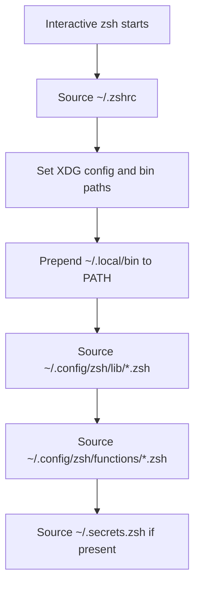

# Zsh Dotfiles

This page documents the bundled Zsh catalog. It keeps only two files in the home
directory and stores reusable shell code under the XDG configuration directory.

---

## What is installed

Run `omarchy-tweaker dotfiles`, accept the Zsh catalog, and the following links are created:

| Source | Destination | Purpose |
|:--|:--|:--|
| `zshrc` | `~/.zshrc` | Interactive shell entrypoint. |
| `functions/` | `~/.config/zsh/functions/` | Numbered Zsh function files. |
| `lib/` | `~/.config/zsh/lib/` | Numbered Zsh library files. |
| `script/_hastebin` | `~/.local/bin/_hastebin` | Paste/share helper, aliased as `hastebin`. |
| `script/_ltx` | `~/.local/bin/_ltx` | Lazy Tmux session manager, aliased as `ltx` and `lazytmux`. |
| `script/_lzj` | `~/.local/bin/_lzj` | Lazy Zellij session manager, aliased as `lzj` and `lazyzellij`. |
| `script/_pal` | `~/.local/bin/_pal` | Command palette, aliased as `pal`. |
| `script/_server` | `~/.local/bin/_server` | Local server launcher, aliased as `server`. |
| `script/startup.py` | `~/.local/bin/startup.py` | Python startup module for interactive Python sessions. |
| `secrets` | `~/.secrets.zsh` | Rendered private environment file. |

Only `~/.zshrc` and `~/.secrets.zsh` are placed directly in `$HOME`. Everything else lives
under `~/.config/zsh/` or `~/.local/bin/`.

!!! note "Configurable destinations"
    Destinations are declared in
    `src/omarchy_tweaker/dotfiles/Zsh/config.toml`; the Python installer does not hardcode
    them.

---

## Startup flow



`~/.zshrc` returns immediately in non-interactive shells. Library and function files are
sourced in numeric filename order, so `00-env.zsh` and `00-helper.zsh` load before later
files.

---

## Secrets

The catalog asks for seven values:

- `OPENROUTER_API_KEY`
- `OPENROUTER_MANAGEMENT_KEY`
- `OMNIROUTE_API_KEY`
- `OMNIROUTE_MANAGEMENT_KEY`
- `OMNIROUTE_CLAUDE_API_KEY`
- `OMNIROUTE_OPENCODE_API_KEY`
- `OMNIROUTE_ATUIN_API_KEY`

Prompt values are normalized to lowercase for template rendering, so the bundled template
uses placeholders such as `{openrouter_api_key}` and `{omniroute_api_key}`.

Secret-like prompts use a masked password prompt, and the rendered `~/.secrets.zsh` is set
to mode `0600`. `~/.zshrc` sources it last, after libraries and functions are available.

!!! warning "Treat `~/.secrets.zsh` as private"
    Do not commit it, paste it into issues, or include it in logs. You can add other private
    exports below the generated values.

---

## Aliases and functions

`lib/50-aliases.zsh` provides navigation, file operation, Git, system, network, package
manager, Docker, clipboard, and utility aliases. Many aliases are guarded by command checks,
for example `zoxide`, `eza`, `bat`, `btop`, `fastfetch`, `uv`, and `wl-copy`.

Helpers that are loaded from `functions/` but intentionally have no alias fall into four
groups:

- Internal helpers and UI functions, such as `_gum_*`, `_ui_*`, `_has`, `_has_gum`,
  `_require_cmd`, `_path_exists`, `_safe_name`, `_human_bytes`, and `_is_tty`.
- fzf picker functions, such as `fzf_file_dir_picker`, `fzf_git_branch`,
  `fzf_git_log_search`, `fzf_shell_variables`, and `fzf_zoxide_jump`.
- Zle widgets, such as `atuin-ai-widget`, `command-pallet-widget`,
  `edit-command-widget`, `hastebin-history-widget`, `hastebin-widget`,
  `lazydocker-widget`, `lazygit-widget`, `ltx-widget`, `lzj-widget`, `server-widget`, and
  `superfile-widget`.
- Hook and lifecycle functions, such as `load_node_version` and `run_onefetch_on_cd`.

<details>
<summary>All functions without aliases</summary>

- `_confirm_danger`
- `_git_repo`
- `_git_require`
- `_gum_badge`
- `_gum_card`
- `_gum_choose`
- `_gum_confirm`
- `_gum_debug`
- `_gum_dim`
- `_gum_divider`
- `_gum_error`
- `_gum_filter`
- `_gum_info`
- `_gum_input`
- `_gum_kv`
- `_gum_ok`
- `_gum_section`
- `_gum_spin`
- `_gum_style`
- `_gum_subtitle`
- `_gum_table`
- `_gum_title`
- `_gum_usage`
- `_gum_warn`
- `_has`
- `_has_gum`
- `_human_bytes`
- `_is_tty`
- `_path_exists`
- `_require_cmd`
- `_safe_name`
- `_ui_c`
- `_ui_has`
- `_ui_hex_to_ansi`
- `_ui_load_theme`
- `atuin-ai-widget`
- `command-pallet-widget`
- `edit-command-widget`
- `fzf_file_dir_picker`
- `fzf_git_branch`
- `fzf_git_log_search`
- `fzf_shell_variables`
- `fzf_zoxide_jump`
- `hastebin-history-widget`
- `hastebin-widget`
- `lazydocker-widget`
- `lazygit-widget`
- `load_node_version`
- `ltx-widget`
- `lzj-widget`
- `run_onefetch_on_cd`
- `server-widget`
- `superfile-widget`

</details>

The audit found **103 unique functions** and **53 functions without aliases**. This is
expected: widgets are bound with `bindkey`, hooks are called by shell events, and helpers
are called by other functions.

---

## Helper scripts

| Command | Aliases | Requirements |
|:--|:--|:--|
| `_hastebin` | `hastebin` | `curl`, `jq`, `fzf`, `gum`, `bat`, `qrencode`, `wl-clipboard`; `notify-send` is optional. |
| `_ltx` | `ltx`, `lazytmux` | `tmux`, `fzf`; `gum`, `bat`, `eza`, `zoxide`, `fd`, and `git` are optional. |
| `_lzj` | `lzj`, `lazyzellij` | `zellij`, `fzf`; `gum`, `bat`, `eza`, `zoxide`, `fd`, and `git` are optional. |
| `_pal` | `pal` | `bash`, `python3`, and `fzf`; `tmux` is optional. |
| `_server` | `server` | `bash` and `fzf` for the picker; individual server programs are optional. |
| `startup.py` | none | Python 3, when used as `PYTHONSTARTUP`. |

`_hastebin` reads optional settings from `~/.config/hastebin/config`. The file is parsed as
plain `KEY=VALUE` lines with an allowlist of setting names; it is not sourced as shell code.
`HASTEBIN_URL` must use HTTPS, except for localhost over HTTP.

`_pal` uses the bundled `command-pallet-widget` on `Alt+Shift+P`. That widget passes the
live `bindkey` table to `_pal`, so no separate `pal.zsh` file is required.

!!! warning "Review generated shell strings"
    The bundled scripts still use `eval` for a few generated commands, including paste
    payloads, tmux/Zellij actions, and palette actions. fzf field and `$SELF` placeholders
    are shell-escaped, but review a script before enabling unfamiliar external tools.

---

## Validation

The bundled catalog is checked with:

```bash
zsh -n ~/.zshrc ~/.config/zsh/lib/*.zsh ~/.config/zsh/functions/*.zsh
bash -n ~/.local/bin/_hastebin ~/.local/bin/_ltx ~/.local/bin/_lzj ~/.local/bin/_pal ~/.local/bin/_server
python3 -m py_compile ~/.local/bin/startup.py
```

`shellcheck` is not part of the current development environment. Syntax checks and the
Python test suite are used instead.

---

## Related pages

- [Dotfiles](dotfiles.md)
- [Commands](commands.md)
- [Bundled Scripts](scripts.md)
- [Tmux Dotfiles](tmux.md)
- [Zellij Dotfiles](zellij.md)
- [Starship Dotfiles](starship.md)
- [Security](security.md)
- [Troubleshooting](troubleshooting.md)
